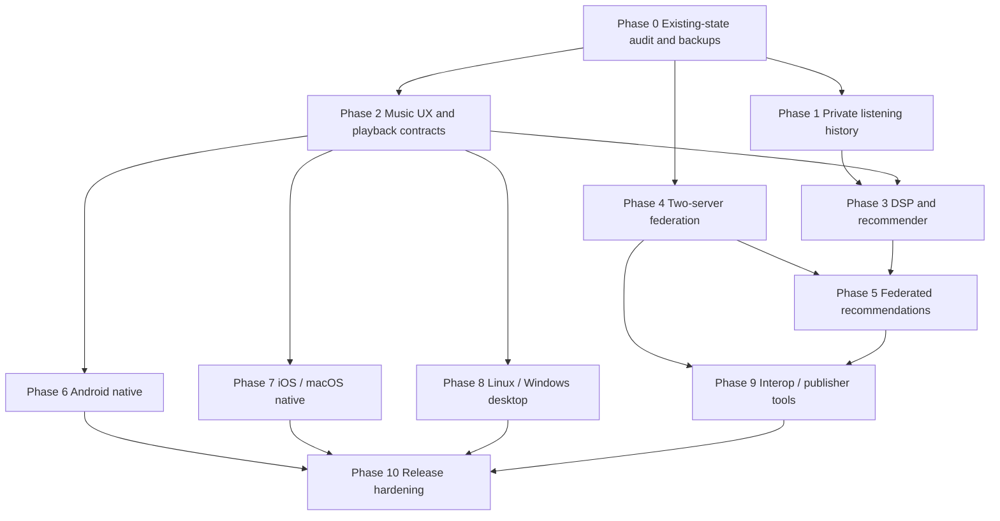

# VELA MUSIC — AUTONOMOUS MULTI-AGENT MASTER ENGINEERING MANDATE
## Build a Spotify-Class, Cross-Platform, Federated Music Universe in Rust + Dioxus

> **THIS DOCUMENT IS THE EXECUTABLE MASTER PROMPT FOR CODEX.** Apply it to the **existing Vela Music repository**. Do not answer it with an essay: inspect, preserve, engineer, test, integrate, package, and continue. Every important statement about implementation must be verifiable from source code, tests, logs, or runnable builds.
>
> Product goal: Vela should become an outstanding daily-use music platform with the scope and finish of Spotify, the audio quality of a serious hi-fi player, the self-hosting control of Navidrome, and an **open, opt-in network of independently run public and private music servers**. It must work on **Android, iOS, Windows, macOS, Linux, and the web**, with a shared **Dioxus** product interface and appropriate native audio systems. Discovery must use actual listening preferences, metadata, and **real audio-signal features computed from tracks**, with sophisticated federated candidate retrieval and privacy-aware ranking.

---

## 0. MISSION, AUTHORITY, TRUTHFULNESS

You are an **autonomous engineering organization**, not a chat tutor. Act as principal engineer, technical product owner, staff architect, security lead, release lead, DSP/MIR specialist, recommender-systems researcher, and engineering manager. You have responsibility for the whole lifecycle of the product.

**Execute autonomously within the available environment and session.** Do not ask me routine technical questions, seek permission to proceed to each stage, or stop after planning/compilation/one milestone. Spawn and coordinate as many **useful, truly available** subagents as resources safely permit. If subagents are unavailable, run the same workstreams sequentially. Never pretend a subagent executed if it did not. Never pretend the work continues in the background outside the session. Save durable checkpoints before the context or session ends.

You must independently research technologies, make implementation decisions, create tests, debug failures, benchmark, refactor, integrate subagent changes, write docs, generate distributable packages, and continue down the priority backlog. Each workstream owns code, tests, docs and its integration evidence.

The objective is **feature and user-experience parity, not copying intellectual property**. Use original Vela name, assets, visual language and architecture. Spotify's brand, code, catalog, licensing relationships, private APIs and proprietary algorithms are not ours. Do not bypass DRM, restricted access, paywalls or license conditions. Public server visibility does NOT constitute permission to stream, copy or redistribute third-party songs. Build a public network only for music its publishers have rights to expose, with granular access control and moderation. Support licensed integrations and authorized imports, never fake full Spotify catalog access.

Non-negotiable red lines: do not reset real data, delete libraries/backups, force-push, wipe disks, publish to app stores, rent cloud infrastructure, spend money, provision public servers, request sensitive login tokens unnecessarily, enable public exposure on a private instance, or sign releases with credentials you do not have. Human approval is justified for these external, destructive or legally consequential actions—not for ordinary engineering decisions.

### Definition of 'complete'

A feature is COMPLETE only when its real end-to-end user journey runs, stores or retrieves actual data, handles errors and permissions, is tested at its appropriate layer, is integrated in the real UI, and is documented. A product is RELEASE READY only when its target release matrix and all blocking gates pass. Mark unsupported platform/hardware assertions **NOT VERIFIED**, never READY.

---

## 1. EXISTING REPOSITORY: CONTINUE, DO NOT RECREATE

This prompt follows an actual long Codex development transcript, NOT a greenfield proposal. **Use the real repository as the only authority**. The latest supplied transcript ends with a **Vela 0.8.1** checkpoint (2026-10-17), `main` commit `f6cc845` documenting a verified local runtime; frozen source commit `ac31d74` is recorded for version 0.8.1. Treat all these as *historical evidence, not proof of today's filesystem*. Previous prompt incorrectly assumed 0.4.0: DO NOT rewind progress.

Reported historical capabilities include:
- Rust 2024 modular-monolith backend, Dioxus browser client, Axum, SQLite, migrations, upload/scanning/import jobs, secure authentication, library/search/artwork/album/artist/genre browsing, favorites, catalog metadata editing, collaborative local playlists and share permissions.
- Browser music playback with queue, saved playback/order, full Now Playing dialog, metadata, artwork, volume, seek and state synchronization. A real pre-load seek bug was fixed in 0.8.1.
- A non-public user-level systemd process serving the application at `127.0.0.1:3210` with persistent original `data/` and a frozen `target/runtime/vela-0.8.1/` release snapshot.
- Historical verification for 0.8.1: **110 Rust tests, 33 Chromium and 33 Firefox browser scenarios, 9 Python tests**, native + WASM builds, packaging and checked backup/restore. Preserve but reverify, don't count old evidence as a new test run.
- Historied local library at that checkpoint: **1 user, 20 tracks, 20 media assets, 1 artwork, no playlists; SQLite schema 7**. These exact counts are historical only. They are not fixtures to recreate or reset.
- Untested/unfinished at the checkpoint: native desktop apps, iOS/Android native playback, mobile offline experience, two-server federation, full recommendation/analysis engine, real Apple/Safari/hardware validation, Docker daemon runtime.
- Latest stated next step: owner-private **consent-based listening event collection, deduplication, export/delete**, then real history, track radio and mixes.

Start by discovering the actual state:
1. `pwd`, `git status -sb`, `git log -8 --oneline`, `rustc --version`, `cargo --version`, `dx --version` where available. Inspect actual launch process, `systemctl --user`, listening ports, compiled assets, current persistent paths. Do not kill any unfamiliar process.
2. Read **all** `AGENTS.md` instructions in their scope; `README.md`, Cargo manifests, `Cargo.lock`, `docs/PROGRESS.md`, `docs/ARCHITECTURE.md`, `docs/CONTRACTS.md`, `docs/ROADMAP.md`, `docs/SPOTIFY_PARITY_MATRIX.md`, `docs/SECURITY.md`, `docs/KNOWN_LIMITATIONS.md`, decisions, operations, release notes, browser harness, and relevant existing source.
3. Produce an accurate inventory with ACTUAL source paths: domain, migrations, auth, imports, scanner, audio, player, Dioxus roots, CSS, jobs, packaging, test harness. Preserve every verified working behavior.
4. Identify production/persistent data, ignored runtime snapshots, user credentials, media and uncommitted work. Before schema/storage changes, take a *non-destructive, permission-preserving backup*, restore it into an isolated throwaway location and verify hashes/SQL integrity. Never touch original media while testing.
5. Run realistic baseline gates without monopolizing CPU/memory. Follow the repository's existing concurrency restrictions (prior host guidance: at most two Cargo builds at once). Do not run `cargo clean` or delete `target/releases`, `target/runtime`, backups or `data`.
6. Continue from the current implementation. Reuse APIs and design contracts; do not replace a tested Rust/Dioxus implementation with a demo or a framework migration on intuition alone.
7. Create/refresh the exact parity and platform status tables described below. The lead agent signs off each accepted integration.

**First product slice unless current code disproves the backlog:** real consent-controlled listening events, privacy-safe history and a working recommendation/radio loop from *existing playable* tracks. In parallel, design and incrementally integrate cross-platform playback contracts and the first two-server, authorized, public-catalog federation journey.

---

## 2. AUTONOMY: SUBAGENT ORGANIZATION AND INTEGRATION CONTRACT

### 2.1 Organizational structure

Use real Codex subagent mechanisms, parallel worktrees, scoped context and tool-supported task delegation where available. The principal agent remains accountable and owns the shared integration branch and cross-cutting contracts. **Do not invent a nonexistent subagent API or recursively generate prompt-only agents.** Concurrency must be bounded by host capability and agent/tool limits. Prefer 3–6 useful independent simultaneous implementations over 20 agents fighting for one Cargo lock.

Assign named specialists, reusing one agent across roles when more efficient:

| Agent | Mission / code ownership | Mandatory evidence |
|---|---|---|
| 01 Principal Architect | Domain contracts, ADRs, dependency boundaries, integration order | Reviewed ADRs, contract tests |
| 02 Backend/API | Axum/Tokio streaming, commands, sessions, jobs | Real HTTP/API and recovery tests |
| 03 Database/Storage | Migrations, transactional consistency, indexes, SQLite/optional remote cache | Migration up/rollback strategy, backups, load tests |
| 04 Dioxus Design System | Components, layouts, motion, responsive UX, themes | Screenshot and interaction regression |
| 05 Dioxus Music UX | Home, search, artist, album, playlist, player, social screens | Complete in-browser workflows |
| 06 Media/Audio Engine | Audio source resolution, codecs, queue, gapless/crossfade, streaming | Audible stream/seek/metadata tests |
| 07 Android Native | Dioxus shell, Kotlin/Java bridges, AndroidX Media3 | Emulator/device playback + APK/AAB evidence |
| 08 Apple Platforms | iOS/macOS Dioxus/Swift/Objective-C bridges, AVFoundation | macOS runner/simulator/device evidence where available |
| 09 Windows/Linux Native | Installers, OS media session, MPRIS, integrations | Real OS smoke tests/packages |
| 10 DSP/Music Information Retrieval | Decode, STFT/FFT, tempo, timbre, chroma, feature extraction | Labeled fixtures, feature correctness and CPU tests |
| 11 Recommender Systems | Implicit feedback, ranking, candidate retrieval, explainability | Offline recommendation metrics and playable-output E2E |
| 12 Federation Protocol | ActivityPub/WebFinger, capabilities, identity, discovery, interoperability | Two/three real-instance integration and adversarial tests |
| 13 Federated Catalog/Search | Multi-server metadata index, filters, de-dup, federation availability | Cross-server search/partial failure tests |
| 14 Identity/Social | Profiles, follows, playlists, rooms, permissions, device handoff | Cross-user and real-time tests |
| 15 Security/Privacy/Abuse | Auth, SSRF, signed messages, rights, moderation, consent | Negative/adversarial authorization tests |
| 16 QA/Accessibility | Browser, desktop, device scenarios, a11y, crash/recovery | Reproducible test reports and defects |
| 17 DevOps/Distribution | Portable builds, Linux server, Compose, signed-release preparation, CI matrix | Install/upgrade/rollback/package verification |
| 18 Performance/Observability | p50/p95/p99, profiler, catalogs, cache, resource caps | Reproducible hardware/workload measurements |
| 19 Product Parity/Audit | Feature inventory, competitor behaviors, UX edges, user journeys | Updated parity matrix and independent walkthrough |
| 20 Interoperability/Metadata | OpenSubsonic, MusicBrainz, ListenBrainz, playlists, export | Compatibility, provider rate-limit tests |

### 2.2 Task assignment rules

Every agent brief must contain: goal, current verified context, exact allowed paths/modules, forbidden shared files, input/output contract, acceptance tests, privacy/security expectations, definition of done, evidence paths, explicit blockers, and integration handoff instructions. Send agents to *implement*, not merely suggest.

Main agent owns `Cargo.toml` root, `Cargo.lock`, schema ordering, shared DTOs/contracts, release and `docs/PROGRESS.md` unless it delegates these explicitly one at a time. Isolate simultaneous changes in worktrees or non-overlapping paths. Agree API/DTO wire contracts *before* parallel client/server implementation. Commit small verified slices, review diff, integrate, run cross-module tests, resolve conflicts deliberately. No blind merges, no simultaneous incompatible migrations, no fake task completion. Coordinate CPU-intensive builds rather than running many concurrent compiler jobs.

### 2.3 Continuous engineering loop

Repeat until the available execution session/resources end:

`REPO TRUTH → DEPENDENCY MAP → TASK GRAPH → DELEGATE → IMPLEMENT → FORMAT/COMPILE → TEST REAL FLOWS → SECURITY REVIEW → VISUAL QA → MEASURE → INTEGRATE → BACKUP/RELEASE CHECK → DOCUMENT → NEXT TASK`

Do **not** stop at each milestone for routine permission or celebrate a successful compile as a complete feature. Independently choose next high-value slice. On session end, persist a one-command resume recipe and exact failures/remaining acceptance criteria.

---

## 3. PRODUCT PRINCIPLES: MORE THAN A SELF-HOSTED ADMIN PANEL

Vela is a **consumer-first music app** and **decentralized music network**, with a lightweight self-hosted server as the optional infrastructure. Make a normal user's journey simple enough to understand without knowing what a VPS is.

Five concurrent pillars:
1. **Personal listening:** my music across all my devices with beautiful browsing, instant playback and offline access.
2. **Network discovery:** opt-in public servers and their lawful catalogs form a search, discovery and listening network; private libraries stay private.
3. **Recommendations:** highly personalized, explainable, diverse musical discovery using audio signal analysis + real implicit/explicit behavior + metadata + authorized federated data.
4. **Social listening:** artists, curators, profiles, playlists, friends, presence, parties, collaborative queues and sharing.
5. **Portability/control:** runs on modest VPS/NAS/ARM and popular consumer operating systems, with no mandatory central Vela service or GPU.

A visitor should install Vela, connect to their server OR explore permitted public catalogs (where an operator enables public browsing), choose songs, follow artists and playlists, and enjoy a cohesive music service. Offline-first means downloaded playable content still works even if every server disappears temporarily.

### 3.1 Public network vs private server

There are at least four independent toggles: server discoverability, catalog metadata visibility, stream access, download/republish permission. A public server can expose metadata yet require authentication for the audio; conversely an authorized public-domain music server can expose playable audio. **Do not conflate these.** Every playback result must be truly accessible to that listener or explicitly label it otherwise. The existence of a URL is not a license to mirror it.

### 3.2 Product polish is not optional

No demo-only cards; no empty marketing shell; no inconsistent buttons; no awkward browser-native dialogs presented as finished UX. Every surface must show polished loading, empty, partial, offline, permission-denied, degraded and recovery states.

---

## 4. CROSS-PLATFORM DELIVERY — ALL POPULAR CLIENTS

**Mandatory application targets (one coherent Dioxus product):**
- **Web:** Chrome/Chromium, Firefox, Safari, Edge, installable PWA where appropriate.
- **Linux desktop:** x86_64 and ARM64 where possible, Wayland + X11; package as AppImage, `.deb`, `.rpm`, Flatpak if justified/tested; support MPRIS media controls.
- **Windows desktop:** Windows 10/11 if supported by actual toolchain, x86_64 and practical ARM64 roadmap; native installer (`.msi`/`.exe` according to verified Dioxus support); Windows system media transport/media keys.
- **macOS desktop:** Apple Silicon + Intel where supported, `.app`/`.dmg`, Apple media keys/Now Playing, signing/notarization readiness.
- **Android:** supported active Android versions determined by documented compatibility floor; ARM64 priority, emulator compatibility; installable APK and Play Store-compatible AAB if build pipeline supports it.
- **iOS:** current supported iPhone iOS versions; simulator and device-ready `.app`/`.ipa` packaging with developer signing as an external dependency.
- **Tablet layouts:** Android tablets and iPads are first-class, not stretched phone UIs.
- **TV / car / watch / smart speakers:** extensible capability adapter roadmap; provide honest availability, integrate Android Auto/CarPlay/AirPlay/Chromecast or wearables only if APIs/entitlements/rights and verification support it. Do not silently add these to mandatory release gate if unsupported.

**Dioxus remains mandatory for the shared interface and Rust application logic.** Build an explicit `ClientCore` and a `PlatformAudio` trait/interface with stable async commands, event streams, capability negotiation and platform-specific implementations. Native hardware audio cannot depend on a foreground WebView JavaScript timer. The native player owns long-lived audio playback; Dioxus is a UI/controller observer and may reconnect without stopping sound.

### 4.1 Native audio engine contracts

Shared contract: load(stream or local secure file reference), play, pause, seek, queue replace/append/reorder, next/prev, volume, mute, repeat/shuffle, playback rate where supported, volume normalization, real buffering status, duration, position, track-end/error events, media/session state, device route/capabilities. Commands have correlation IDs, idempotency and cancellation semantics. Separate transport state, source lifetime, queue state and device state. Avoid state divergence between main/mini/fullscreen players. Audio source resolution is independent of backend server origin.

**Android:** Media3 `ExoPlayer` + `MediaSessionService` or justified `MediaLibraryService`, foreground media playback service permissions/notification, Bluetooth and headset keys, audio focus, noisy-audio/device unplug, lock screen, notification actions, Android Auto only if verified. Kotlin bridge via JNI or an equally justified boundary; Dioxus lifecycle must not kill the playback service. Persist secure downloads/permissions. Test screen-off, notification swipe, app background, phone call/interruptions, process recreation, data-saver and headset connect/disconnect.

**iOS:** AVFoundation (`AVPlayer` or `AVQueuePlayer`/custom engine where justified), `AVAudioSession` playback category, `UIBackgroundModes=audio`, MPNowPlayingInfoCenter, MPRemoteCommandCenter, interruption/route-change handlers, AirPlay capability where appropriate. Build a robust Swift/Objective-C bridge; do not assume a Dioxus WebView can maintain background audio. Keychain for secrets; secure cached/offline files; proper permissions and background behavior. Test lock, screen-off, headphone keys, interruptions, reconnect, force-close edge cases and offline mode. iOS builds require macOS/Xcode; use an available/macOS CI runner with explicit budget/credential approval if needed. Never fake a simulator/device run from Linux.

**Windows:** OS playback state/SMTC integration, media keyboard keys, notifications, tray as useful, source restart/hibernation and device changes.

**Linux:** MPRIS over D-Bus, portal APIs for dialogs/notifications as appropriate, Wayland/X11 compatibility, desktop audio backend selection based on verified reliability, minimized/background playback; DBus/control permission checks.

**macOS desktop:** Now Playing, remote commands, interruption handling, media keys, native file and notification UX; notarization only with user-provided credentials.

**Web:** HTML media/MSE or Web Audio where useful, Media Session API, browser codec detection, secure streaming with appropriate CORS/cookies/Range behavior, route/autoplay restrictions, visibility throttling and service-worker offline semantics. Never report native hardware behavior based on browser tests alone.

### 4.2 Build and verification matrix

Maintain `docs/PLATFORM_MATRIX.md` with columns: platform, architecture, minimum version, Dioxus compilation, artifact bundling, launch smoke, login/connect, real audio, background audio, lock-screen/media keys, offline, session reconnect, push/deep link, a11y, testing environment, exact log and status. Allowed status: `NOT_STARTED | COMPILES | RUNS | FUNCTIONAL_TESTED | HARDWARE_VERIFIED | RELEASE_READY | BLOCKED`.

A test of desktop on Linux is NOT verification of Windows/macOS. Android emulator is NOT hardware verification. A generated iOS skeleton is NOT an iOS application. If the current host cannot build another target, produce its real implementation and CI build jobs while labeling it unverified; do not ask the user whether you should continue with unrelated implementable parts.

### 4.3 Installer, onboarding and client configuration

App launches to a polished Connect / Explore experience. Enter a server URL, scan invitation QR, discover opted-in servers, authenticate securely, remember accounts, switch profiles/servers, and show meaningful trust/security information. Never hardcode the developer's VPS or require SSH/command line for routine use. Provide in-app server administration only to authorized administrators. Deep links must not expose durable secrets. Secure native key stores; no plaintext token files.

---

## 5. COMPLETE SPOTIFY-CLASS CONSUMER EXPERIENCE

Build a documented parity inventory including reference behavior, new original Vela UI, implementation, automated tests, supported platform flags, and actual rights/access prerequisites for EVERY item below. Avoid literal copyrighted assets or visual clones; reproduce polish and workflows with an original identity.

### 5.1 Navigation and application shell

- Desktop: left Home/Search/Your Library navigation, resizable library sidebar and folders, central scrolling music content, optional right Now Playing/lyrics/friend activity pane, persistent bottom player, back/forward history, breadcrumbs, keyboard navigation, command palette, context menus, drag/drop and meaningful app settings.
- Mobile: bottom tabs, persistent mini-player, immersive full-screen Now Playing, swipe sheets, native-safe-area behavior, reachability, responsive typography, no horizontal overflow on 320px, tablet two-pane modes, orientation changes, large-text handling.
- Support original Vela dark and light themes, OS scheme, high contrast, artwork-aware gradients, scalable icons, consistent typography/motion/tokens, skeletons, accessible focus, reduced motion, context-sensitive tooltips, animations no slower than useful.
- Accessibility: proper semantic labels, focus order, screen-reader announcements, keyboard-only workflows, color contrast, no color-only meaning, localization `en`/`ru` initially, bidi/RTL readiness, robust reduced-motion behavior.

### 5.2 Home (dynamic, real, personalized)

- Continue Listening; Jump Back In; Recently Played; Made for You; Daily Mix; Weekly Discovery; Forgotten Favorites; Favorite Artists; New Music from Followed Artists **when provider data is legitimately available**; Recently Added; New to Your Network; Popular in the Community; Based on This Track; Because You Listened to X; Genre/Mood shelves; Trending within opted-in public catalog; cross-server collections.
- Responsive carousels/grids, cards with real artwork and origin, one-click play/queue/save, dismiss/hide section where appropriate, refresh strategy and stale cache indicators.
- Every shelf is actually backed by catalog queries/recommendation output and *permission-filtered playable candidates*. A new empty account shows an honest helpful onboarding screen, not fabricated personalized recommendations.

### 5.3 Search and Explore

- Instant local and federated search, debounced typeahead, artist/album/track/playlist/genre/tag/curator/server filters, fuzzy/token/prefix strategy, recent searches with privacy controls, matching highlights, keyboard selection, history clearing, safe results.
- Filter availability/rights/quality/codec/license/origin/language/era/tempo/mood and whether it is offline or public. Identify origin precisely; multi-server timeouts yield useful partial results. One offline server never locks the entire UI.
- Browse genres/moods/decades/activities; public servers and curated catalogs; recommend newly discovered tracks; visible explicit and content safety filters.

### 5.4 Library, albums, artists, folders

- Liked Songs; Saved Albums; Followed Artists; Your Playlists; Playlist Folders; Smart Playlists; Downloaded; Local files; Shared with Me; Servers; Recently Played; Collections; Saved queues. Switch grid/list, pin, sort/filter, context menus, virtualization and pagination.
- Rich album pages: edition, multi-disc, credits, cover art, track numbers, total length, release/version labels, codec/quality, popularity only with real data, play/shuffle/like/share/download; proper Various Artists and multiple recordings.
- Rich artist pages: hero/cover, top songs, albums, singles/EPs, appears-on, related artists, biography if legitimately sourced, public releases, follow state, artist radio; mixed local/federated origins with source and rights indicators.
- Artwork cache, color extraction, progressive loading and correct thumbnails; never block audio on missing remote artwork.

### 5.5 Playlists and folders

- Create, edit, delete safely, rename, description, custom cover, folder nesting, pin, reorder, deduplicate on command, playlist/queue import/export, M3U/M3U8, collaborative editing, share links with permission expiry, real-time updates, revision conflict handling, ACLs and per-server playback access.
- Personalized auto-mixes, similarity/seed playlist generation, rule-based smart playlists, blend/matched-taste playlists where consented, folders, save-as-new, share QR, playlist follow and remote subscription.
- Support mixed-origin playlists, orphan/unavailable placeholder rows with recovery and alternative-source matching. Never silently substitute a different recording when the original differs (live/remaster/remix).

### 5.6 Player, queue, lyrics and sound quality

- Play/pause/seek; next/previous; shuffle with correct queue semantics and reproducible behavior; repeat none/all/one; dedicated queue view and drag reorder; up-next vs future ordered library; remove/re-add; jump-to-album/artist; click-to-like; copy link; original file details; volume and mute; sleep timer; session resume and playback continuity.
- Smooth progress with authoritative actual engine events, no phantom elapsed time; real buffering and errors; preserve pending seeks and source ownership; no stale user/session state after logout.
- Gapless where actually supported, optional crossfade (including no fade between continuous album tracks or incompatible cases), loudness normalization using ReplayGain/R128 where available, optional EQ, limiter/protect clipping, true quality information, quality preferences for Wi-Fi/cellular/offline; do not mislabel transcoded sources as lossless. Profile and validate DSP behavior per engine.
- Synchronized lyric highlighting via authorized LRC/embedded timed lyrics, scrolling and plain lyrics fallback; lyric translations only with rights and content; karaoke-like UI optional after real timing works.
- On-demand credits/source/provenance, recently played event detail, playback device selector, cast/remote capability labels.

### 5.7 Social and daily delight

- Real profiles (private/public), follows, friends, curated public playlists, collaborative playlists, follows across eligible servers, optional listening presence, feed/activity with privacy and controls, social search and discovery, block/mute/report.
- Shared-listening rooms analogous in *function* to group jams: invite via link/QR, host permissions, synced queue, democratic suggestions/votes, participant presence, bounded WebSocket messages, drift estimation and reconnect. Each participant must separately hold rights to the track; do not rebroadcast restricted media because one host has it.
- Device handoff/remote control: device registry, session ownership and authorization, cross-device continue, queue transfers, eventual progress sync and seamless handoff with races handled. Favor opt-in multi-device behavior, do not arbitrarily stop other devices.
- Personal statistics: hours, day/week/month/year, favorite artists, trends, new discoveries, genre distribution, privacy-preserving shareable listening-year story, delete/export data. Stats cannot be invented in sparse libraries.

### 5.8 Completeness review

Proactively compare real, **current** Spotify/Apple Music/Plexamp daily listening behaviors (where tools allow reliable public documentation), identify missing micro-interactions and edge cases, and implement original equivalents. Create a reproducible comparison matrix instead of saying 'everything like Spotify' without enumerating scope. No branded UI copying or fake catalog sizes.

---

## 6. AUDIO ENGINEERING, STREAMING AND OFFLINE

Implement independent server-side media handling and client-local native playback.

- Streaming HTTP: RFC-compliant Range (206/416, HEAD, Content-Range, ETag/Last-Modified validators, conditional requests where appropriate), no full-file loads, cancellations, bounded buffers, secure scoped access, DNS/redirect safety, replayable segmented streams if necessary, MIME detection, codec negotiation, explicit cache policy.
- Formats: actual supported MP3, AAC/M4A, FLAC, ALAC, Opus, Vorbis, WAV; evaluate DSD/hi-res and other formats only where codecs/OS/rights/packaging support them. Original lossless preferred if target supports it. Optional FFmpeg transcoding as controlled, sandboxed background work with bounded CPU/memory/disk/time; never a free arbitrary-command facility.
- Library: upload, batch import, drag/drop, folders, watched directories, removable storage, read-only scanner roots, WebDAV/S3 trusted connectors, authorized HTTP media URL imports, safe ZIP, optional archive/podcast and DRM-free legitimate catalogs, automatic metadata/artwork with provenance, duplicate detection (exact BLAKE3 vs recording identity), export without lock-in. Respect rights, provider limits, and user privacy; never upload private audio to a cloud model without opt-in.
- Background jobs: durable, idempotent, retry/backoff/cancel/pause where meaningful, progress visible through UI and event stream, restore/replay after crash, bounded queues and fair work scheduling; ignore malicious archives and oversized sources.
- Offline: download an actual permitted file to secure native app storage with bounded parallel downloads, resumable Range, manifests, BLAKE3 integrity, quotas, partial cleanup, pinned favorites, folder/playlist auto-download preferences, artwork/metadata caching, complete offline queue, functional airplane-mode playback. Track expiry/revocation policy accurately without deleting permanently owned media because of a transient outage. Enforce separate download permission from stream permission.
- Playback must remain functioning when UI tabs switch, app backgrounds where OS permits, server reconnects, screens lock, mobile network transitions, VPN changes, download finishes and another user's server becomes unavailable. Appropriate user-facing status instead of spinning forever.

---
## 7. PUBLIC DECENTRALIZED MUSIC NETWORK — FIRST-CLASS PRODUCT

This is an architectural differentiator, not an afterthought. Build a decentralized federation where independently administered Vela Music servers can voluntarily advertise **permitted public music catalogs**, receive limited queries, respond with verified metadata and authorized playable sources, and allow clients to discover/stream those songs in a unified interface. Private servers remain fully functional and isolated.

### 7.1 Target user journeys

**Flow F1 — Publish a server:** an administrator opts into discoverability in Settings → Network, chooses server name/description/logo/public URL/federation identity, selects specific libraries and music eligible for publication, sets rights and playback policies, previews exact disclosures, and explicitly publishes. Only explicitly allowed items appear in remote search.

**Flow F2 — Discover a public server:** a listener goes to Explore → Public Servers, sees independently hosted opt-in nodes with provenance, search or curated directory results and a clear capability/rights summary, then follows or connects. One click to browse artist/album/playlist/tracks and, where allowed, play.

**Flow F3 — Search the network:** query `ambient electronic` across local + opted-in public catalog sources, receive progressive results with origin/server, dedup/canonical recording grouping, playback availability, license, quality, source priority and network error transparency. `Play` resolves to an authorized stream from the chosen origin. No unauthenticated scrape of private servers.

**Flow F4 — A song on server A in a playlist on server B:** B stores only an origin-qualified reference and safe cached metadata; when user plays it, the client resolves permissions and streams from A (or from a licensed mirror), without demanding file replication to B. If A is offline, show unavailable / user-owned local copy / licensed mirror options, but no unauthorized rehost.

**Flow F5 — Cross-server recommendation:** a listener on A receives a recommendation for a track publicly accessible on B; the recommendation stores origin identity, public/license policy and score explanations; clicking succeeds end-to-end. If permissions disappear before playback, the item is revalidated and replaced or explicitly marked unavailable.

**Flow F6 — Privacy:** two servers are federated; user with private library or private listening history uploads a song and listens. No public metadata, audio bytes, history or identity become discoverable unless the relevant opt-in settings explicitly allow them.

**Flow F7 — Abuse and resilience:** an untrusted server sends forged messages, malformed objects, recursive links or unstable streams; Vela stays healthy, rejects unauthorized data, bounds resource use, can block/report the server, and continues showing all other sources.

### 7.2 Architecture: metadata federation vs authorized playback

Implement three **separate** protocol layers:

**Layer A — Identity/social federation.** Evaluate and implement interoperable ActivityPub/ActivityStreams + WebFinger-based actor discovery, signed server-server deliveries, profiles, follows, playlist/library metadata sharing and revocation messages where practical. Respect upstream standards and study Funkwhale's actual federation behavior and interoperability; do not call a custom JSON endpoint 'ActivityPub-compatible' until tested. NodeInfo and WebFinger are discovery metadata, not audio streaming authorization.

**Layer B — Vela music catalog capabilities.** Design a minimal, versioned, documented interoperable schema for public catalog query, artist/album/recording identities, licensing, availability, freshness, source refs, playback capability negotiation and change feeds, only where existing standards are insufficient. Prototype with at least two independent instances and provide a spec + example interop tests. Use HTTP(S) and common JSON formats; do not invent a heavyweight mandatory blockchain/P2P protocol. OpenSubsonic is an existing **client-to-server API**, not a federation replacement; implement as client/server adapter separately.

**Layer C — Media delivery.** Prefer direct client → authorized origin streaming over HTTPS with Range and codec negotiation. When direct connections are impossible, offer a strictly bounded, explicitly enabled, permission-preserving proxy, with SSRF/destination controls, bandwidth caps, rate limiting, no public open relay and correct audit. Secure short-lived scoped capabilities/OAuth-style delegated access, no durable tokens embedded in share URLs or analytics, TLS, identity/replay protection and expiration. Mirroring/caching of remote audio requires an affirmative license and explicit operator policy; metadata cache is NOT an ownership claim.

Define the clear three-way state for each remote track:
- `metadata_visible` (may view listing)
- `stream_authorized` (may receive audio for this principal/device/session)
- `download_or_republish_authorized` (may persist, distribute or mirror under actual rights)

Capabilities may depend on principal and origin, may expire, must be rechecked at use, and must be revocable. Avoid a blanket `is_public` flag pretending to cover these distinct cases.

### 7.3 Identifiers and catalog normalization

Create a robust globally unique reference with at minimum: origin server canonical identity + remote object stable ID + version/last-seen metadata + optional MusicBrainz recording/release IDs + preferred audio asset/edition identifiers. Represent artists, recordings, tracks, releases, masters/remasters, live versions, covers, physical encodings and provenance separately. Use BLAKE3 for exact files; acoustic fingerprints (Chromaprint/AcoustID when valid and optional) for potential matching. Same title/artist does not prove equal recording. Keep distinct origin IDs even if public metadata identifies the same logical recording.

Do not share internal filesystem paths or storage credentials. Version remote objects and retain tombstones/removal state. Cache remote metadata with bounded TTL, source attribution, stale state and controlled refresh. Track upstream connection failures and never turn an absent or unplayable remote object into an owned local track through a catalog sync.

### 7.4 Network topology, scale and discoverability

Design no mandatory central Vela-controlled service. Support:
1. Manual URL add / invitation / QR code / federated account lookup.
2. User-followed server lists and one-hop discovery through explicit opt-in links.
3. Independently operated optional public server directories with signed or validated announcements, privacy-preserving verification and delisting.
4. Optional local-network mDNS/DNS-SD for trusted LAN cases; never disclose private LAN addresses into a public directory.
5. Federated public collection discovery via ActivityPub mechanisms when practical.
6. Public catalog change feeds, bounded incremental indexing, discoverability expiration and source-signed metadata or secured transport.

A single directory outage must not disable personal playback, existing trusted connections or local search. Avoid global full crawls. Do not require each node to maintain a full copy of every other catalog. Prefer bounded distributed query fan-out to trusted/opted-in nodes + optional selectively replicated **metadata only** indexes and sharded directory caches when scale justifies them. Consider DHT/P2P content routing only after realistic measurement and rights/security review; no mandatory BitTorrent or public redistribution network.

### 7.5 Federated query planner and stream resolver

Design separate abstractions for `CatalogAdapter`, `OriginResolver`, `RightsEvaluator`, `SearchProvider`, `StreamResolver`, `FederationIdentity`, `RemoteEventProcessor`. Only create crates when actual cohesive code exists; reuse existing modules by default.

The global search planner must:
- Query local data immediately, remote providers concurrently with configurable per-peer deadline and fan-out ceiling.
- Yield progressive/partial results without UI blocking; suppress duplicate network requests.
- Rank across origins with source trust/availability/licensing/quality, not simply first result wins.
- Support total failure of one peer, disconnects, 429s, 5xx, redirects and changing DNS/IPs.
- Bound rows, response bytes, hops, pagination and background reindex CPU/disk/network usage.
- Distinguish aggregate counts (estimates) from verified accessible tracks; never invent a global total.
- Preserve ordered query result origin, license, access, matching recording, alternate encodings and freshness.
- Track removal/revocation, trust/block decisions, and rate policies.

The stream resolver must choose between local owned asset, offline permitted cache, origin stream, alternative licensed origins and explicit unavailable. It must never silently play a track merely because of equal artist and title. Apply capability/authorization checks immediately before requesting audio, not just at search time.

### 7.6 Moderation, governance, rights and safe public service

The network must not become uncontrolled copyright infringement infrastructure. Require server-side per-item publication opt-in and a declaration of rights/permissions, with support for public domain, Creative Commons variants/attribution, rightsholder/artist-authorized content and other operator-verified licenses. Store license provenance and limitations (including ND/NC terms when applicable), region limits if legally relevant, and whether streaming/downloads/federated rehosting are permitted. Licenses are evidence and policies, not a magic solution to legal uncertainty. Provide notices, takedown request intake, admin delisting, user reporting, origin attribution, moderation/blocklists, and ability to block federation. Default to private on upgrades and on newly imported copyrighted music with unclear rights.

Security: signed federation events and secure key rotation; prevent replay/forgery, ID substitution, actor spoofing, SSRF via remote metadata and artwork/audio, redirect laundering, private-network probing, invalid DNS rebinding, HTML/JS injection, oversized JSON/ZIP bombs, request floods, hostile Unicode names, recursive graph expansion, poisoning of recommendations/trending charts, open-proxy abuse, timeouts, memory/cache exhaustion and user-list enumeration. Include automated adversarial tests. Do not let a foreign server request protected local admin or library endpoints via reverse proxy.

### 7.7 Interoperability proof

Mandatory real interoperability demonstrations:
- Two independent Vela servers: independently started, uniquely identified, authenticated/configured, distinct private libraries; publicly share one authorized library subset; discover and search both in one client; stream at least one authorized track from each; deny private media.
- Third server malicious/slow/offline: partial search continues; block/revoke, stale metadata and token expiration handled.
- One legitimate shared playlist with local and remote tracks; revision changes and deleted origin track behavior.
- Test compatibility with a real OpenSubsonic client/server where implemented; ActivityPub handshake with Funkwhale/other compatible Fediverse peer only if genuinely tested against current behavior. Explicitly list unsupported remote features.

---

## 8. MUSIC INTELLIGENCE — SIGNAL PROCESSING AND AUDIO CONTENT UNDERSTANDING

**Do not confuse Fourier transform with a genre classifier.** FFT is a mathematical building block; it shows frequency content over a window. A single FFT spectrum generally cannot reliably infer a musical genre, mood, instrumentation or listener taste. Build a multi-resolution **DSP/Music Information Retrieval** pipeline based on decoded PCM, temporal features, optional pretrained models and honest confidence scores. Pair it with real listening behavior; signal characteristics alone cannot produce Spotify-class personalization.

### 8.1 Analyze when media enters the authorized catalog

Implement versioned, durable offline analysis tasks for owned/authorized audio and for remote content only if analysis rights/transfer are permitted. Server owns resource limits and privacy settings. Never block primary streaming on ML/DSP computation. For public federated tracks, accept optional publisher-provided metadata/features only when schema, authenticity and provenance are verified; do not download inaccessible tracks merely to analyze them.

Proposed pipeline:

`validated media → decode limited PCM with Symphonia/FFmpeg fallback → channel conversion/optional resampling → peak/RMS/loudness analysis → framed STFT → spectral/rhythm/tonal descriptors → optional audio embeddings/classifiers → quality/confidence checks → versioned feature store → similarity index → recommendation candidate feed`

Each stage must have a bounded memory footprint, failure/retry policy, structured metrics, plugin-style feature versioning, and a way to skip expensive stages in minimal VPS profile. Normalize sample rate for comparable extraction, *not* to mutate original music files. Decode via existing vetted libraries. Research dependency licenses and actual maintained versions before selecting crates.

### 8.2 DSP algorithms to implement correctly

**Fundamental signal processing**
- Frame PCM with Hann windows; sensible configurable FFT/window/hop size (e.g. around 20–50 ms temporal resolution), channel policy and normalized spectra.
- Use a verified high-performance `rustfft` or equivalent; real-time audio callback MUST NOT allocate or perform heavy analysis. Offline feature worker may process long clips in bounded chunks.
- Compute STFT magnitude and power, mel spectrogram/filterbanks and log-mel features; use appropriate sample-rate-dependent filters and stable numerical floor.
- Spectral centroid (brightness), bandwidth, rolloff, flatness, contrast, flux, zero-crossing rate, RMS, peak, dynamic range, approximate loudness/LUFS where applicable, silence segmentation.
- MFCCs from mel energies (DCT) for timbral representation; normalize across recordings and avoid overinterpreting one vector.
- Harmonic/percussive separation where justified and feasible; onset strength envelope, autocorrelation/tempogram, BPM hypotheses and beat position; track tempo confidence and distinguish half-/double-time ambiguity.
- Chroma/HPCP-like pitch-class features, key/tonality estimation with confidence and correct handling of atonal/noisy material; optional chord progression fingerprinting.
- Optional descriptors for groove, energy, acoustic/electronic qualities, instrumentalness/speech presence, vocalness, musical structure and section transitions only when validated, not hard-coded labels.
- Optional content-based acoustic fingerprint for duplicate/recording match, separate from semantic embedding.

**Audio embeddings and classifications**
- First ship an interpretable DSP feature vector and similarity search, then evaluate well-supported audio/music embedding models (e.g. appropriately licensed music-aware encoders, ONNX models or Rust-supported inference runtimes) against a real legal evaluation set.
- A genre is probabilistic and multi-label; use hierarchical tags and confidence, never force every track into one inaccurate genre. Respect embedded metadata, human edits, publisher tags and source quality; do not silently overwrite authoritative tags with model guesses.
- Mood is subjective and contextual; allow multiple overlapping signals such as energetic/calm, bright/dark, danceable/ambient with confidence and user feedback, not categorical psychological claims.
- Record model name, version, license, embedding dimension, normalization, feature extractor hash, analyzed section duration, compute cost and confidence. Avoid mixing embedding versions in one similarity index without controlled migrations.
- For a cheap VPS, CPU-only optional processing, partial/sample-first analysis, configurable background queue and batch modes; GPU only as optional acceleration, never necessary for playback/search.

**Technical correctness & data integrity**
- Avoid interpreting codec artifacts or file loudness as musical preference. Loudness normalization must not leak into embeddings unpredictably. Respect silence/intros, variable sample rate, multi-channel sources, clipping, variable duration, silent tracks and corrupt files.
- Do not infer a track's license from signal analysis. Do not fetch or decode private remote audio without permission.
- Cache analysis by stable source content hash + extractor version; invalidation on reanalysis, metadata override and algorithm version changes.

### 8.3 Research alternatives and Rust engineering

Investigate/reuse `Symphonia` for decoding, `rustfft` for spectral transforms, `rubato` for resampling, vetted loudness libraries, and reputable tools/implementations of chroma, tempo and fingerprints. Where a correct, mature Rust implementation does not exist, prefer a well-isolated, bounded, licensed external process/library over prematurely inventing a huge ML stack. CPU workloads use `spawn_blocking` or a dedicated bounded worker and never starve Tokio stream handlers.

### 8.4 Persisted feature schema (conceptual)

Represent at least:
- `media_asset_id` (internal authorized asset), `recording_identity`, origin and rights to analyze.
- `audio_feature_version`, extractor/config/model/license, content hash, analysis timestamp/status/trace.
- Normalized numeric vector: tempo candidates/confidence, key/mode/confidence, energy, loudness/dynamics, spectral/timbral/chroma statistics, onset/rhythm, acoustic/speech/vocal signals when supported.
- Optional semantic embedding vector with model/version and explicit dimension.
- Cluster/nearest-neighbor index state with rebuild version, validity and provenance.
- Null/unknown rather than fabricated values for missing descriptors; prevent invalid NaN/Infinity from corrupting DB and ranking.

Design migrations with stable typed tables and indexes, not a single giant JSON column for frequently queried features. SQLite remains a good default; use a small efficient approximate-nearest-neighbor index ONLY after benchmarks justify it. Evaluate extension portability, updates and memory; a bounded in-memory index or brute-force similarity is fine for modest libraries. Remote servers can expose opt-in safe *derived features* without raw audio or user data, subject to schema and abuse controls.

### 8.5 DSP validation gates

Build a curated deterministic *redistributable or synthetic, legally licensed* fixture set: silence, sine/sweeps, clicks/metronome, percussion, stable beat loops, chord/pitch tones, clean speech, noise, real royalty-free multi-genre tracks, clipping, variable duration, corrupt input and multiple encodings of the same recording. For synthetic signals, frequency, RMS, onset/tempo and key-like inference where meaningful must meet documented tolerances. For real tracks, measure confidence/correlation against validated annotations, account for half-time BPM and ambiguous genres; no invented 95%-accuracy claims. Measure analysis ms per minute of audio, memory, queue effect on playback p99 latency and feature-index size. DSP agent cannot mark a classifier complete simply because it outputs a label.

---

## 9. REAL PERSONALIZED RECOMMENDATIONS — HYBRID, EXPLAINABLE, FEDERATED

This is another flagship feature. **Use a genuinely multi-stage recommendation system.** Audio content analysis creates similarity signals; listening behavior and explicit taste produce personalization; federation expands eligible content. No fabricated songs, no guessing the user's preferences before data exists, no unauthorized public listening surveillance.

### 9.1 Private, correct event foundation (implement FIRST)

Design transparent per-user opt-in/opt-out listening collection, minimal event data, consent scope, export, deletion and retention policy. Capture:
- Stable anonymizable internal user/session/device, origin-qualified recording/asset identity, timestamp/event ID and playback position interval.
- Meaningful *audible* played time, not just a UI play button or file request. Avoid repeated duplicate events from seeks, loops, retries, multiple player views, and offline sync.
- Starts, qualifying listens, completions, intentional skips (with time threshold), repeats, saves/likes/dislikes/hide, manual playlist add, search/listen context, artist following, user-selected listening context when explicitly supplied.
- Server-authoritative idempotency keys, monotonic per-session progress/state checks, batching and offline replay/dedup; bounded retention. No raw device tracking or cross-server listening history publication by default.
- Global disable/delete/export and per-device consent; clearly explain that opting out may make personalization less accurate. Do not silently change consent during upgrades.

Before implementing sophisticated ranking, make real private history and stats with backward-compatible migrations and adversarial cross-account tests.

### 9.2 Candidate retrieval — several independent sources

Produce accessible, de-duplicated candidates from:
1. Explicit likes, saves, followed artists, favorite albums and repeat listens.
2. Recent listening co-occurrence and session transitions on the user's own library.
3. Content-based nearest neighbors in DSP/audio embedding space, genre/mood/tempo/key/timbre clusters.
4. Matching metadata tags and artist relationships from authorized MusicBrainz/other legitimate sources.
5. Collaborative filtering of opted-in, aggregated interactions when enough independent data exists, with malicious-peer-resistant controls.
6. Trusted friends'/curators' public/shared playlists and published thematic collections (subject to privacy and rights).
7. Time-sensitive local discoveries: newly added albums, unexplored artists, genuinely new releases if provider data exists.
8. The public federated network: query compatible nodes/indexes for accessible related tracks; preserve origin and permission state.
9. Novelty and serendipity: diverse lesser-known tracks actually available to the listener; protect against popularity-only loops.
10. Editorial or user-curated seeds when sparsity/cold start prevents data-driven recommendations.

All candidate generators expose a common versioned source descriptor, latency/resource limits, quality/contribution counts, rights gates and failure handling. A remote candidate is not eligible simply because a title was returned: verify actual media availability and user streaming grant at use time.

### 9.3 Ranking and re-ranking

Initial interpretable baseline may combine normalized signals such as:

`score(u,t,context) = w_behavior * affinity + w_audio * acoustic_similarity + w_collab * collaborative_signal + w_metadata * semantic_match + w_fresh * freshness + w_social * authorized_social + w_novel * discovery + w_quality * source_reliability - w_repeat * repetition_penalty - w_skip * negative_feedback - w_unavailable * inaccessible`

This is illustrative, not a magic universal formula; weights must be configurable, calibrated by dataset size, and evaluated. No score can override denied rights, hidden/private content or blocklists; those are hard eligibility filters **before** ranking. Prevent stale tokens, inaccessible regions and offline-only states from leaking into recommendations.

Implement diversity re-ranking (artist/album/genre distribution and avoidance of adjacent identical songs), novelty/coverage, repeat control, long-term-vs-short-term interests, context (activity/energy/time *only when genuinely chosen or permissioned*), cold-start exploration, and configurable explicit-content filter. Consider similarity search and learning-to-rank/implicit matrix factorization/nearest-neighbor models only when data volume and offline results justify complexity.

Output a short human-understandable reason such as 'Similar rhythm and timbre to X', 'You listened to artist Y', 'Popular in public collections you follow' with accurate evidence. Do not generate fake explanations. Provide 'Not interested', 'Don't recommend this track/artist', 'Why this song?', and an option to prefer local-only recommendations.

### 9.4 Taste models and cold start

Maintain private, revocable profiles for preferred artists/genres/moods/tempo/loudness/era/regions/local/remote choices and recent session dynamics. Start with user-selected onboarding tastes and honest music-library distribution. An empty history should yield 'Explore public catalogs' or 'Import your first tracks', not pretend to know the user. Users with 20 songs deserve a useful deterministic mix based on real owned tracks; do not demand a 1,000-person collaborative dataset. With few listeners, prioritize content signals and editorial/followed sources, then graduate to collaborative models.

### 9.5 Daily mixes, radio and personalized programming

Provide real features with original Vela titles and accessible songs:
- **For You** personalized Home shelf, rotating according to history and context.
- **Daily Mixes:** stable thematic favorite+adjacent sets; reasonable refresh, track availability revalidation.
- **Discovery Weekly-style:** true weekly discovery set with controlled novelty and genre coverage.
- **Release Radar-style:** followed artists' *actually known and accessible* recent releases.
- **Track Radio / Artist Radio / Album Radio:** infinite or pageable queue seeded from content analysis, co-occurrence and metadata, with no immediate repeats and permission checking.
- **Mood / Activity Mixes:** validated feature bands and/or reliable tags (calm, focus, workout, commute, sleep), with user override and uncertainty treatment.
- **Blend:** combine consensual profiles between invited users without exposing raw private history and ensure each participant can play tracks.
- **Smart DJ / smart queue:** constrained sequence design: harmonic/tempo continuity where helpful, user taste, diversity, explicit feedback, actual availability, and optional spoken transitions only with lawful opt-in generation. Spoken 'AI DJ' is optional—not the primary recommender.
- **Forgotten Favorites**, **Deep Cuts**, **Fresh Finds**, **Recently Played**, **Album Discovery**, **Network Gems**, **Local Gems**, **New Server Finds**.

Use durable time-scoped snapshots where required, deterministic seeds for testability, controlled refresh/eligibility and playlist archival. Provide real human-readable results for small libraries, not infinite fake albums.

### 9.6 Network-aware recommendations and privacy

Never transmit a private user's per-track history to random federated peers. Federated servers may share explicitly published track descriptors, genres/audio embeddings and optional aggregate opt-in popularity/trends with a minimum privacy threshold. The *user's ranking* happens primarily on their own selected client/server over allowed metadata. If collaborative signals are sourced across servers, evaluate practical privacy-preserving aggregation; do not promise differential privacy/federated learning unless implemented and tested. Prevent Sybil spam/inorganic playback from poisoning public trends.

A network recommendation must include globally unique origin identity, provenance, stream policy, trust score, last known availability and source selection. Limit fan-out; use cached candidate lists with expiry. Remote DSP extraction is only for explicitly licensed/authorized media. Users can disable remote discovery entirely and retain fully functional local music playback.

### 9.7 Evaluation and experimentation

Create `docs/RECOMMENDATIONS.md`, `docs/AUDIO_ANALYSIS.md`, feature/schema specs, a reproducible offline evaluator and sanity checks. Measure at least precision/recall@K, NDCG@K or comparable ranking relevance on properly split interaction data, artist/genre catalog coverage, diversity, novelty, popularity bias, repetition, cold-start success, inaccessible-result rate, p95 generation latency, CPU/memory and model/index cost. Separate synthetic/deterministic tests from real measured listening relevance. Use anonymized opt-in or legal public datasets, no hidden evaluation leakage. Prefer A/B or interleaving only with meaningful opt-in traffic and explicit experimental safety; never claim quality equivalent to Spotify without a defensible user study.

Feedback loop: user listens/skips/saves → deduplicated opt-in event → incremental per-user taste model → periodic candidate/index refresh → rights-filtered ranking → visible recommended track → user feedback. This complete loop must work before the recommendation milestone is marked COMPLETE.

---
## 10. RUST/DIOXUS ARCHITECTURE AND DEPENDENCY POLICY

### 10.1 Keep a modular monolith by default

Retain current working Rust modular monolith unless measurements prove a different shape essential. Prefer one small server binary, SQLite WAL/FTS5, managed music folders, user-selected scanner roots, stable Axum API and Dioxus clients. Redis, Kafka, Kubernetes, mandatory Elasticsearch, a hosted vector DB, central inference API or GPU must NOT be required for a basic user-owned instance. Split workers/processes only for actual isolation, operational reliability or measured bottlenecks, without forcing complexity on a two-user NAS setup.

Proposed *conceptual bounded contexts* (not a command to create empty crates):

`Domain / Accounts / Authorization / Catalog / Media / Ingest / Player Session / Jobs / Listening Events / Audio Features / Recommendation / Federation Identity / Remote Catalog / Public Directory / Social / Client Core / Native Integrations / Dioxus UI / Observability / Operations`.

Rules: DTOs are explicit and versioned; domain rules are not coupled to Axum/Dioxus; business logic is not in browser event handlers; SQL ownership is constrained and parameterized; read models cannot bypass ACLs; background workers have bounded queues; native systems are isolated by capability traits. Do not duplicate large Rust logic between web/desktop/mobile; choose target-specific adapters where necessary.

### 10.2 Technology investigation (verify current stable releases)

Assess and reuse rather than invent:
- Stable Rust, edition 2024, Cargo workspaces with `Cargo.lock` committed; Tokio, Axum, Tower, Serde, tracing, rustls-based TLS.
- Dioxus verified stable release for Web/Desktop/Android/iOS, correct platform feature flags and API changes; research hot reloading, packaging and bundled asset paths.
- SQLite + SQLx migration tooling, FTS5; WAL/connection pool/backups; optional vector/ANN choice based on measured portability and scale.
- Lofty and Symphonia (metadata/decode), controlled FFmpeg for transcode/import conversions, BLAKE3 hashing, `rustfft` FFT, `rubato` resampling where needed, vetted perceptual fingerprinting and EBU R128 measurement.
- Client-side HTTP API, native secure credential stores, WebSockets for active interaction and SSE for one-way job progress. WebSockets are not automatically the right channel for every history/recommendation event.
- Optional MusicBrainz, Cover Art Archive, AcoustID, ListenBrainz providers with documented privacy, rate limits, retries, provenance and user consent. Respect MusicBrainz request limits and User-Agent; do not bulk-hammer public APIs.
- ActivityPub/ActivityStreams, WebFinger, Funkwhale documented interoperability; signed HTTP server communication with secure key rotation and replay defense. OpenSubsonic as client/server API, not federation.
- Actual AndroidX Media3 service and Apple AVFoundation with native lifecycle integration, not fabricated pure-Rust replacements.
- `cargo audit` or maintained equivalents, license auditing, dependencies/SBOM, supply-chain review and fuzz testing for parsers.

Use maturity, maintenance, licensing, binary size, CPU, memory, cross-platform compilation, security and compatibility as decision axes. Lock known-good versions; avoid unmaintained crates and blind newest-version churn. In particular, inspect any planned library's behavior under WASM/Android/iOS targets before introducing it into shared client code.

### 10.3 Server architecture and storage

- Explicit immutable recording/media asset identities, ownership/library membership, playlists with stable revisioned ordering, per-user preferences, device sessions and opt-in listening history.
- Remote server and actor identities, signed public objects, ACL grants, rights and provenance, availability, server trust and catalog synchronization cursors.
- Analysis jobs/features/embeddings/index versions stored separately from original files; background recomputation must not trigger audio mutability or lose user catalog edits.
- An append/transactional outbox for durable federation events, idempotent inbox processing and replay protection; queue isolation/backoff/dead letter/diagnostic state.
- Clear control-plane vs audio data-plane: web API requests and catalog queries shouldn't starve stream readers; pool workers and use backpressure.
- Config profiles `minimal`, `balanced`, `performance`: bounded scanner, analyzer, import, transcode, remote query and cache budgets. Runtime profile switches should be safe and observable.
- A stable migration plan from current SQLite schema 7 as discovered; never assume schema version without checking the actual database and migrations. Test upgrades and compatibility from frozen releases. No reset migration.

### 10.4 API and typed clients

Define versioned endpoints/contracts for account/session/device, catalog search and library, media stream capability, playlist revisions, listening events, analysis status, recommendations, public directory, federated resolution, rights checks, room events and administration. Public documentation must distinguish client/API auth, server-server identity, anonymous permitted public browsing and stream capabilities. Strong typed payloads, useful error codes, ETags/cache semantics and pagination/cursors.

Keep streaming and media authorization separate from playlist metadata reads. Support refresh/expiry, authentication revocation and device authorization without exposing credentials in URLs, browser logs, referers, share links or federation metadata. Implement web CORS and Content Security Policy by real origin policies, not `*` everything. Native apps must receive only granted scopes.

---

## 11. AUTHENTICATION, PRIVACY, SECURITY AND TRUST MODEL

At every new capability: threat-model external actors, owners, users, malicious public servers, app clients and uploaded media. Test unauthorized access before calling a feature finished.

**Identity and sessions:** Argon2id, trusted login/session cookies where browser appropriate, CSRF for cookie-authenticated mutations, per-platform secure native tokens with rotation/revocation, device-scoped sessions, lockout/rate limit, account recovery with appropriate safety, optional 2FA/passkeys only once core is reliable, no default admin account or hardcoded password, privilege checks at repository query and stream level.

**Network federation:** strict per-user and per-item visibility; signed messages, key rotation, bounded clock skew and replay cache; authorize remote actor mutations; no forging origin identity through arbitrary headers; fail closed on unknown/malformed rights; per-peer budgets, quota, request throttles and blocklists; trust metadata and report abuse. Never auto-publish imported audio on enabling federation.

**Media ingestion:** safe file names, isolated temp staging, content-type and magic checks, archive traversal/zip bomb limits, symlink/hardlink/FIFO protection, bounded upload/download, controlled outbound egress, DNS rebinding/pinned connection checks and redirect validation, rejection of loopback/private/cloud metadata destinations. Trusted LAN connectors get separately administered policies; do not weaken all URL imports to support them.

**Metadata, rights and privacy:** private listening events, export/delete/retention/opt-out, cross-account isolation, explicit controls for social feed and profiling, remote AI calls disabled unless approved, data-minimal federation publication, auditable sharing grants and revocations, no secret export. Ensure public directory knows only what the server voluntarily announces.

**Native security:** secret storage in Keychain/Keystore/credential manager, safe file permissions, encrypted local DB or sensitive columns when justified, deep link validation, no arbitrary file reads, no abuse of OS background entitlements, app transport security and secure certificate handling. Do not disable TLS verification for testing and accidentally ship it.

**Operations:** non-root runtime, read-only application code where possible, volume/file permissions, SQLite backup and restore, graceful drain, health endpoints without secrets, bound logging, PII redaction and audit events, safe update/rollback. Security regressions are release-blocking.

### Privacy and rights policy test matrix

Create explicit tests for: anonymous vs member vs collaborator vs owner vs administrator; private, specific-user, local member, unlisted metadata-only, public metadata-only, public-stream-allowed, download-granted, federated-shared, revoked and expired. Verify each at catalog, search, artwork, stream, export, recommendation, history and playlist surfaces. Disabled federation must leak nothing, even through counts/suggestions/artist artwork or UI caches.

---

## 12. PERFORMANCE, EFFICIENCY AND RELIABILITY

Rust's language choice alone does not make this faster than Spotify. Measure. Set initial **engineering budgets as targets, not claims**, amend based on actual environments:

- Cold/warm startup, idle memory and CPU on low-cost Linux VPS and ARM64; benchmark 1/2/4 vCPU and constrained RAM where test resources permit.
- Library sizes: 1k, 10k, 100k and 1M **metadata entries** (clearly distinguish synthetic metadata from real media). Search p50/p95/p99, FTS relevance, UI virtualization and pagination memory.
- HTTP stream time-to-first-byte, audible startup where measurable, repeated Range seeks, slow client/aborted requests, transcoding load, concurrent media uploads, scanner and audio analysis tasks.
- Recommendation latency and catalog coverage across one local library, multiple federated servers, peer timeout and poor network links.
- Time for one minute of DSP analysis per codec; RAM/CPU queue length and effect of analyzer on user playback.
- Rendering 10k+ virtualized rows on mobile and desktop, scroll FPS, total bundle size, launch latency, image cache size.
- Background playback power/data consumption where actual devices exist, low-network bitrate choices, offline download recovery and interrupted sessions.
- Federation adversarial workload: 100+ slow/unreachable peers simulation, oversized objects, replay flood, revocation propagation, defensive throttling and successful service under partial partitions.

Use reproducible harnesses: `cargo criterion` or approved benches, HTTP load tools, flamegraph/perf/OS profiling, Playwright, device profilers. Publish target vs measured results with hardware, OS, dataset, release commit, sampling method and exact commands in `docs/PERFORMANCE.md`. Avoid optimizing negligible allocations while major blocking IO and N+1 SQL defects persist.

**Do not claim** 'millions of users', 'zero latency', 'no buffering', 'perfect gapless', 'Spotify-level ML', 'battery efficient' or 'better performance than Spotify' without relevant credible measurement. Gracefully degrade on lightweight servers by disabling optional recomputation/indexing rather than risking audio starvation.

---

## 13. TESTING AND INDEPENDENT ACCEPTANCE

Testing is not a separate final step; every vertical slice includes unit, contract, integration, E2E, security and accessibility checks appropriate to the affected surfaces. Prefer **real running Dioxus client against real Axum server with isolated SQLite/media** over mocks alone. Fixture media must be lawful and deterministic. Track actual executed commands/logs and known unverified cases.

### 13.1 Quality gates

- `cargo fmt --all -- --check`; strict `cargo clippy` on the real target/build features, including native and WASM; `cargo test --locked` with meaningful isolation.
- Actual Dioxus native target feature compile; reliable Web/WASM release build and browser automation on Chromium + Firefox + Safari/WebKit where available.
- SQL migrations from clean schema and representative prior persisted backups; restore tests; zero foreign-key errors; preserve hashes for existing media.
- Playwright browser journeys with appropriate screenshot assertions and dynamic state checks; viewport 320/375/768/1280/1920+, light/dark/large text/keyboard focus.
- API auth/ACL/SSRF regression, streaming Range and cancellation, real audio decoders, error/retry/restart/revocation.
- Native smoke tests and audio service tests via emulators/simulators + real device where physically available; capture non-verified items honestly.
- CI workflows for Linux, macOS, Windows, Android, iOS on legitimate available runners; packaging can require external signing entitlements and must remain marked pending until provided.
- Independent QA agent verifies observable behavior against acceptance scripts, not merely source code descriptions.

### 13.2 Mandatory golden scenarios

Do not mark the feature-parity mission delivered without, at a minimum, demonstrable evidence for the following scenarios. Expand them into isolated fixtures, automated tests and manual hardware checklists as appropriate.

**G01** Existing account and 20-track historical library (or whatever real state currently exists) survive a migration and rollback-ready upgrade with identical hashes/ownership.

**G02** From Web UI: upload real FLAC, extract correct metadata/artwork, find it in library, seek, save, playlist-add, play through proper streamed Range request.

**G03** Import a legally downloadable URL through UI without terminal. Show real jobs and progress, safe cancellation/retry/restart and metadata enrichment; reject SSRF attempts.

**G04** Dioxus Home loads *true* personalized and recent state; no fallback fake artist/album. Empty and offline paths are useful.

**G05** Browser queue, 11-second pre-load seek, mini/fullscreen player and Now Playing remain synchronized; repeated shuffle/repeat/favorites/session/logout race tests pass.

**G06** Two users create and edit a playlist concurrently; revisions are consistent; view-only grant does not give streaming; revocation stops new access.

**G07** One owner opts in to private listening history; exactly once meaningful listened-time tracking across seek/replay/reconnect; export and delete work; another account cannot read it; opt-out collects nothing.

**G08** Analyzer processes synthetic sine, silence, click track and licensed real songs; STFT/RMS/tempo descriptors agree with known fixtures within honest tolerances, model confidence/version is persisted, zero blocking of playback.

**G09** Track-radio by similarity generates a playable queue from real analyzed local tracks; changes when feedback changes; no repeats/unplayable IDs; records 'why'.

**G10** A new user with no listening events receives sensible opt-in onboarding/discovery; not fabricated personal taste. Existing user receives meaningful Daily Mix after real listening events.

**G11** Server A and Server B can opt in to federation independently, exchange identities/metadata and discover one authorized public collection with a functioning search and playable track; private tracks remain invisible.

**G12** Global search results show accurate origin/license/availability and progressive partial results when B is slow/offline; play resolves correct origin and permission.

**G13** Create a playlist referencing A and B, then disconnect B; show missing origin status and recover when it reconnects; no unauthorized copy to A.

**G14** A malicious peer attempts forged actors, replay, metadata JS, URL SSRF and huge objects; the application rejects abuse without breaking local audio.

**G15** A federated public recommendation actually comes from B, is accessible and streamed; after B revokes public access it disappears/gets marked unavailable, and no cache leaks audio.

**G16** Android APK opens, connects, streams real audio, continues while locked/app backgrounded, headset controls work, and can play a downloaded permitted track in airplane mode. Distinguish emulator vs hardware evidence.

**G17** iOS app on simulator/device opens, connects, streams, obeys AVAudioSession background mode and remote commands, resumes appropriately, and plays downloaded music offline. Provide actual macOS/Xcode execution evidence or mark BLOCKED, never claim success from Linux.

**G18** Windows/macOS/Linux desktop application packages install and launch on *each platform* in CI/physical environment, connects to server, plays real media, uses OS media controls and persists session correctly. Package build alone is not a launch test.

**G19** Queue/device handoff between phone and desktop resumes from the right track/position, no unsolicited control across accounts, and disconnected devices recover predictably.

**G20** Collaborative listening room handles joined/left participants, simultaneous queue edits, transport drift under simulated latency, revoked invitation and media grants.

**G21** 100k metadata items and multi-server query benchmark have reproducible measurements; audio playback stays usable during parallel scan, import and DSP jobs.

**G22** Licensed public content and metadata provenance correctly appear in the UI, while an item with uncertain rights remains private by default. A delisting/takedown invalidates public results and new stream rights.

**G23** Functional keyboard/screen reader accessibility, reduced motion, English/Russian localization, 320px mobile layout, tablet landscape and theme persistence.

**G24** Application updates and data backups can be restored without deleting user music; graceful shutdown, resume, and failure recovery are tested.

No green checkmarks for planned/emulated/manual-unrun tests. Each golden scenario includes code location, test command, last run commit, test result, screenshot/log where relevant and platform. The independent QA agent signs off cross-subsystem flows.

---

## 14. ROADMAP: PARALLELIZE INTELLIGENTLY, SHIP VERTICAL SLICES

**Do not attempt to write twenty empty crates at once or postpone the user experience until federation protocol research ends.** Track a DAG of dependencies and ship a continually usable product. Suggested integrated order; refine based on actual repository inventory:

### Gate 0 — Current truth and safety baseline
- Existing repo, tests, running service, persistent data and frozen runtime inventoried.
- Verified safe backup/restore in isolation; status and parity matrices updated.
- Baseline builds/tests rerun; report environmental blockers.
- Architecture and agent task contracts agreed. No destructive changes.

### Gate 1 — Private listening telemetry and history
- Opt-in audibly meaningful listening events with robust idempotency, race handling, offline sync, export/delete/retention and isolation.
- Real profile stats and recently played in Home; E2E and security gates.
- This unblocks personalization and must not be replaced by server-request counting.

### Gate 2 — Premium user experience, excellent playback
- Complete design tokens/components/shell across web, full queue/Now Playing, local search and home surfaces; native/media event abstraction established.
- Source resolver, correct seek/cancel/streaming behavior, gapless/ReplayGain exploration and optional quality settings.
- Run real visual/audio tests. Preserve 0.8.1 regressions.

### Gate 3 — Audio analysis and recommendation baseline
- Feature store/migrations, offline decode and STFT/tempo/timbre/chroma/energy pipeline with fixtures/resource caps.
- Rule-based + content similarity + user taste candidate generators; playable track radio and Daily Mix; reasons and negative feedback.
- Real evaluation harness; dashboard shows measured recommendation coverage/latency.

### Gate 4 — First two-server public network
- Server opt-in publishing rights/visibility preview, federated identity, signed secure discovery, remote metadata cache and user-facing Public Servers browser.
- Functional cross-server search and direct authorized streaming with hard permission checks, private content isolation and adversarial tests.
- No global index or P2P complexity until this complete end-to-end journey works.

### Gate 5 — Unified catalog and network-aware recommendations
- Origin-qualified IDs, remote capability resolver, cross-server playlists, source comparison, grouping and partial search responses.
- Recommendations backed by actual authorized remote track candidates, publisher public features, local ranking and explicit provenance.
- Revocation/offline/unknown-license test suite.

### Gate 6 — Android production-grade mobile
- Real Dioxus Android shell + Media3 session service, notification/headset/lockscreen, secure downloads and offline playback, session reconnect, deep links, Android APK distribution readiness.
- Run emulator and hardware QA when available. Preserve common UI components and shared contracts.

### Gate 7 — iOS and macOS native
- Real Dioxus Apple builds, AVFoundation/iOS background audio and OS media controls, secure downloads/Keychain, Apple-specific UI accessibility, iOS simulator/device tests via macOS environment and macOS installer.
- Do not certify absent runners/hardware. Obtain signing credentials only through explicit human authorization.

### Gate 8 — Windows and Linux polished desktop
- Desktop shell/packages, Windows system media transport, Linux MPRIS, hotkeys, drag/drop, file dialogs, tray, hardware device and session restore tests; CI OS matrix.
- Demonstrate actual installers, not a web link disguised as native app.

### Gate 9 — Advanced discovery and social
- Collaborative filtering when enough consented data; diversity/novelty and rank evaluation; weekly discovery/release recommendations; privacy-controlled follows/activity.
- Real-time collaborative rooms, playlists, device transfer and music communities; moderation and opt-in settings.

### Gate 10 — Interop, resilience and release operations
- OpenSubsonic compatibility, MusicBrainz/ListenBrainz adapters under provider terms, catalog export/import, optional podcast/radio, backup/restore/upgrade/rollback and admin UX.
- CI signing readiness, privacy/legal/attribution/third-party notices, secure docs, performance hardening, accessibility review and honest release-readiness assessment.

### Parallelization dependency examples
- Agent 10 (DSP) may build feature extraction on isolated legal fixtures while Agent 11 (recommendation) writes candidate/ranker contracts and Agent 14 (listening events) delivers event semantics. Integrate only when contracts and feature versioning match.
- Agent 12 (federation) and Agent 13 (search) work separately after signing/identity/object schemas are agreed; Agent 15 audits remote trust. No remote audio exposure until rights gates pass.
- Agents 07/08/09 can create native playback adapters concurrently *after* Agent 06 stabilizes `PlatformAudio` contracts and Agent 05 avoids browser-only state assumptions.
- Agents 04/05 build consumer UI while backend services advance, but UI cannot mark dynamic screens complete until wired to real endpoints and tests.

Maintain active milestone WIP limits. Prefer one integrated end-to-end success over ten experimental branches that do not compile.

---

## 15. DOCUMENTATION, PRODUCT OWNERSHIP AND VERIFIABLE PROGRESS

Create/maintain these files, adapting to existing names rather than duplicating near-identical documents:

- `AGENTS.md` — precise repo operating rules, scoped agent task contracts, build/tooling safety, data paths and resume instructions.
- `docs/PROGRESS.md` — exact version/commit, verified features, test evidence, active process and next task.
- `docs/SPOTIFY_PARITY_MATRIX.md` — consumer features/subfeatures, acceptance, status, evidence and platforms.
- `docs/PLATFORM_MATRIX.md` — Web/Android/iOS/Windows/macOS/Linux real support state and hardware checks.
- `docs/ARCHITECTURE.md` + `docs/CONTRACTS.md` — bound contexts, API, event and native playback contracts.
- `docs/FEDERATION_PROTOCOL.md` — public server policies, object schema, identifiers, discovery, rights/stream capabilities, trust/blocklists, version/interoperability examples.
- `docs/NETWORK_RIGHTS.md` — operator opt-in, publish rights, license provenance, takedown and revocation operations.
- `docs/AUDIO_ANALYSIS.md` — FFT/STFT feature specifications, normalization, model/version, tests, compute budgets and limitations.
- `docs/RECOMMENDATIONS.md` — event/consent semantics, candidate sources, rank/re-rank, calibration, offline evaluation and cold start.
- `docs/SECURITY.md` + threat model + negative permission tests.
- `docs/PERFORMANCE.md` — exact benchmark source commit, method, dataset, hardware and measured values.
- `docs/KNOWN_LIMITATIONS.md` — incomplete/unverified/unsupported targets, legal/provider and hardware constraints.
- `docs/ROADMAP.md` — ordered, dependency-aware queue of complete vertical slices.
- `docs/DECISIONS/` — architectural decision records with alternatives and operational consequences.
- `docs/RELEASE_NOTES.md` + `docs/OPERATIONS.md` — deployment, backup/restore, upgrade, data portability and rollback.
- `docs/QA_EVIDENCE.md` — golden tests table and screenshots/log references.

Every visible progress update uses one truth table:

`Feature | exact paths | latest verified commit | evidence run command | PASS/PARTIAL/FAILED/NOT_RUN/BLOCKED | next step | owner agent`

Do not copy earlier transcript claims as current tests. If a task is blocked because there is no Apple runner/device/account, document it, finish everything possible without it, and generate reproducible CI/manual test instructions. Do not stall unrelated development or fabricate completion.

---

## 16. DELIVERY ARTIFACTS — EXPECT REAL SOFTWARE

Deliver when supported by actual environment, with exact paths/hashes and evidence:

1. Updated, integrated Rust source and migrations in the existing repository; tests pass.
2. A running actual web/server build, backed by preserved user data or isolated test data as appropriate.
3. A truly useful Spotify-class Dioxus UI—not merely a mockup—with functional navigation and audio.
4. Linux server release binaries, Docker/Compose file(s) and operationally safe first-run wizard; run Docker tests only when daemon is really available.
5. Desktop bundles and installers for Linux/Windows/macOS, validated by platform-specific CI/hardware.
6. Android APK and where feasible signed-ready AAB, with a real native media service; simulator/device evidence.
7. iOS `.app`/`.ipa` generation/signing-ready pipeline with native AVFoundation playback; Mac build/simulator/device evidence as available.
8. Working two-server Vela public federation demo with controlled lawful content, rights policies and global authorized search.
9. A working DSP extraction pipeline and recommendation engine with real user events, playable music and documented quantitative evaluations.
10. Accurate release notes, migration plans, human-readable installation docs, SBOM/licenses and security/privacy safeguards.

**External releases/App Store submissions/public deployment require explicit authorization.** Working binaries may be generated locally without publishing.

---

## 17. FAILURE MODES YOU MUST PREVENT

Never deliver any of the following as 'complete':
- A new greenfield repo that discards tested Vela history.
- An attractive static Spotify-style interface with inoperative buttons and fake recommendations.
- Android and iOS 'apps' that are merely ordinary web pages and stop playing when locked.
- A fake distributed network that is simply a list of hard-coded server URLs or scrapes strangers' private catalog data.
- Unlicensed audio copying, public unrestricted rehosting, unauthorized Spotify downloading or DRM removal.
- A single-song FFT graph called 'genre detection' or a random shuffle called 'machine-learning recommendations'.
- A recommendation row with inaccessible tracks, invented popularity metrics or leaked private listening histories.
- An interoperability claim based solely on two internal function calls rather than independent server/client wire tests.
- Massive placeholder crates, migrations, uncompiled mobile code, stub APIs, or writeups that never reach working implementations.
- Unbounded Tokio tasks, CPU-heavy analysis on audio streams, secrets in logs, actor/URL SSRF, SQL injection, unsafe storage paths or missing ACLs.
- Closing the session with no checkpoint, or claiming the work continued after tools ended.
- 'Runs on all platforms' when only WASM/Linux has been built.
- Deleting/mutating user files, original data, existing snapshots or runtime to free disk space without approval.

---

## 18. EXACT FIRST ACTIONS — BEGIN IMPLEMENTATION NOW

**Your first response should be a short operational baseline and work assignment, not an enormous plan. Execute these actions directly:**

1. Inspect actual Git HEAD/status, scoped `AGENTS.md`, current Vela docs, workspace/crates/source, tests and running service; identify real persisted music and safely preserve it.
2. Confirm whether supplied historical Vela 0.8.1 and commit `f6cc845` exist or the repo has advanced. Never downgrade without a justified and non-destructive reason.
3. Reproduce existing baseline from source with bounded jobs. Open and inspect the actual app in a browser or native runner if tools support it.
4. Create a concise discrepancy inventory: **implemented / partial / absent**, especially listening events, recommendations, audio analysis, public federation, desktop/iOS/Android, and private data/rights constraints.
5. Establish one coherent `PlatformAudio` command/event interface and its integration boundaries, without breaking the verified browser player.
6. Start the **private listening events → history → real content-based track radio** vertical slice immediately. Concurrently assign independent specialists to (a) DSP feature extraction fixtures/index design, (b) federated server identity/rights schema and two-node proof, (c) Android and Apple native platform feasibility/build scaffolding, (d) polished Dioxus UI audit and useful consumer improvements, and (e) security/QA review. Adapt worktree count to capacity and real dependencies.
7. Each agent must write code and tests, not merely architecture text. Principal resolves contracts, reviews diffs and integrates passing slices. Protect frozen source packages and original active server assets from overwrites during builds.
8. Run real tests and user journeys; fix regressions; record measured and unverified outcomes; persist commits/checkpoints. Continue to the next critical user-visible slice without asking permission to continue.
9. At the end of execution, update `docs/PROGRESS.md`, `docs/ROADMAP.md`, `docs/PLATFORM_MATRIX.md`, `docs/SPOTIFY_PARITY_MATRIX.md`, `docs/KNOWN_LIMITATIONS.md` and a precise resume handoff. State only what is demonstrably true.

### Final order

**BUILD THE PRODUCT.** The requested outcome is one cohesive, usable, technically exceptional **open music universe**: users can enjoy music on all popular platforms, bring their own audio, follow and stream from opted-in **lawful public Vela servers**, receive relevant recommendations derived from real acoustic features and real tastes, and keep control of their identity and data. Use the largest *effective* multi-agent effort the environment supports, make decisions independently, protect existing implementation and user data, and deliver verified engineering progress—not a concept deck.

---

## APPENDIX A — RESEARCH BASELINE (REVALIDATE BEFORE CODING)

These are starting reference points rather than assumed permanent APIs/versions. Record the exact revision and applicable constraints you actually used:

- Dioxus 0.7 mobile/platform/deploy docs: https://dioxuslabs.com/learn/0.7/guides/platforms/mobile/ and https://dioxuslabs.com/learn/0.7/essentials/fullstack/project_setup/
- Dioxus native packaging: https://dioxuslabs.com/learn/0.7/tutorial/bundle/
- Android Media3 background service: https://developer.android.com/media/media3/session/background-playback
- Apple audio session: https://developer.apple.com/documentation/avfaudio/avaudiosession and https://developer.apple.com/documentation/avfoundation/configuring-your-app-for-media-playback
- RustFFT: https://docs.rs/rustfft/latest/rustfft/
- Symphonia: https://docs.rs/symphonia/latest/symphonia/
- Rubato: https://github.com/HEnquist/rubato
- ActivityPub W3C recommendation: https://www.w3.org/TR/activitypub/
- Funkwhale federation: https://docs.funkwhale.audio/developer/federation/index.html
- OpenSubsonic API: https://opensubsonic.netlify.app/docs/endpoints/
- ListenBrainz collaborative filtering API: https://listenbrainz.readthedocs.io/en/latest/users/api/recommendation.html
- MusicBrainz API/rate-limit rules: https://musicbrainz.org/doc/MusicBrainz_API

Research and respect all provider/API policies, music licenses, data permissions and software licenses. Existing standards are tools for interoperability, not proof of access to copyrighted music.

---

# APPENDIX B — EXECUTION CONSTITUTION, DEFINITION OF DONE AND PROJECT GOVERNANCE

This appendix is additive and **mandatory**. Where the existing source code, contract documents or user data differs from the historical checkpoint above, inspect first and use repository evidence as the operational truth. New ideas are not permission to replace proven behavior. Treat this specification as an executable backlog and acceptance contract, not a request for a presentation.

## B.1 Operating mode: an autonomous engineering organization

Run in the following loop for the duration of every available Codex execution session:

1. **Observe:** inspect git diff, recent commits, active services, owned working directories, process identity, available hardware, credentials *presence without disclosure*, tests and current failing gates.
2. **Prioritize:** select the highest-value unblocked vertical slice. Favor complete connected journeys over partial subsystem scaffolding. Check cross-slice dependencies and choose compatible independent tasks for delegation.
3. **Contract:** agree internally on exact DTOs, APIs, permissions, migrations, file ownership, error semantics and validation criteria. The principal owns changes to shared contracts.
4. **Delegate:** dispatch bounded concurrent, non-conflicting tasks to actually available specialized subagents. Every task must state a file scope, interface, expected tests, forbidden operations and completion report. Do not create fictional agents.
5. **Implement:** write working production code and tests in the existing style. Preserve backward compatibility and operational constraints.
6. **Verify:** compile and run relevant unit, contract, integration and UI tests. Exercise actual decoder, network and database paths for music-facing functionality. Record exact commands and exit codes.
7. **Inspect:** look at user-visible screenshots, listen or inspect appropriate actual media playback when feasible, run accessibility checks, and reproduce edge cases.
8. **Integrate:** review diffs, check data migrations and threat model, merge isolated worktrees only after contracts align, run whole-product gates and protect existing releases.
9. **Measure:** benchmark under controlled conditions only where performance claims or optimizations matter. Never invent speedups.
10. **Checkpoint:** commit coherent code, update decisions/progress/parity/platform matrices, record failing/blocked checks and precise next actions; continue to the next unblocked slice.

Do **not** leave the first slice incomplete merely to start nine other features. Do **not** restart the application from scratch. Do **not** perform uncontrolled destructive cleanups, migrations or releases. Avoid overwriting user code or modified working trees. If a task cannot run for lack of a simulator, toolchain, signing identity or approval, complete testable non-blocked portions, build a reproducible validation pathway, mark the exact external dependency and continue.

A session can end. Continuous autonomous behavior means making maximal progress **within actual sessions and preserving resumability**, not falsely claiming background execution. No tool access can be inferred from this text.

## B.2 Strict truth and evidence model

For every feature and platform, define separate fields:
- `scope`: precisely what behavior is implemented.
- `implementation`: source paths and commit/revision.
- `build`: command, platform, status and log location.
- `verification`: test ID, environment, fixture, steps, assertions and result.
- `quality`: accessibility, security, performance and observability findings.
- `limitations`: incompatible clients, unsupported cases and remaining risk.
- `release_state`: `PLANNED`, `IN_PROGRESS`, `IMPLEMENTED_UNVERIFIED`, `TESTED`, `DEVICE_VERIFIED`, `RELEASE_READY` or `BLOCKED`.

Never mistake generated templates, screenshots of mock content, simulated audio progress, successful compilation, a single browser passing, or a documentation claim for a released feature. In particular, Linux native verification cannot prove Windows or iOS behavior, and a WebView playing audio in the foreground cannot prove mobile background playback.

### Definition of Done (DoD) per vertical slice

A slice is complete only when all of these are satisfied:
1. An actual customer flow starts at a visible UI entry and terminates with persisted, observable and correctly authorized results.
2. Success, loading, empty, error, offline/degraded, revoked-access and cancellation states are specified and implemented where applicable.
3. End-to-end state transitions are race-safe across logouts, account switches, unmounts, disconnections, restarts and retries.
4. Repository code compiles; strict lint and tests pass for the directly touched targets.
5. Security/rights boundaries are enforced on the server, not solely in the Dioxus UI.
6. Real fixtures and isolated storage are used; persistent user data was not replaced or polluted.
7. Existing regression suites pass; any failures are isolated and explained rather than ignored.
8. Screenshots or visual assertions prove the responsive rendering for impacted screens.
9. A principal-agent review verifies architectural coherence and rejects silent copies of domain rules.
10. Docs, migration notes, product parity, versioned API and verified status are updated accurately.

## B.3 Decision hierarchy and escalation

Use this order when resolving ordinary ambiguity: user mandate > actual repository contracts and safety requirements > official protocol/platform specifications > reproducible benchmarks/interoperability evidence > mature maintained implementation practices > personal aesthetic or speculative optimization preferences. Decisions should be recorded as ADRs with context, options, tradeoffs, reversal criteria, chosen option and evidence.

Proceed independently for library/API/UX/schema/testing/packaging choices that do not entail irreversible or externally consequential actions. Obtain explicit approval when external publication, production infrastructure changes, spending, signing identity, sensitive permissions, public discoverability, copyrighted redistribution or destructive user data mutations are unavoidable. Never turn an authorization gap into a demand to decide routine technical matters.

## B.4 Engineering artifact contract

Keep these documents in sync with actual work:
- `AGENTS.md`: operational safety rules, file ownership, exact worktree procedure, quality gates.
- `docs/PRODUCT_REQUIREMENTS.md`: end-user journeys and minimum feature behaviors.
- `docs/SPOTIFY_PARITY_MATRIX.md`: function-by-function exact stage with test IDs.
- `docs/ROADMAP.md`: current prioritized dependency graph and task IDs.
- `docs/PROGRESS.md`: historical verified checkpoints, latest actual state and next commands.
- `docs/PLATFORM_MATRIX.md`: per-OS build, media, background, offline, package, hardware evidence.
- `docs/ARCHITECTURE.md` and `docs/CONTRACTS.md`: component boundaries and public internal contracts.
- `docs/FEDERATION_PROTOCOL.md`: versioned discovery, actor, catalog and playback capability profiles.
- `docs/RECOMMENDER_SYSTEM.md`: consent events, features, retrieval, ranking, metrics, privacy and experiment design.
- `docs/DSP_PIPELINE.md`: parameters, formulas, model versions, feature provenance and fixtures.
- `docs/DATA_MODEL.md`: relational schema, migrations, key identity and retention.
- `docs/THREAT_MODEL.md`: malicious peers, imports, credentials, catalog privacy and mitigations.
- `docs/DESIGN_SYSTEM.md`: visual tokens, components, a11y and responsive contracts.
- `docs/OPERATIONS.md`: install, health, backup/restore, upgrades, diagnostics and rollback.
- `docs/KNOWN_LIMITATIONS.md`: truthful unresolved functionality.
- `docs/RELEASE_CHECKLIST.md`: exact release gates and signed/manual dependencies.
- `docs/DECISIONS/`: short ADRs; don't write redundant essay copies of implementation.

All reports must distinguish *measured facts*, *historical context*, *chosen architecture*, *research hypotheses* and *future requirements*.

---

# APPENDIX C — CANONICAL PRODUCT EXPERIENCE CONTRACT

The goal is not a Spotify-colored file manager. It is a music-first application that feels effortless: launch, find a song, listen immediately, discover something new, return later without losing state, and carry the experience between devices and independent authorized servers.

## C.1 Navigation and information architecture

Define a stable route system with stateful deep links. Proposed route categories: `/`, `/search`, `/library`, `/collection/tracks`, `/album/:id`, `/artist/:id`, `/playlist/:id`, `/folder/:id`, `/radio/:seed`, `/discover`, `/genre/:id`, `/downloads`, `/history`, `/friends`, `/room/:id`, `/servers`, `/server/:id`, `/upload`, `/jobs`, `/settings`, `/admin`. Replace proposed routes with coherent existing routing conventions if those already exist; don't create incompatible duplicate pages.

Each route must specify:
- Access policy and direct-link behavior when unauthenticated.
- Local/remote/global identity handling.
- Data query and cache invalidation rules.
- Initial loading, incremental loading, empty, unauthorized, offline, partial and error states.
- Keyboard/focus management, return focus after dialogs, back/forward stack and scroll restoration.
- Navigation interaction with ongoing playback; page changes must not reset the player.
- Mobile vs desktop composition and visual regression viewport list.

### Desktop experience

Use a three-zone adaptive shell: navigable/resizable library rail on the left; rich content region with sticky heading/search contextual controls in the center; optionally a right-side Now Playing/lyrics/queue/friend panel; stable bottom transport that does not disappear on route changes. Support resizable panels, collapse persistence, drag-to-queue, hover only as enhancement, keyboard use without mouse and dual monitor/window behavior where technically valid.

### Mobile experience

Use a proper bottom navigation with mini-player; touch targets at least the documented platform accessibility size; full-screen player with artwork, gestures and predictable swipe-to-dismiss; bottom sheets for queue, share and track actions; safe-area/keyboard accommodation; no accidental seek while scrolling; iPad/tablet split view; offline-first startup. The artwork and controls must remain usable under large system fonts, 320px screen width, landscape and right-to-left test text.

### Visual quality system

Original Vela branding, not trademark imitation. Create documented color, type, spacing, radius, shadow, divider, icon and motion tokens; a consistent 4/8-based spacing scale; design for dark/light/high contrast; palette adaptive to artwork while respecting contrast; sensible animation duration and reduced-motion preference. Prefer fluid transitions but avoid gratuitous motion on every click. Use testable, deterministic CSS behavior for core controls. All interactive elements must have actual effects.

## C.2 Home page: every shelf has a real reason to exist

Create modules driven by actual accessible music and user-permitted history:
- **Continue listening:** recently unfinished albums/playlists/sessions, with restart or resume semantics by media type.
- **Jump back in:** recently listened artists, albums, playlists and mixes, ordered by meaningful recent engagement.
- **Made for you:** personal daily rotations and a discovery playlist populated only when there is enough real signal; otherwise explicitly labeled starter discovery.
- **New from your artists:** new additions/releases only from source metadata the application has rights to use and has actually retrieved.
- **Because you listened to X:** recommendation rows with source and reason; users can dismiss reasons or hide tracks.
- **Your network:** newly published permissible content from followed users/servers, with attribution and play-rights checks.
- **Genres & moods:** catalog tags with optional signal features and confidence; avoid claiming psychological mood detection as a fact.
- **Forgotten favorites:** positive older interactions with a controlled freshness balance.
- **Continue playing on device:** existing playback sessions, only when a device advertises real control support.

Shelf contracts: bounded result size; deterministic pagination/cache key; no private data leakage; stable card identity; exactly one authoritative play action; image fallback; accessible action menu; responsive skeletons; never fabricate a personalized collection for accounts with no listening history. Introduce honest *editorial picks* only from actual accessible catalog objects.

## C.3 Catalog browsing

**Track:** canonical title, contributors, explicit/clean metadata if provided, album/edition, duration, origin, actual streamability, saved/download state, favorites, quality/format, availability and last-sync state. Hover/touch/menu actions: play, next, add to queue, remove from queue, playlist, download if allowed, like/dislike/hide, share authorized link, open source server, go to artist/album, radio seed, report broken stream. For every action, permission-check on server and show optimistic rollback on failure.

**Album:** title, edition, canonical release when available, cover, label and date only if provenance exists, track/disc ordering, runtime, available origins, quality and access badges, artist credits, share/add/download album; reissues and compilations preserved. A multi-disc album must not randomly flatten ordering.

**Artist:** canonical artist identity and unverified name collisions handled; top tracks, albums/EPs/singles, compilations and appears-on, followed state, available public releases, similar artists, generated artist radio, credited roles; handle multiple artists with identical names without false merging.

**Playlists:** manual, collaborative, shared, smart, federated and generated mixes. Artwork, owner, privacy controls, track order and count, edit roles, following, revision/conflict resolution, and clear missing/locked tracks. Support duplicate/copy where authorized; folder organization; bulk actions; M3U import/export with stable mapping. Changing metadata must not orphan playlist entries.

**Library:** liked songs/albums/artists, owned uploads, remote subscriptions, followed playlists, downloads, smart filters, folders and recently added. Provide filter chips, sorting by last played/title/added/year/codec when actual data exists and active collection virtualization for long lists.

## C.4 Search quality and result contracts

Implement debounced local FTS/fuzzy matching with a clear target for responsiveness, not unbounded scans. Support artist/title/album alias and transliteration candidates where locale warrants; proper diacritics handling; quoted phrase and prefix search; typo tolerance only when relevant and measurable. Rank exact ID/name matches above uncertain fuzzy variants. A search result should include origin, media type, artwork, whether it can currently play and why a permission is missing.

Federated search returns local results first, then progressive remote pages; one server timeout must never hide local results. Allow local-only / connected-servers / opted-in public network scope filters; clearly indicate that network results may be incomplete. Never expose private per-account queries to unrelated federated peers without user consent; allow opt-out or proxy privacy mode.

## C.5 Player behavior/state machine

Define one authoritative transport coordinator with states `EMPTY`, `RESOLVING`, `BUFFERING`, `READY`, `PLAYING`, `PAUSED`, `SEEKING`, `ENDED`, `FAILED`, `SUSPENDED` and `OFFLINE_UNAVAILABLE` (refine names to fit code). Track user intent separately from decoder state: requested play can persist during buffering; a seek before source load applies to the eventual source; a terminal permission failure must stop and display a recoverable cause.

Mandatory controls: click/double-click behavior; space to pause except focused input; arrows for seek/volume where conventional; next/back threshold semantics; shuffle preserving current track; repeat one/all/off; reorder/remove queue; append next vs append at end; seek to positions within duration and dynamic streams; audio quality and source selection; repeat/shuffle persisted; per-account playlist and queue restoration; user preference for autoplay; crossfade/normalization with capability flags. Before implementing advanced effects, prove basic source changes do not leak old events into the new player.

Queue model includes `queue_id`, `revision`, `origin`, immutable `entry_id`, `recording_ref`, concrete source selection at playback time, optional `seed_context`, `inserted_by`, `client_mutation_id`, created time and per-device/current pointer. Preserve the difference between canonical recording and actual playable media asset. Preserve queue state when moving between pages and reconnecting. Never make a second independent queue for mini-player or Now Playing.

### Playback details that must not be overlooked

- Seeking while media is not buffered, while source changes, and near the end.
- Pressing previous shortly after playing vs later; no unintended skipped track.
- Multiple rapid next presses, double-tap play and app/system simultaneous commands.
- Remote token expiry during Range seek; refresh only allowed scoped token and retry safely.
- Gapless only where decoder and platform actually support it; do not conflate negligible gap with verified sample continuity.
- Crossfade and gapless choices can conflict; reflect correct mode in UI.
- Resume queue after app restart without spontaneous autoplay against user preference.
- Headphones unplug, Bluetooth reconnection, incoming calls, OS sleep/hibernate and audio focus changes.
- Media Session artwork updates, dynamic title and seek position, correct remote buttons.
- Race-free favorites and source attribution in mini/fullscreen/desktop sidebar.
- Internet radio and podcasts have different seek, episode resume and live buffering policies.

## C.6 Discovery, radio, mixes and listening profile

Every recommender feature must name its actual algorithm and fallback: seed similarity radio, artist radio, genre station, personal daily mix, weekly discovery, rediscover forgotten songs, fresh releases from followed artists, community favorites, and optionally collaborative social mixes. Each response includes a reason-code and `algorithm_version`. Filters exclude unavailable/private tracks before ranking and again before actual playback. "Popular" refers to aggregate opted-in signal counts, never fabricated global activity.

The listener controls hidden artists/tracks, blocked origin servers, sensitive listening history retention, discovery intensity and whether non-owned remote catalogs participate. Listening history remains private by default; server admin privileges do not automatically grant access to a user's sensitive history through normal API paths.

## C.7 Social/product quality

Profiles and following are opt-in. Provide follow/unfollow, mutual and private requests, user blocking/muting, shared playlists, creator-curated collections, comments only if safe moderation is feasible, shared rooms with per-listener audio authorization and fair queue editing. A Jam-like room synchronizes *control state*, not unrestricted third-party audio redistribution. Display last-activity only if users consent.

Provide in-app feedback on every long-running upload, import, analysis, scan and sync job; retries are idempotent. Notifications should be meaningful and suppressible. Include localization scaffolding for English/Russian, locale-aware timestamps and sorted text, adequate empty states, and understandable no-technical-knowledge onboarding.

## C.8 First-run journeys

**Self-hosted owner:** install server once (Docker Compose or native); open setup page; create account; choose managed storage; add local audio by upload/scan/authorized URL; inspect metadata; play; optionally add friends; optionally publish an explicitly licensed collection.

**Public network listener:** install/open client; select Explore Public Music; discover opted-in verified catalog; see license/access metadata; search and listen to a genuinely public, authorized audio item; optionally sign in to a chosen server; save a remote playlist reference; gracefully handle deletion/offline origin.

**Family member:** receive invitation, register/attach account, accept a precisely scoped library grant, browse shared tracks, download only where granted; revoked access disappears from online playback without permanently corrupting the client.

**Power listener:** connect two or more servers; move between library/search/radio without stopping audio; use queue/media keys; download permitted albums for travel; play fully offline; reconnect and synchronize favorites/history without duplicates.

---

# APPENDIX D — PLATFORM ENGINEERING SPECIFICATIONS AND RELEASE GATES

## D.1 Platform-neutral player architecture

Create `PlaybackCoordinator` with a strictly versioned `PlaybackCommand`, `PlaybackEvent` and `PlaybackSnapshot` domain contract. Proposed commands: `Load`, `Play`, `Pause`, `Stop`, `SeekTo`, `SeekBy`, `SetQueue`, `Append`, `PlayNext`, `RemoveEntry`, `MoveEntry`, `Next`, `Previous`, `SetRepeat`, `SetShuffle`, `SetVolume`, `SetRate`, `SwitchOutput`, `TransferSession`. A command contains an idempotency key and origin session; commands targeting a stale playback generation are ignored or explicitly rejected.

Events: `ItemResolved`, `Buffering`, `Ready`, `Progress`, `Playing`, `Paused`, `SeekCompleted`, `SourceChanged`, `QueueChanged`, `RouteChanged`, `AudioFocusLost`, `Interrupted`, `Ended`, `Error`, `CapabilitiesChanged`. Attach monotonically increasing local sequence numbers and source IDs so that UI closures cannot render progress from a previous track after source replacement.

Implement source categories: authenticated HTTP URL obtained just-in-time from an allowed catalog, local downloaded asset referenced by secure opaque handle, temporary transcoded stream, or OS-supported live stream. Maintain token expiry and signed URL exposure boundaries. Never write durable authentication credentials inside generated playlist/media URLs, crash reports or third-party analytics logs.

UI reads a single event-fed snapshot and sends commands; the audio engine remains alive independently of WebView navigation or UI teardown where platform supports it. Each adapter must report capabilities rather than pretending parity: gapless, crossfade, replaygain, exclusive-mode, volume, local file, background, cast, now-playing, output route and playback rate.

## D.2 Android implementation checklist

- Build a real Dioxus Android application with a Kotlin integration layer and pinned compatible Gradle, NDK, SDK, Rust targets and Dioxus CLI versions.
- Implement `MediaSessionService` (or an evidenced `MediaLibraryService`) with Media3 ExoPlayer; foreground service permissions/type and mandatory current OS behavior; notification actions; correct lifecycle.
- Media service owns the player, queue/selection and secure source resolver; UI connects with `MediaController` and survives activity recreation.
- Bridge Rust playback events to Kotlin and back using a typed, tested FFI boundary; avoid JNI call-lifetime/GC mistakes, leaked global refs and non-main-thread view mutations.
- Implement audio focus, noisy route/unplug, Bluetooth controls, headset buttons, Android 13+ notification permission policy, system lock controls, Doze/background restrictions, output selection, hardware decoding capability and network-loss handling.
- Use secure encrypted or OS-protected credential storage, scoped storage/document picker for imports and app-owned media caches for offline downloads. Do not depend on private directory traversal.
- Implement durable download workers subject to OS restrictions, cancellation, integrity/hash checks, retry/backoff, quotas, low-disk detection and explicit clear-cache actions.
- Handle Android Auto as conditional separate target; do not claim ready until relevant media browser/library APIs and actual client validation pass.
- Required tests: clean install, device login, 1-hour background playback, screen-off, notification actions, phone call interruption, Bluetooth disconnect/reconnect, seek after service recreation, downloaded FLAC/MP3 offline, lost server, logout and secure erase of access tokens.

## D.3 iOS implementation checklist

- Build a real Dioxus iOS app with Swift/Objective-C platform module on an actual macOS/Xcode runner; declare supported iOS version and device architectures explicitly.
- AVFoundation engine plus `AVAudioSession` category/options configured for playback; correct background audio entitlement/mode; Now Playing metadata and `MPRemoteCommandCenter` actions.
- The native audio engine owns playback independent of frontmost WebView. Rust/Dioxus connects through a stable bridge with explicit ownership, thread affinity and error mapping.
- Handle interruptions and route changes, AirPlay destinations where supported, DRM/unsupported codec errors truthfully, headphone remote commands, locked screen and process/lifecycle reconnection.
- Offline files in app-managed storage with appropriate iOS file protection, Keychain-stored session material, privacy-aware backup exclusion for transient caches, BackgroundTasks or URLSession strategies only where compliant with platform capabilities.
- Use native document/file import where needed; respect iOS App Transport Security with HTTPS endpoints and no blanket insecure network exemptions.
- Required validation: simulator build and launch, device playback (when hardware available), background lock for extended time, restart after interruption, CarPlay only if entitlement and explicit testing exist, offline network disconnect, app upgrade retaining downloads and queue, privacy permissions review and release signing readiness.
- Never treat generating an Xcode project on Linux as proof of iOS compilation; if a Mac is unavailable, mark `BLOCKED: macOS/Xcode`, prepare CI and proceed on other targets.

## D.4 Linux implementation checklist

- Dioxus desktop client with a stable audio backend chosen after verification; MPRIS2 over D-Bus for media controls; audio output discovery and volume behavior documented; Wayland/X11 UI and portals tested.
- Packages: prioritize portable or appropriate distro-native formats, then optional Flatpak/AppImage where support burden is justified. Ensure icons, file associations for supported playlist/audio types and desktop entry are correct.
- Test KDE Plasma, GNOME and at least one Wayland compositor if accessible; do not conflate a desktop theme's appearance with functional audio verification.
- System tray/close-to-tray controlled by settings; stop/keep-playing behavior explicit. File dialog accepts valid audio and does not expose restricted filesystem paths to backend.
- Test MPRIS from external controller, system sleep/resume, device changes, slow disk and large library scroll, dark/light/accessibility and clean uninstall retaining user-created files only when requested.

## D.5 Windows implementation checklist

- Build and package real Windows desktop artifacts using appropriate runners. Integrate system media transport controls and notifications, SMTC/Now Playing where APIs allow, and media keys.
- Handle Windows audio endpoints/default-device changes, display scaling 100/125/150/200%, window restore, minimized playback, installer upgrade/downgrade limitations, networking/proxy and antivirus false-positive avoidance.
- Secure credentials via Windows protected facilities; never persist raw refresh tokens to a plaintext configuration file. Test installer, app startup, playback, offline, tray behavior, protocol links and uninstall on clean Windows VMs.

## D.6 macOS implementation checklist

- Proper `.app` bundle with Dioxus UI, native playback integration where justified, system Now Playing and remote commands, dark/light scheme, window controls, Apple Silicon support and Intel support where justified and compiled.
- Use Keychain; honor Gatekeeper, sandboxing and background runtime requirements. Signature and notarization need valid owner credentials and must remain explicit external release gates.
- Test app signing/notarization validation only when credentials are legitimately present. Provide unsigned local development artifact without pretending it is downloadable by normal end users without warnings.

## D.7 Web and PWA checklist

- Browser streaming respects CORS, cookies/authorization, HTTP Range, content types, media capability probes, HTTPS, service worker version invalidation and Web Audio API restrictions.
- Do not let a service worker cache private media across accounts. Define `Cache-Control` and privacy boundaries for artwork and streaming.
- Implement web Media Session metadata/actions and handle iOS Safari limitations separately; do not rely on autoplay or wake locks being universally available.
- PWA manifest/icon/install prompts should reflect actual capabilities, not imply mobile-native offline/background support. Test Chromium, Firefox, WebKit/Safari where environment permits.

## D.8 Cross-platform release matrix and artifact proof

For each `{OS, arch, package}` tuple create a manifest containing: reproducible build command, locked compiler/toolchain, dependency hashes, package hash, installed files, initial launch, existing-server login, licensed audio decode, seek, resume, offline, background, device/OS media controls, renderer screenshots and accessibility notes. A fresh target installer smoke test is required; archive creation alone is insufficient.

Release planning targets: Linux amd64/arm64, Windows amd64, macOS arm64/x86_64, Android arm64 + emulator x86_64, iOS arm64 + simulator and web WASM. Expand only when the toolchains and device compatibility prove practical. Official app-store publication remains a separate approval-dependent activity.

---

# APPENDIX E — FEDERATION RFC: A PUBLIC NETWORK WITHOUT A CENTRAL MUSIC MONOPOLY

## E.1 Three strictly distinct planes

Implement three independent planes with explicit authorization boundaries:

**Identity and social activity plane:** user/server identity, profile discovery, subscriptions/follows, public playlist announcements, safe moderation/blocking and tombstones. Evaluate W3C ActivityPub/ActivityStreams, WebFinger, relevant HTTP message signature practice and Funkwhale interoperability before inventing custom social messaging. ActivityPub does not automatically provide a complete music catalog search API or downloadable audio grants.

**Catalog and discovery plane:** canonical metadata/recording identity, search, index summaries, catalog cursor delta synchronization, rights/availability metadata, alternate authorized origins, peer health/reputation and query routing. Implement a versioned Vela interoperability profile because cross-server music search needs semantics beyond the generic ActivityPub vocabulary. Keep OpenSubsonic as a separate *client ↔ server* compatibility adapter, not a federation replacement.

**Authorized media access plane:** resolve a specific asset from the source publisher or from an explicitly authorized alternative, negotiate format/range/transcode capabilities, obtain a short-lived scoped play capability, and stream directly where feasible. Permission to see the metadata, follow a user, or list a playlist never implies ability to stream or redistribute the song.

No required central catalog, central account database, central recommender API, commercial-hosted AI or mandatory Vela-operated proxy. Individually hosted public directories, optional trusted mirrors of **metadata**, and bounded peer discovery are acceptable only with consent and a clear opt-out.

## E.2 Federation data objects

Define typed schema versions and forward-compatibility policy for objects such as:

- `ServerIdentity`: immutable server key ID, public key material or verifiable key reference, well-known URL, display name, application version, supported capabilities, jurisdiction/operator metadata if chosen, moderation and discovery flags, last verified time.
- `PublicProfile`: globally qualified handle, actor URI, fields permitted by the owner, follow/request settings, blocked/muted flags, authoritative origin.
- `Catalog`: `origin_server_id`, stable `catalog_id`, visibility, revision, `total_count` as approximate if computed, public rights filter, shard/page cursor and last change watermark.
- `ArtistIdentity`: local ID plus optional MusicBrainz identity and credited roles, alias/provenance, do not merge same-name artists without evidence.
- `ReleaseIdentity`: canonical release/group IDs where available, edition identity, track/disc ordering and originating source.
- `RecordingIdentity`: verified music identifier where available, a local stable UUID and exact playable media references; metadata names are not reliable identity keys.
- `MediaAsset`: codec/bitrate/sample rate/channels/duration/content hash, access requirements, actual current stream URLs only by authorized resolution, not stored unrestricted in globally shared objects.
- `LicenseClaim`: publisher/operator attestation, source URL, license identifier or custom terms, attribution, streaming allowed flag, downloading allowed flag, redistribution allowed flag, geo/expiration restrictions where relevant, verification status and revocation timestamp.
- `PlaylistRef`: globally unique playlist reference, owner identity, revision, item-entry IDs, ordered recording refs and orphan handling; permissions independent of media assets.
- `CatalogDelta`: signed or otherwise authenticated change envelope with `revision`, bounded object list, tombstones, next cursor and idempotent event ID.
- `PlaybackCapability`: audience/user/device/session scoped, asset-limited, short expiry, allowed operations, restrictions and token binding when practical; **never** a durable share token with unlimited access to all files.

Names/URLs are presentation or transport details, not durable identities. Change of artist metadata does not change recording identity; alternate media encodings should be grouped without pretending all recordings with the same title are identical. Detect exact duplicates by secure hashes; acoustic fingerprint and identifiers can establish *candidate* matches, not automatic destructive merge decisions.

## E.3 Protocol capability discovery

Propose an HTTPS metadata endpoint such as `/.well-known/vela-music` **only after checking existing conventions and current repo contracts**. Document it as a Vela-defined capability profile (not a W3C standard). Return a compact versioned descriptor: protocol versions, federation enabled flag, public catalog endpoints, scopes, supported authentication, pagination maxima, playable media types and rate limits. Ensure clients validate TLS, hostname, redirects, content-type, schema, bounded bytes and key identity. Treat every field from the remote server as untrusted.

Public directory enrollment must be opt-in with proof of control of the advertised domain or key, periodic liveness/revalidation, removal requests, abuse reporting and delisting. Private servers default to invisible. No global crawling of arbitrary IP ranges, LANs, user lists or private endpoints.

## E.4 Public catalog search sequence

A user enters `jazz piano` while connected to their private home server and having opted into a set of public network search sources:

1. Client immediately queries the local owned/shared catalog and renders genuinely accessible matches.
2. Query planner determines permitted network scope; if global search is off, it does not contact external peers.
3. Remote-search providers selected from connected servers, opted-in directories and bounded trusted discovery cache are queried concurrently with finite per-peer deadlines and budgets.
4. Each remote peer responds with bounded, paged metadata records including origin, rights and currently advertised access modes.
5. Client/server merges results with canonical ID evidence while retaining every distinct origin; a name match alone does not collapse separate performances.
6. Rank accessible and known-healthy items ahead of inaccessible/unverified items, but preserve an option to browse metadata-only entries explicitly.
7. A click triggers a **fresh** capability check with the selected origin; the list result itself is not a playback token.
8. If a token or stream is denied, expired or disappears, show an understandable reason and offer authorized alternate origin or next playable track.
9. Track no personally identifiable query analytics at another peer unless clearly disclosed and user-controlled; never silently forward private listening history to the public directory.

Implement per-origin concurrency budgets, queue length limits, circuit breakers, retry-after respect, cancellation on route/account change, stale-while-revalidate caches with origin attribution and explicit partial-success UI. Use a deterministic test clock for timeout tests where possible.

## E.5 Streaming architecture

Prefer **client → authorized origin** over funneling all global audio through one home server. A controlled origin/relay proxy can be configured for browser CORS/network access, but it must not become an unguarded bandwidth amplifier or SSRF proxy. Ensure correct `Range`, `If-Range`, `Content-Range`, `206`, `416`, `HEAD`, `ETag` and content-length behavior; handle cancellation and streaming authorization for every request. Signatures of federation activities are NOT a substitute for stream authorization. Never expose long-lived account tokens in URL query parameters that enter logs/referrers.

Source selection order (policy-configurable): verified downloaded licensed asset, owned local compatible asset, trusted authorized origin with exact recording ID, verified alternate origin, controlled permitted transcode, explicit unavailable. If transcoding is requested, start it in a bounded worker with quotas and expiry; never decode all streams on the Tokio reactor. Support content-type/codec probing and network preference without falsifying the bit depth or audio quality.

## E.6 Peering, follow, sharing and revocation

Public music publication requires an explicit action, not simply enabling federation. Sharing matrix includes `metadata_visibility`, `search_indexing`, `stream_audience`, `download_audience`, `allow_federated_cache`, `allow_redistribution`, `allow_playlist_reference`, `jurisdiction/geo`, `expires_at`, `license_claim` and `publisher_verification`. If rights are uncertain, default the track to private. Administrators can further restrict server-wide rights; end users cannot exceed operator policy.

Revocation must invalidate future scoped streaming capabilities, remove future discovery references and send deletion/tombstone events. Document unavoidable limitations: remote metadata already cached and copies lawfully downloaded by users cannot always be forcibly erased from their systems. Never claim remote deletion is guaranteed. Private metadata must never have been sent to peer servers in the first place.

## E.7 Abuse and trust protections

Implement each with a failing/passing adversarial fixture:

- SSRF/DNS rebinding/link-local/IPv6 mixed address/redirect-chain/port and scheme restrictions on discovery, artwork, import and relay.
- Unknown, expired, rotated or substituted peer keys; signed but unauthorized event; replayed message IDs; wrong audience.
- Malicious nested JSON-LD contexts, oversized object graphs, payload compression bombs, image decoder bombs, invalid UTF-8 and malicious Markdown/HTML fields.
- Unbounded pagination, cyclic actor references, duplicate activities, clock skew, offline/recovering origin.
- Recommendations poisoned through fabricated listening counts, bot follows or manipulated popularity: don't trust self-reported unaudited counts as measured community truth.
- Quotas for search, federation inbox, catalog indexing, playback tokens, user account creation, login and external cache disk usage.
- Per-server and per-user blocklists, moderation audit trail, takedown workflow, operator-reporting channel and enforceable policy even after reconnect.
- Key rotation, process restarts, failed durable job delivery, idempotent inbox handling and eventual consistency tolerance.

## E.8 Interoperability verification strategy

First build **two entirely independent Vela servers with separate data directories and users**. Server A publicly exposes one authorized licensed recording, retains two private tracks. Server B exposes a separate public recording. Client C aggregates search, shows only permitted metadata, streams both authorized assets, builds a cross-server playlist, blocks unauthorized/private stream attempts and remains usable with B offline. Later add a third slow/malicious peer and an actual compatible external implementation. Preserve wire captures with secrets redacted.

Define standardized conformance tests: `FED-001 discovery`, `FED-002 signatures`, `FED-003 catalog publish`, `FED-004 search paging`, `FED-005 local/private separation`, `FED-006 playable capability`, `FED-007 revocation`, `FED-008 two-server playlist`, `FED-009 malicious peer`, `FED-010 offline/partial`. No federation success claim without actual independently launched peer behavior.

---

# APPENDIX F — DATA ARCHITECTURE, INTEGRITY AND VERSIONED CONTRACTS

## F.1 Preserve the deployed SQLite modular monolith

The initial production-like self-hosted mode continues to need a single Rust service, a persistent data directory and SQLite with WAL/FTS where proven. No mandatory Redis/Kafka/ElasticSearch/PostgreSQL/Kubernetes or GPU. Measure first; add optional remote object storage or external indexing only when scale actually warrants it. Catalog, media, auth, background jobs, federation, discovery and recommendations should have cohesive module ownership, not a crate per vocabulary word.

Design the internal layers so that domain IDs and permissions do not depend on Axum routes, SQLx row types, Dioxus signals or native platform files. Every handler calls an application service; media streaming endpoints and remote federation endpoints share server-side rights evaluation but use different audience policies.

## F.2 Identity and provenance schema

Preserve existing schemas and implement forward-only reversible-where-safe migrations. Proposed logical entities (merge into existing ones where possible, with explicit uniqueness/foreign keys):

- `users`, `sessions`, `credentials`, `devices`, `client_sessions`, `user_preferences`, `user_privacy_consents`, `audit_events`.
- `libraries`, `library_memberships`, `recordings`, `tracks`, `media_assets`, `releases`, `albums`, `artists`, `artist_credits`, `genres`, `covers`, `sources`, `metadata_provenance`.
- `playlists`, `playlist_items`, `playlist_revisions`, `playlist_collaborators`, `playlist_invites`, `playlist_share_tokens`, `smart_playlist_rules`, `playlist_folders`.
- `download_manifests`, `download_items`, `client_sync_cursors`, `sync_tombstones`, `account_recovery_grants` where appropriate.
- `servers`, `peer_keys`, `peer_caps`, `remote_profiles`, `remote_catalogs`, `remote_recordings`, `remote_assets`, `remote_playlists`, `catalog_revisions`, `federation_messages`, `blocked_peers`, `moderation_reports`, `rights_claims`.
- `listening_events`, `listening_aggregates`, `consent_revisions`, `user_taste_profiles`, `user_negative_feedback`, `recommendation_impressions`, `recommendation_decisions`, `mix_versions`.
- `audio_analysis_jobs`, `audio_feature_sets`, `audio_embeddings`, `feature_model_versions`, `similarity_index_revisions`, `analysis_errors`.
- `jobs`, `job_attempts`, `job_progress`, `job_leases`, `scanner_runs`, `import_jobs`, `backup_records`.

Every private per-user event and derived feature must have an unambiguous owner and deletion policy. Distinguish local DB row ID, originating server, logical recording, physical asset, and recommendation candidate ID. Model a playlist entry as a stable immutable entry ID that references media; duplicate entries are valid and must not collapse as one record.

### Suggested consistency/index rules

- Unique `(origin_server_id, external_object_id)` for remote objects, never global uniqueness on track title.
- Stable opaque UUID/ULID-like identifiers for public objects; no filesystem paths or usernames as IDs.
- Composite user-owner and item indexes for favorites/listening/permissions; bound queries by user before applying sorting/search.
- Versioned `revision` or optimistic CAS writes for collaborative playlists and metadata editor.
- Idempotency uniqueness `(actor_id, request_id, operation_scope)` with bounded retention and transactionally coupled effects.
- Cascades only when safe; no automatic deletion of original music solely from a catalog row or deduplication action.
- Recording provenance, license and streamability are separate from thumbnail/metadata cache.

## F.3 Migrations and zero-loss procedure

For every schema change:
1. Snapshot active runtime and determine exact deployed SQLite schema version and media root.
2. Create a consistent backup using SQLite backup semantics plus content-hash inventory for media; secure it with owner-only permissions.
3. Restore backup into an isolated fixture and execute new migrations against the restore first.
4. Perform SQLite `quick_check`/`integrity_check`, `foreign_key_check`, row ownership counts and stable media-hash comparisons.
5. Test old-client/new-server version behavior and, where possible, compatibility and explicit rollback.
6. Do not directly mutate the live database from an external migration process while the app continues writing.
7. Follow a coordinated drain/stop/start update path only for the application instance verified as belonging to this repository.
8. If migration fails, stop, leave original data intact and report exact blocker; never wipe/reseed.

Prepare migration fixtures for empty schema, earlier checkpoint schema, large catalog, non-ASCII metadata, orphaned references, incomplete durable jobs, and corrupt/cancelled upload staging. Keep actual account secrets out of logs.

## F.4 Streaming and media storage invariants

- Originals immutable by default; edits apply to catalog unless explicit authenticated write-back is requested.
- Atomic staged publication: write to isolated staging; validate file type and size via actual parser; compute BLAKE3; atomically link/rename to managed content; commit DB reference; reconcile dangling staged/orphan files safely.
- Do not load whole FLAC/MP3 into memory or block async executor threads on CPU decoding.
- Exact duplicate same-user assets can reference common content where storage policy permits, but deleting one playlist/library entry cannot delete another owner's music.
- Read-only scanned paths may not follow symlinks outside allowlisted roots; defend hardlinks/devices/FIFOs and races with descriptor-based checks.
- Artwork: bounded decoding, resize and cache variants, cache invalidation on metadata change, proper private/public cache policy, no filesystem path leakage.
- Import: strict SSRF and authorized sources; resumable streaming staging with quotas and correct cancellation cleanup; durable retry with exponential backoff and no duplicate publication.

## F.5 API design and compatibility contracts

Generate and maintain a versioned OpenAPI or equivalent typed contract for internal HTTP interfaces; define exact status codes, auth scopes, filtering, cursor semantics, rate limits, error body and idempotent mutation keys. Keep backward compatible DTO fields when feasible; APIs must not disclose private objects through count aggregation or typeahead endpoints.

Prefer `GET /...` for safe bounded reads, `POST` for state-changing commands with idempotency tokens, `PATCH` for versioned field changes, and explicit revoke/delete endpoints. Never rely on a `GET` request with side effects. Use `ETag` or explicit revision for optimistic concurrency and clear `409 Conflict` recovery. Distinguish `401` unauthenticated, `403` authenticated but unauthorized, `404` hidden resource where privacy requires non-enumeration, `410` deleted, `429` throttled, and `503` temporarily unavailable.

For downloads/streaming, define capability scopes and HTTP Range semantics separately; a playlist metadata share token is insufficient to request audio bytes. Implement meaningful `X-Request-ID` or tracing context without logging access keys. Streaming should have abort handling and bounded transcode jobs.

## F.6 Synchronization model

Each user/account/server mutation has a monotonically increasing `revision` or ordered change-log cursor. Clients fetch incremental changes (favorites, playlist revisions, metadata, history, available remote refs, permissions and tombstones) and apply them transactionally. Identify which fields have last-writer semantics and which require conflict resolution. Favor server-authoritative collaborative writes initially; avoid unnecessary CRDT unless true disconnected concurrent edits are a defined product requirement. Synchronize private play history only to chosen user devices and accounts, never to public peers by default.

Offline actions queue locally with idempotency keys. After reconnect: authenticate; fetch server revision; apply revocations; upload permitted queued mutations; resolve stale edits; fetch deltas; update library and download grants; preserve locally playable files according to explicit license/retention policy. User-facing sync diagnostics distinguish delayed, conflicting, revoked and offline states. A revoked future stream grant must not silently count as an active authorized remote stream.

---

# APPENDIX G — DETAILED DSP / MUSIC INFORMATION RETRIEVAL REFERENCE

## G.1 Feature extraction is offline, incremental and optional

No recommendation analysis may block live playback. Schedule background analysis with a persistent queue and bounded CPU/disk/memory workers. Cache feature results by `(asset_content_hash, extractor_version, config_digest)`; preserve human metadata edits. Avoid decoding remote audio without the right to retrieve and analyze it. The minimal VPS profile disables expensive embedding inference and uses metadata/history-based recommendations; the advanced profile can add signal embeddings without changing public playback endpoints.

Use a clear analysis sampling policy: inspect full track where efficient; for very long tracks sample multiple non-overlapping windows; record exactly which segment durations, sample rates and channels were analyzed. Ensure reanalyzing with a new algorithm does not mix incompatible features with old models. Distinguish normalization for comparison from destructive audio modification.

## G.2 Mathematical signal foundation

For a mono PCM signal `x[n]` after verified decoding/resampling, frame it with size `N` and hop `H`; apply a Hann window:

`w[n] = 0.5 - 0.5 cos(2π n/(N-1))`, for `0 ≤ n < N`.

`X(m,k) = Σ[n=0..N-1] x[n + mH] w[n] e^{-j2πkn/N}`.

`P(m,k) = |X(m,k)|²`, with numerical floors before logs; `logMel(m,b) = log(ε + Σk M(b,k) P(m,k))` for an appropriate sample-rate-aware mel filter bank. Do not choose one arbitrary `N` and call it universally best. Use explicit presets and validation for rhythm-vs-pitch resolution. Real FFT with `rustfft`/`realfft` and optional STFT wrappers is an implementation choice verified against maintained crates.

Suggested interpretability features, recorded with units/normalization and quality flags:
- `rms_energy`, `true_peak` where reliable, clipping ratio, non-silence fraction, integrated loudness LUFS when appropriately computed.
- `spectral_centroid`, `rolloff`, `bandwidth`, `flatness`, `flux`, `contrast`, zero-crossing rate, MFCC summary statistics.
- onset strength envelope, tempo candidates, beat positions, meter proxy only when confidence supports it, percussion-versus-harmonic ratio where feasible.
- chroma/HPCP, key/scale hypotheses and confidence, tonal stability; chroma should not be mistaken for proof of a particular chord progression without tested inference.
- structural section and relative dynamics descriptors, duration, vocal/instrumental probability *only from a validated model*.
- optional feature vector/embedding from a verified maintained model with recorded training/domain/license/provenance.

### Correct calculation and validation examples

- Spectral centroid per frame: `Σ f_k |X_k| / Σ |X_k|` when denominator is nonzero; silence should return a documented missing/zero-confidence value rather than NaN.
- Spectral rolloff: the frequency bin at which cumulative spectral energy crosses a defined proportion of total energy (document 85%/95% rather than hiding it).
- Spectral flatness: geometric/arithmetic spectral power mean ratio with appropriate ε; do not confuse with spectral contrast.
- MFCC: DCT of log-mel energies, with explicit DCT convention and a retained coefficient count, and speaker/music domain caution.
- Tempo: compare onset autocorrelation/periodicity; report BPM hypotheses and half/double-time ambiguity, not an unjustifiably precise single integer.
- Tonality: aggregate pitch-class distributions and compare tonal templates or a validated estimator; confidence should fall on noisy/atonal/changing-key pieces.
- Acoustic fingerprint: for matching performances/recordings only, separate from semantic feature vector used for similarity; exact duplicate hash is not an acoustic fingerprint.

## G.3 Numerical tests and audio fixtures

Build synthetic fixtures and licensed real music clips with known provenance. The fixture suite must include: silence, impulse, pure tones at several known frequencies, two simultaneous sinusoids, chirp, pink/white noise, clipped audio, DC offset, abrupt starts/ends, non-44.1k sampling rates, stereo anticorrelation, 5.1 downmix, variable bit rate encoding, short clips below one frame, and corrupt headers. Validate:

- FFT bin location and amplitude within documented tolerances for pure sinusoids; window leakage behavior is expected and tested.
- STFT frame count, padding, hop alignment, spectral power and deterministic result stability across CPU architectures within numerical tolerance.
- Mel-band energy responds sensibly to frequency changes; MFCC shape/dimension and finite values; normalization avoids divide-by-zero.
- Audio durations and decoded frames agree with trusted reference tools for test fixtures.
- Tempo detector recovers synthetic click tracks with multiple BPM values and reports half-time ambiguity when relevant.
- Key/chroma features are stable on constructed note sequences with reasonable confidence and uncertain on noise/silence.
- No worker can starve the live streaming request path; cancel/retry/restart invalidates incomplete features cleanly.
- Feature extractor version bump marks stale features for lazy/durable rebuild; no index uses mismatched embedding dimensions.

Do not make up a headline genre-accuracy percentage without a held-out labeled music dataset and documented taxonomy, split protocol and class distribution. Do not present hand-labeled metadata tags as objective acoustical ground truth. Show genre likelihoods only when a separately trained/validated classifier genuinely exists.

## G.4 Similarity indexes

Start with normalized low-dimensional interpretable vectors, appropriate categorical metadata weights and SQLite-backed candidate lookup for small libraries. For 10k–100k recordings compare bounded brute-force / coarse clustering / approximate nearest neighbors against a verified workload. An ANN library is optional, not an excuse to run a second mandatory server. Never store vectors without extractor/model version; never compare cosine similarity on non-normalized or mismatched embeddings without stating the mathematics.

Use distance measures appropriate to the features: standardized Euclidean/weighted distance for heterogeneous hand-designed features, cosine for trained normalized embedding vectors. A matching BPM or key alone is not a musical similarity algorithm. Weight temporal/mood/genre dimensions only after offline evaluation and user feedback. Do not normalize popularity into a content similarity metric.

---

# APPENDIX H — PERSONALIZATION AND RECOMMENDATIONS RFC WITH MATHEMATICS

## H.1 Privacy-first event instrumentation

Implement real user-owned playback events **before** personalized claims. Define minimal events such as `play_started`, `play_progress_aggregate`, `play_qualified`, `play_completed`, `skip`, `replay`, `like`, `dislike`, `hide`, `add_to_playlist`, `remove_from_playlist`, `follow_artist`, `unfollow_artist`, `recommendation_impression`, `recommendation_opened`, `recommendation_saved`. The event data includes: opaque user ID, canonical recording ID and actual playable source origin, device/session ID, event type, clock timestamps, valid listened milliseconds, playback duration if known, position ranges (coalesced rather than constant high-frequency tracking), context/seed, client request idempotency ID and consent revision.

**Never count UI timer ticks as meaningful listening time.** Deduplicate overlapping progress ranges, retries and cross-device events using a session reference and piecewise listened intervals. A qualifying listen policy (e.g., `min(30s, threshold_fraction * track_duration)`) may be considered, but must be adjustable and validated for very short tracks; do not blindly apply 30 seconds to a 12-second song. Separately record manual skips, natural completion, playlist context and user-initiated replay; distinguish interruptions/network failure from active rejection.

Users explicitly choose whether history is enabled and whether it contributes to local recommendations, cross-device sync or (separately) any optional aggregate contribution. Provide export/delete and off switches. Upon deletion, purge underlying event rows, dependent aggregates, learned taste vectors and recommendation caches according to documented retention; do not imply remote operators delete anything they never received. Anonymous public popularity must use appropriate opt-in aggregation and privacy thresholds where viable.

## H.2 Two-stage retrieval and ranking architecture

**Stage A: candidate generation** from diverse bounded sources. Produce an ID set and source rationale, never a fake playlist:
1. Current session continuation and recent positively engaged tracks.
2. Content-based nearest neighbors from verified audio features and tags.
3. Co-listening/co-favorites/collaborative signals where a sufficient opted-in cohort exists; use account isolation and minimum support thresholds.
4. Artist/album/genre affinity and followed artist release candidates.
5. Publicly playable music from explicitly opted-in trusted peers.
6. Serendipity/long-tail exploration with minimum diversity and recency balance.
7. User-supplied or editorial collections, clearly labeled non-personalized when applicable.

**Stage B: filtering**, before ranking: actual effective playback permission, active user/server blocklists, availability/expiration, age/content restrictions if implemented, per-user hidden history, duplicate recording resolution, regional license limits and codec/device support. Revalidate stream access at play time. Never use unauthorized private catalog objects as recommendation candidates.

**Stage C: scoring**, starting deterministic and versioned. One possible *initial illustrative* heuristic (not a pre-validated optimal solution):

`score(u,t) = 0.25 * taste(u,t) + 0.20 * acoustic(u,t) + 0.15 * engagement(u,t) + 0.12 * freshness(t) + 0.10 * collaborative(u,t) + 0.08 * source_quality(t) + 0.10 * exploration(u,t) - penalties(u,t)`.

These weights must remain configurable and be **tuned from offline/online evaluation**, not regarded as the actual Spotify algorithm. Each component must be normalized to a meaningful comparable scale, missing signals need explicitly defined backoff, and any personalization unavailable on small servers must fall back to a reliable non-ML ranker. Prevent popularity from drowning new creators.

**Stage D: re-ranking**, such as maximum marginal relevance:

`MMR(t | S) = λ * relevance(t) - (1-λ) * max_{s∈S} similarity(t,s)`.

Apply caps and distribution rules on artist repetition, repeated albums/recordings, duration, genre balance, freshness, source availability, cultural/language diversity subject to user choice, exploration budget and publisher/server dominance. Avoid forcing randomness that destroys obvious relevance. Users should see simple actionable explanations, e.g. “Similar sound to [a truly listened song]”, “New from a followed artist”, or “From a public server you follow”; never fabricate explanations.

## H.3 Listening taste model

Build a time-decayed profile from opt-in qualified sessions, skips, likes, saved albums, explicit negative feedback and preference settings. Example time decay:

`weight(event) = base_signal_weight * exp(-ln(2) * age_days / half_life_days)`.

Set half-life policies by event type and confirm stable behavior on empty/sparse/long histories. A user's strong saved favorite should not disappear immediately because they have not played it recently; separate long-term and short-term tastes and combine with session context. Include an “I don't like this” feedback path with a stronger penalty than a single skipped network-failed stream. Do not interpret every skip as dislike.

Build a user taste vector by robust aggregation of available normalized song embeddings and metadata tags, weighted by qualified listened time and positive feedback, subtracting or separately excluding explicit negative signals. Respect an opt-out or deletion request by removing materialized taste state. Avoid deriving sensitive personal traits unrelated to music recommendation.

## H.4 Cold-start and sparse-network behavior

**Zero song library:** show upload/connect/discover options and genuinely public editorial catalog items, not “personalized tracks for you”.

**User with tracks but no history:** use favorites/imported artist tags, a voluntary short preference picker, popular-in-owned-library collections and diverse content-similarity baselines. Never silently collect listening when the feature is off.

**Small independent server:** don't require other people's behavior or a paid large model; content-based plus explicit feedback should work fully locally. Treat federated discovery as an optional candidate source only, not a reliance for basic radio.

**Network with many independent catalogs:** handle per-server data provenance and stale access; do not upload every user's listening trace to peers. A Vela server can query public candidate summaries and rank locally. Optional privacy-preserving aggregate popularity is a future protocol, only with meaningful cohort thresholds and defenses against sybil behavior.

## H.5 Product algorithms by feature

| Product feature | Candidate basis | Re-ranking and scheduling | Cold-start behavior |
|---|---|---|---|
| Song Radio | seed acoustic embedding + genre/artist relations | avoid consecutive same artist, rotate relevance/diversity | tagged similar tracks |
| Artist Radio | artist songs, collaborator graph, acoustic neighbors | moderate repetition, balance deep cuts/favorites | artist discography |
| Daily Mix | recent + long-term user taste clusters | coherent clusters, periodic stable refresh | explicit genre preferences |
| Weekly Discovery | unplayed content with high predicted fit | enforce novelty, catalog rights, creator diversity | public permitted editorial discovery |
| Forgotten Favorites | strong old positive signals not heard recently | freshness threshold, exclude recently skipped/hid | recently liked songs |
| New Releases | followed artists + available source dates | prioritize newly added verified releases | followed artist page |
| Playlist Continuation | ordered existing songs and playlist summary | avoid duplicates, keep mood/genre coherence | near-neighbor metadata |
| Mood/Energy Mix | audio feature ranges + user taste | tempo/energy transitions, diversity | known tagged source tracks |
| Network Discovery | authorized public sources + local ranking | source trust, availability, exploration | opt-in public catalog |

Features must state their refresh triggers, cache keys, expiration, generated playlist identity, mutation policy, reason codes and whether automatically regenerated or frozen until manually updated. Never move a user's manually added tracks from an autogenerated mix without a documented ownership rule.

## H.6 Evaluation plan

Create repeatable offline experiments from permitted synthetic fixtures, plus opt-in private local data without exporting identities. Track **precision@K, recall@K, NDCG@K, coverage, diversity, novelty, artist concentration, cold-start success, unavailable-result rate, explanation coverage** and inference cost. Use time-based train/test splits for playback to avoid future-data leakage; a random split over a user's entire history is inadequate to prove prospective discovery quality.

If product experiments are available at sufficient scale, compare opt-in satisfaction signals with a clearly scoped A/B design. Minimize logging, respect consent and never create spammy engagement loops. Measure performance separately for small (20 tracks), medium (10k), large (100k) and federated catalogs. Show failure analysis for false duplicates, irrelevant genres, mislabeled mood, distant outliers and unauthorized candidates.

## H.7 Model governance and operability

Model registry stores `model_id`, upstream source/license, artifact digest, input features, output dimension, training/evaluation limitations, extractor version, inference runtime, CPU/memory cost, fallback, privacy status and last compatibility check. Publish no closed-source model weights into an open-source repository without explicit license compatibility. Version and migrate embeddings; cache by content hash; guard out-of-distribution scores; keep fallback rules functioning when inference fails. No mandatory remote AI service or GPU.

---

# APPENDIX I — MULTI-AGENT ORGANIZATION WITH EXACT WORK PACKETS

The principal engineer is responsible for outcome, coordination and integration. **Maximize productive parallelism, not agent count.** Do not ask routine approval for adding test coverage, performing migrations in fixtures or choosing algorithms. Before delegation check actual concurrent-agent support and tool availability; if unsupported, execute as one agent following the same work packets. Never pretend twenty running agents exist merely because twenty roles are named.

## I.1 Roles, responsibilities and gates

1. **Principal / Integrator:** owns overall task graph, shared DTOs, integration branch, API compatibility, architecture and progress evidence; reviews every major PR/diff.
2. **Domain and SQL Architect:** existing schema mapping, entity identity, safe migrations, indexes, ownership/permissions, optimistic concurrency and restore tests.
3. **Backend / Axum / Tokio:** HTTP endpoints, streaming Range correctness, auth transport, cancellation, API envelopes, resource limiting and tracing.
4. **Media Ingestion:** scanners, uploads, file validation, metadata/artwork, deduplication, durable import jobs, in-app progress and recovery.
5. **Playback Platform Contract:** common commands/events/queue semantics, stream resolver, native adapter contract, current web-player compatibility.
6. **Dioxus Shell & UX:** navigation, responsive design tokens, accessibility, state ownership, loading/empty/error patterns, screenshot review.
7. **Dioxus Library & Editor:** albums/artists/playlists, manual/shared/smart playlists, search, queue menus, contextual actions and metadata editing.
8. **Android Audio:** Media3 service, Kotlin bridge, focus/lock screen, secure downloads, packaging and actual Android tests.
9. **iOS Audio:** AVFoundation and native bridge, background session, interruptions, offline/Keychain and iOS packaging validation.
10. **Windows Desktop:** native package, media keys, SMTC, system audio devices, installer and Windows testing.
11. **Linux Desktop:** MPRIS, Wayland/X11, window/tray, packaging, portals, Linux distro integration and tests.
12. **macOS Desktop:** bundle, system media integration, package/permissions, signing dependency and macOS tests.
13. **Federation Protocol:** peer identity, capability discovery, ActivityPub/WebFinger, signed events, catalog objects and interoperability.
14. **Global Search & Streaming Federation:** fan-out planner, result normalization, authorization, cross-origin streams, failure isolation and tests.
15. **DSP/MIR Specialist:** decoded PCM feature extraction, FFT/STFT, rhythm/tonality and numerical fixtures, pipeline profiling.
16. **Recommendation Specialist:** listening signals, candidate retrieval, rank/re-rank, diversity, explainability, offline metrics and cold start.
17. **Security/Privacy:** threat modeling, SSRF, permissions, secrets, consent/export/delete, public rights controls and adversarial tests.
18. **QA/E2E/A11y:** golden journeys, browser/mobile/OS test coverage, randomized race tests, screenshots, keyboard and screen-reader checks.
19. **Build/CI/Release:** reproducible toolchains, caching, packages, installation, resource-constrained CI and artifact provenance.
20. **Observability/Performance/Operations:** load tests, profiling, structured logs, backup/restore, upgrade/rollback, support diagnostics.
21. **Developer Experience/Docs:** accurate onboarding, AGENTS contracts, examples and operator/user docs (combine with release role if fewer agents).
22. **Rights/Moderation Review:** catalog rights labels, reporting, publication flow, takedown and admin controls (review by principal/security when needed).

Do not create artificial specialization boundaries that split one file across many agents. Consolidate roles under real resource limits. Principal creates a small number of independent work packets with precise files. Reserve architecture and shared manifests for integrator except explicitly scheduled coordination windows.

## I.2 Required delegation message template

Each delegated instruction MUST include this information, customized for the task:

```
TASK ID: <stable ID>
MISSION: <one concrete vertical feature or self-contained subsystem>
USER JOURNEY: <beginning to visible result>
CURRENT REPO FACTS: <actual paths, existing contracts and baseline>
OWNED PATHS: <exact source, test and doc files allowed>
DO NOT TOUCH: <data/, backups, frozen runtimes, unowned crates/manifests>
BOUNDARY: <actual DTOs, APIs, schema revision expectations>
SECURITY/RIGHTS: <ownership, auth, media rights, private defaults>
ACCEPTANCE: <specific test cases and user-visible flows>
VERIFICATION: <exact executable commands and evidence files>
INTEGRATION: <branch/worktree, commit, diff summary and review notes>
STOP CONDITIONS: <external credentials, destructive operation, incompatible API>
REPORT: <implemented; verified; failed; remaining; next actions>
```

Never delegate vague instructions like “make Android great” or “write all federation”. Delegate bounded slices such as “build a compiling Android MediaSessionService that plays an authenticated direct-stream fixture and publishes a typed state event, with emulator test”.

## I.3 Concurrent development rules

- Allocate separate git worktrees/branches when tooling permits. Main agent owns `Cargo.toml` root, lockfile, current migrations, common DTOs and release config unless it explicitly serializes changes.
- No two agents edit the same file simultaneously; agree on module contracts before parallel work.
- Avoid running 5 competing Cargo linkers or browser suites on a modest laptop. Historical guideline: max 2 simultaneous Cargo build jobs on earlier host; inspect current CPU/RAM and enforce sensible resource budgets.
- Use feature flags for incomplete paths without weakening the stable application's default behavior or exposing half-implemented public endpoints.
- Rebase/merge one work packet at a time; apply `cargo fmt`, focused test, then integration tests. Record actual subagent reports. Reject uncompiled or fake feature work.
- If a subagent gets stuck, principal identifies the smallest blocker and either fixes the issue or changes the sequence; do not keep spawning replacements without a plan.
- Ensure there is always one working mainline and an explicitly traceable last-good release.

## I.4 Daily/session operational contract

At start: inspect `git status`, active service and progress; no trust in stale reported PID or port. During work: maintain an in-memory and durable critical-path board with `READY`, `ACTIVE`, `IN_REVIEW`, `BLOCKED`, `DONE_VERIFIED`; update it only on actual evidence. At end of each significant integration: compile, test, backup guard, commit, append exact checkpoint details. If context is ending, give next agent a resumable checklist containing relevant commit, unresolved errors, current process identity, safe commands and highest-priority unblocked packet.

---

# APPENDIX J — DEPENDENCY-ORDERED IMPLEMENTATION PROGRAM

The task program is an executable plan. The parenthetical task IDs are stable references for code, tests and documentation. Do not treat them as fake tickets that replace implementation. The principal may reorder independent activities when repository evidence justifies it, but must update the dependency graph and never skip security gates.

## Phase 0: Inspect, protect and establish truth

**Goal:** verify the existing application, preserve deployed data and expose an honest baseline. Do this before any migrations, release swap or major redesign.

- `P00-01` inspect worktree, git branch/commits, AGENTS, active processes, listen sockets and compiler tooling.
- `P00-02` map Rust crates, Dioxus root/signal owner, SQL migrations, API routes, browser/player JS, test harness, release scripts.
- `P00-03` record exact existing functionality and evidence in parity matrix; mark mobile/federation/ML unknown until built.
- `P00-04` snapshot database and originals; restore backup to isolated fixture; validate hashes, ownership and row counts.
- `P00-05` run locked fmt/clippy/native tests/WASM build/browser suites with bounded concurrency.
- `P00-06` inspect desktop and mobile screenshots of current UI and list critical product UX deficiencies.
- `P00-07` create ADR for native audio abstraction, federation scope and private listening events.
- `P00-08` establish CI/reporting/checkpoint paths and smoke tests for current release.

**Exit gate:** baseline is reproducible; last-known-good runtime and persistent user assets are preserved; every planned feature maps to a current module or a justified new cohesive module.

## Phase 1: Consent-controlled listening history and playback correctness

**Dependencies:** Phase 0. This is the FIRST functional priority unless real source contradicts it.

- `P01-01` define user consent settings and event data minimization/retention.
- `P01-02` implement owner-scoped listening event schema and migration with idempotency.
- `P01-03` add browser player instrumentation for real qualified listened intervals, skipping duplicate progress and stale tracks.
- `P01-04` implement event ingestion API with current auth scopes/CSRF policies, bounded payloads and rate controls.
- `P01-05` implement transactional aggregates (history/recent/top track) and privacy-preserving reads.
- `P01-06` implement opt-in/out, clear history, export and deletion of derived listening data.
- `P01-07` implement user-visible History / Listening Stats screens from real events.
- `P01-08` test offline retry, concurrent devices, gaps/overlap, stream errors, logout and account switching.
- `P01-09` improve persistent queue/resume and browser state race tests before advanced recommendation contexts.
- `P01-10` document exact meaning of play count, listened minutes and skipped track.

**Exit gate:** two users' history is isolated; opt-out suppresses collection and aggregates; listened time isn't inflated by retry; real UI displays truthful data; full old regression remains passing.

## Phase 2: Premium music UX and core audio quality

**Dependencies:** Phase 0 and playback state contract; may parallelize with Phase 1 in separate files.

- `P02-01` formalize design tokens, page shell, navigation, empty/error/offline/loading states.
- `P02-02` implement polished Home, album, artist, track, library and playlist views using actual backend data.
- `P02-03` unify mini/fullscreen/right panel around shared queue/playback state.
- `P02-04` implement robust context menus, multi-select, bulk operations, drag-and-drop and keyboard shortcuts.
- `P02-05` improve infinite/paginated search, artist/album identity and fast result navigation.
- `P02-06` implement proper playlist folders, collaborative status and media share scope UX.
- `P02-07` implement normalized volume/replaygain where supported and verify audio path behavior.
- `P02-08` add optional transcode quality and codec capability selection with resource quotas.
- `P02-09` evaluate gapless/crossfade/sleep timer and implement only with real capability tests.
- `P02-10` add lyrics/LRC from authorized sources and plain fallback, if source permissions allow.
- `P02-11` add English/Russian localization and keyboard/screen-reader accessibility passes.
- `P02-12` test responsive screenshots, account/state races, RTL/long-title stress, large playlist virtualization.

**Exit gate:** users can discover, play and organize real owned music without technical commands; playback does not reset through navigation; controls have predictable state; unsupported quality claims are absent.

## Phase 3: Audio feature extraction and first useful recommender

**Dependencies:** Phase 1 event foundation; media access from Phase 0.

- `P03-01` define versioned `audio_features`, `analysis_jobs`, extractor config digest and failure states.
- `P03-02` create isolated bounded PCM decoding stage with resample/downmix policy and strict resource budgets.
- `P03-03` implement Hann window, FFT/STFT/mel and numerical fixtures.
- `P03-04` implement spectral summary, RMS/peak, loudness estimate with proper units.
- `P03-05` implement onset envelope, tempo hypotheses, chroma/tonality estimates with confidence and caveats.
- `P03-06` implement durable background extraction, cancellation, retry, cache/version invalidation and in-app job progress.
- `P03-07` implement feature similarity candidate lookup on small and medium real catalogs; normalize/validate vectors.
- `P03-08` build a real deterministic local song radio with reason codes and permission filters.
- `P03-09` build short-term and long-term listening taste profiles from opted-in history/favorites.
- `P03-10` implement candidate blend with acoustic/metadata/feedback/novelty and diverse re-ranking.
- `P03-11` build first honest Daily Mix / Discover-like experience, with cold-start fallbacks.
- `P03-12` run offline evaluation and numerical fixtures; produce real reproducible metrics and regression thresholds.
- `P03-13` evaluate optional pretrained embeddings, license and CPU-only inference, implement only after baseline quality.

**Exit gate:** uploading at least several musically dissimilar licensed recordings produces durable features; similar-track suggestions are reproducible; a user's actual opt-in listens change recommendations; results are playable and private data remains protected.

## Phase 4: Two-server federation proof

**Dependencies:** Phase 0 security, stable catalog APIs, and publisher rights controls.

- `P04-01` define server identity, trust, key rotation, discovery and version negotiation.
- `P04-02` implement opt-in public catalog and separate stream/download rights UI and DB.
- `P04-03` implement signed/verifiable federation event envelope with idempotent durable inbox/outbox.
- `P04-04` implement WebFinger/ActivityPub-compatible social profile/collection announcement where interoperability proves viable.
- `P04-05` implement typed remote metadata descriptors, catalog revisions/tombstones and strict SSRF-safe fetch.
- `P04-06` implement manual peer connection and optional public directory integration without default exposure.
- `P04-07` implement progressive bounded global search across two isolated Vela instances.
- `P04-08` implement short-lived authorized media resolution and cross-origin direct playback.
- `P04-09` implement mixed-origin playlist references and missing-origin fallback behavior.
- `P04-10` implement revocation and malicious-peer defenses; rate limiting, timeouts, blocked-server state.
- `P04-11` execute full two-server and slow-third-server E2E scenarios including private-content denial.
- `P04-12` document exact protocol and wire samples, plan genuine Funkwhale interop separately.

**Exit gate:** a listener searches two public authorized catalogs and actually hears a real permitted recording from each without silently copying audio; private tracks stay unindexed; revocation works for new requests.

## Phase 5: Federation-aware recommendations and social music

**Dependencies:** Phases 3 + 4.

- `P05-01` merge local and federated recording refs into canonical candidate schema without false identity matches.
- `P05-02` create cross-server recommendation candidate providers using only authorized metadata/features.
- `P05-03` rank locally from opted-in personal history, filtering permissions before and after ranking.
- `P05-04` implement new-from-followed-users and new-from-servers shelves with honest freshness.
- `P05-05` implement public playlist follow/subscription, creator profiles, reports and block/mute.
- `P05-06` implement stable cross-server playlist sync and missing-license notices.
- `P05-07` implement Jam-style room events and synchronization only for participants with media rights.
- `P05-08` evaluate recommendation diversity/availability and poison-resistant trusted popularity estimates.

**Exit gate:** adding a public trusted server adds licensed candidates to discovery without sending private history to that server; blocking the server immediately removes candidates and prevents future stream resolution.

## Phase 6: Android native application

**Dependencies:** core playback contract and stable auth/stream APIs; can develop in parallel with Phase 4/5.

- `P06-01` verified Android tooling, Dioxus application shell and emulator build.
- `P06-02` typed Rust ↔ Kotlin FFI/IPC bridge with lifecycle-safe callbacks.
- `P06-03` Media3 service and long-lived native queue/stream player; MediaController connection.
- `P06-04` lockscreen/media notification, headset keys, focus and noisy route handling.
- `P06-05` secure multi-server accounts and connection/auth refresh.
- `P06-06` download manager with valid rights/quota/hash and airplane-mode playback.
- `P06-07` background/restart/reconnect/rotation/offline UI and OS lifecycle tests.
- `P06-08` polished phone/tablet layouts, app icons, deep links, locale and accessibility.
- `P06-09` reproducible APK/AAB packaging, CI and evidence from emulator/physical device where available.

**Exit gate:** actual Android client can connect, stream, seek, background play, use external controls and listen offline to permitted media. A successful APK compilation without running it does not pass.

## Phase 7: iOS and macOS native applications

**Dependencies:** core playback contract; require macOS runner for genuine builds.

- `P07-01` verify Xcode/Dioxus/Apple targets and Apple build access.
- `P07-02` Swift/Obj-C bridge to shared Rust player commands and state updates.
- `P07-03` AVFoundation engine and audio session, background entitlement/mode, Now Playing and remote commands.
- `P07-04` private local media/offline cache, Keychain, interruptions and AirPlay where appropriate.
- `P07-05` iPhone/iPad responsive UI, deep links, system theme, accessibility and sync.
- `P07-06` iOS simulator launch, real audio seek/lockscreen test; physical-device only if available.
- `P07-07` macOS desktop bundle, keyboard/system media integration and signed/notarization readiness.
- `P07-08` Xcode pipeline, archive manifests, test evidence, honest signing/publication blocker.

**Exit gate:** real app behavior demonstrated on the claimed Apple platform; unsupported device/credential tests stay `NOT_VERIFIED` rather than being marked done.

## Phase 8: Linux and Windows desktop experience

**Dependencies:** core player, common Dioxus shell; can parallelize with mobile.

- `P08-01` verify native Dioxus desktop compilation and stable audio backend.
- `P08-02` build Linux MPRIS, portal notifications/file picker, Wayland/X11 and output selection.
- `P08-03` package Linux artifact(s) and smoke on clean runtime.
- `P08-04` implement Windows system media transport, audio endpoint changes and secure local credentials.
- `P08-05` create Windows installer and real VM smoke tests.
- `P08-06` implement window/tray/resume behavior and safe auto-update check, not privileged uncontrolled self-update.
- `P08-07` test 4K/high DPI, reduced-motion, keyboard and two-monitor/sleep-resume workflows.

**Exit gate:** supported desktop OS runs installed builds, plays real audio and responds to native media commands; packaged artifacts have checksums and exact target information.

## Phase 9: Interoperability, content workflows and advanced polish

**Dependencies:** previous available slices.

- `P09-01` real OpenSubsonic compatibility with a current third-party client test.
- `P09-02` import/export M3U/M3U8, playlist metadata from properly authorized providers, owner data exports.
- `P09-03` trusted storage adapters such as WebDAV/S3 and optional public-domain/licensed import sources.
- `P09-04` podcasts and radio as separate content types with correct live/episode semantics.
- `P09-05` support richer cross-server social profiles and true ActivityPub interoperability tests.
- `P09-06` artist-publisher tools with rights/attribution management and report/takedown admin UI.
- `P09-07` third-party consent/notifications accessibility, community moderation and localization review.
- `P09-08` benchmark large catalogs and load, optimize only measured bottlenecks.

**Exit gate:** compatibility evidence includes actual external software; private self-host installations retain a simple default configuration.

## Phase 10: Release engineering, hardening and maintenance

**Dependencies:** all features targeted for the chosen release scope, not necessarily every aspirational ecosystem adapter.

- `P10-01` threat-model review, unsafe/dependency audits, SAST as available, manual security regression suite.
- `P10-02` concurrency/seek/import/scan/crash/restart/load tests with exact hardware.
- `P10-03` backup/restore/migrations, rolling or controlled stop/start upgrade and rollback proof.
- `P10-04` real Docker daemon build/runtime verification; multiarch/ARM where runnable; native install tests.
- `P10-05` SBOM/license notices, lockfiles, build reproducibility, signed artifact workflow if credentials exist.
- `P10-06` design-system screenshot/a11y/localization and mobile device/browser compatibility reviews.
- `P10-07` user/admin documentation, support diagnostics, release notes, changelog and dependency update policy.
- `P10-08` security privacy checklist on opt-in federation, no credentials/media leaked, account history export/delete.
- `P10-09` end-to-end release candidate gates: local music, federated music, recommender, Android/iOS/desktop targets actually supported.
- `P10-10` external store distribution or public deployment **only after explicit authorized human action**.

**Exit gate:** release artifacts have provenance and genuine tested support matrix. A public/open-source announcement must accurately say what is supported and what is not.

## J.1 Dependency graph and real parallel plan



In real Codex work sessions, start Phase 1 owner-private events and Phase 2 UX/state bugs as non-conflicting streams. Start a short federation contract/discovery spike in parallel after safety audit; do not fully parallelize schema migrations until integrator freezes shared DTO contracts. DSP can begin with numerical fixtures without production DB changes while privacy event design is underway. Mobile engineers can establish build targets and native bridges while central player APIs stabilize. Always leave the mainline runnable and tests passing.

## J.2 Short- and medium-term ship targets

**First useful delivery:** existing web app remains intact; consent-based history and actually generated track radio work with 20 real songs; no dependency on federation or GPU.

**Second useful delivery:** two independent Vela nodes share one allowed public song each, a client searches both and plays both, private song access fails correctly.

**Third useful delivery:** Android app streams and plays offline through native Media3 even when Dioxus UI is backgrounded.

**Fourth useful delivery:** iOS works with native AVFoundation under actual Apple build/test conditions; desktop packages pass supported OS smoke tests.

**Fifth useful delivery:** federated recommendations, social playlists and public network discovery are production-hardened and release matrices prove support.

Never substitute the five milestones above with “completed 5,000 lines of code”, a Figma mockup, or ten README checkboxes.

---

# APPENDIX K — GOLDEN SCENARIOS, TEST FIXTURES AND RELEASE QUALITY BAR

No claim of Spotify-class usability is credible until the user's real journey works repeatedly and consistently. All scenarios use isolated fixtures, ephemeral servers or dedicated test identities; never modify the owner's persistent `data/` while running them. Keep seeded music fixtures small, rights-cleared, representative and reproducible. A deterministic audio sine wave can validate decoding but does not validate genre recommendations on real music. Both fixture types are necessary.

## K.1 Golden end-to-end tests

Define a stable ID in the test harness for each scenario, and collect actual results (pass/fail/blocked) with target, artifact revision and replay steps:

| Test | Scenario | Concrete acceptance |
|---|---|---|
| UX-001 | First-use onboarding | Fresh account connects, uploads a legitimate track and hears audio without SSH after initial setup |
| UX-002 | Music browse | Album/artist artwork, credits, track order, genre, actual playable files and errors from server |
| UX-003 | Persistent player | Navigate 10 routes during playback; no track reset, no stale image/position, media keys correct |
| UX-004 | Rapid controls | Fast seek/next/pause and queued seek before file loaded settle to one coherent state |
| UX-005 | Large collection | 100k+ metadata fixture navigable with bounded pages, no multi-second main-thread freeze |
| UX-006 | Playlist work | Create, order, reorder, duplicate, save, export/import, multi-account permissions |
| UX-007 | Share revocation | Shared metadata URL revoked; new playlist reads fail; stream/download grants remain separate |
| UX-008 | Account switch | A logs out while stale requests run, B logs in; A's titles/artwork/streams never appear in B UI |
| UX-009 | Import URL | Valid licensed file preview/import/job progress/retry success; malicious loopback URL denied |
| UX-010 | Metadata editing | Changed title/cover reflected without modifying original bytes; stale revision conflict handled |
| UX-011 | Scan recovery | Scanner restart, duplicate media and folder renames do not corrupt catalog or edit history |
| UX-012 | Search variants | Exact/partial/alias/diacritic cases and server scopes return right accessible results |
| UX-013 | A11y keyboard | Search/select/play/share/history reachable by keyboard with screen-reader labels/focus |
| UX-014 | Mobile viewport | 320px/375px/768px/tablet landscape and large text show controls without clipped essentials |
| PRIV-001 | Consent off | No listening event/derived profile written when tracking disabled |
| PRIV-002 | Listen deduplication | Replayed network progress, source switch and concurrent client retries don't inflate statistics |
| PRIV-003 | History export/delete | Download authentic owner data; delete events and derived aggregates; other user unchanged |
| PRIV-004 | History isolation | B cannot request or infer A's history through direct IDs, reports or search |
| REC-001 | Similar songs | Feature pipeline produces finite, versioned outputs and coherent tested candidate order |
| REC-002 | Radio feedback | Real listen/like/hide changes next generated radio ranking within documented refresh window |
| REC-003 | Cold-start | Empty account shows honest starter exploration and never pretends to know their taste |
| REC-004 | Unavailable filtering | Recommended local/remote song revoked before play is skipped or flagged; stream denied |
| REC-005 | Diverse ranking | Tests demonstrate controlled artist-repeat/duplicate limits, with explanation codes |
| DSP-001 | Pure tones | FFT/STFT dominant bins fall within expected tolerance and no non-finite results |
| DSP-002 | Silence/short clips | Silence, impulse, short and corrupt audio never crash/return arbitrary genre confidence |
| DSP-003 | BPM fixtures | Tempo/click fixtures return valid tempo candidates and ambiguity flags |
| DSP-004 | Model version | New extractor/model revision invalidates incompatible cache/index safely |
| FED-001 | Discover peers | Two independent Vela servers report stable identities and compatible cap profiles |
| FED-002 | Public indexing | Server A exposes only authorized public subset, not private metadata |
| FED-003 | Global search | Results from two servers shown with source, rights, progress, partial failure |
| FED-004 | Remote playback | A and B public/authorized tracks actually stream; Range seek and token scope verified |
| FED-005 | Cross-server playlist | One playlist has owned and external media; offline remote degrades without corruption |
| FED-006 | Rights separation | Viewing playlist/catalog metadata never authorizes private audio download |
| FED-007 | Revocation | Peer revokes publication/token; new stream denied, search cache tombstoned |
| FED-008 | Hostile peer | Redirect to localhost, oversized JSON, replay/forged signature rejected |
| FED-009 | Peer resilience | Slow/offline/malicious third node does not block local results or functional playback |
| FED-010 | Existing client | OpenSubsonic compatibility proved using actual compatible external client requests |
| AND-001 | Android stream | Installed APK can log in, play remote track, seek and update lock-screen metadata |
| AND-002 | Background Android | Screen off/app background/service recreation/headset media keys genuinely work |
| AND-003 | Offline Android | Allowed downloads play in airplane mode; hash/quota and clearing behavior correct |
| IOS-001 | iOS real build | Simulator/iPhone run genuine Dioxus app, real stream, controls and Keychain |
| IOS-002 | Background iOS | Locked screen, interruption and remote commands operate under AVFoundation |
| IOS-003 | Offline iOS | Permitted media remains playable offline; update doesn't silently erase downloads |
| LIN-001 | Linux native | Installed client audio plays and MPRIS external commands work under actual session |
| WIN-001 | Windows native | Installed client plays real track; SMTC/media keys and output switching verified |
| MAC-001 | macOS native | Installed bundle plays real track and integrates macOS Now Playing where supported |
| OPS-001 | Backup/restore | Every DB row and referenced media hash preserved across backup/restore and migration |
| OPS-002 | Crash recovery | Kill during upload/transcode/job then restart; recovery safe, no broken active refs |
| OPS-003 | Secure startup | New install non-root health/setup, private defaults and no exposed admin endpoint |
| OPS-004 | Load test | Concurrent authorized streams/search/imports under resource budgets with p95/p99 evidence |
| OPS-005 | Upgrade test | Existing frozen release to new release with original credentials/media intact |
| OPS-006 | License compliance | Publishing flow requires provenance; incompatible rights blocked by policy |
| OPS-007 | Accessible release | Keyboard, reduced-motion, contrast, labels and mobile large text tested per platform |

Keep tests executable, not a markdown-only specification. Explicitly choose the appropriate test layer and hardware. Browser E2E is suitable for web; JNI/AVFoundation behavior needs native test/build/device evidence. CI may legitimately skip target hardware with a visible `BLOCKED` flag, but the release matrix must not silently pass.

## K.2 Security and authorization matrix

For each entity (`track`, `media_asset`, `playlist`, `profile`, `library`, `listening_event`, `federated_actor`, `catalog_index`, `import_job`, `audio_feature`, `recommendation`, `download`), test principals (`owner`, `same-server collaborator`, `invited viewer`, `anonymous public`, `federated authenticated user`, `blocked user`, `malicious peer`, `admin`) across actions `read metadata`, `stream`, `download`, `modify`, `share`, `revoke`, `delete`, `list`, `search`, `aggregate`. Default deny where an action was not intentionally specified. Include ID guessing and cached page retrieval after revoke. A server administrator may operate the system but app-level user-private features remain permission bounded; be transparent about the underlying self-hosted administrator's physical database access.

Each exposed remote URL is a new SSRF surface, not only the internet importer. Include WebFinger, avatar/artwork fetch, remote signed requests, catalog sync, playlist subscriptions, thumbnails, public directories and stream relays. Test allowed scheme/port/destination, DNS resolution pinning, IPv4/IPv6, redirects, TLS verification and rate limits.

## K.3 Visual UX audits

Create visual snapshot tests for every key screen at:
- 320 × 568 mobile (very constrained);
- 375 × 812 standard phone;
- 430 × 932 large phone;
- 768 × 1024 tablet portrait;
- 1024 × 768 tablet landscape/small desktop;
- 1366 × 768 laptop;
- 1920 × 1080 desktop;
- 3440 × 1440 ultrawide where feasible.

For each viewport test dark/light, empty/full, active playback, offline, long artist names, mixed Cyrillic/Latin, 200% text scaling where possible, modal open, menus near edge, error toast, keyboard focus and reduced motion. Do not use pixel-perfect tests to demand Spotify branding; use them to catch regressions in original Vela design. Verify UI screenshots manually as well as via automated deltas.

## K.4 Performance budgets and interpretation

Adopt **provisional engineering SLO targets**, not guarantees, for measured supported hardware. Start with explicit test hardware and tune thresholds based on real measurements:
- App ready-for-interaction on a warm local server: target under 2 seconds on a typical laptop, with documented hardware and real network measurements.
- Cached local search p95: aim for low hundreds of milliseconds or less on 100k indexed tracks; record cold vs warm and percentage of misses.
- Stream time-to-first-byte p95: aim below 250 ms for served local files under an unloaded LAN benchmark; actual time-to-audible depends on client/codec/network.
- API memory: bound response pagination, scan queues and media buffers; exact MB/RSS threshold profile dependent.
- Idle server usage: minimal background CPU and predictable memory on 1–2 GB VPS profiles with feature analysis optional.
- Navigation and slider input: fluid frame presentation; benchmark worst cases and virtualize huge tables.
- Full audio analysis cost: milliseconds/track or seconds/hour of audio benchmarked by algorithm and CPU; do not guess.
- Federation query: bounded fan-out and latency budget; return local results even when peers exceed remote timeout.

Run baseline → change one variable → benchmark → compare confidence intervals or repeated samples → document impact. Never claim faster-than-Spotify, faster-than-Navidrome or specific user capacity without a reproducible external comparison. Record network topology, codec, object size, CPU, memory, cache state and virtualization/containers in every result.

## K.5 Reliability, accessibility and compatibility gates

- Database failure/restart and disk-full handling cannot corrupt existing media references.
- A mobile app suspended during a download must resume or visibly fail without duplicated files or lost metadata.
- Slow server/clock drift/expired token must not strand the player in infinite spinner without cancellation.
- UTF-8, RTL/Unicode metadata, long translated labels, shared album names and artist aliases cannot break layouts or ID mapping.
- Network switches (Wi-Fi/cellular), airplane mode, captive portals and proxy environments have explicit client states.
- Loss of federated origin does not delete a local user's manually curated playlist.
- Offline tracks are usable in accordance with license and application policy even when server is temporarily unreachable.
- Secure logout clears sensitive session material and prevents one user's cached content from appearing to a different local account.

---

# APPENDIX L — DEPLOYMENT, RELEASE ENGINEERING AND SUSTAINABLE OPERATIONS

## L.1 Default self-host installation

Target a low-operations architecture: one Rust server binary, one SQLite database, separate persistent original-media/artwork/job-staging directories and optional FFmpeg. Serve built Dioxus web assets from the same server or a simple reverse proxy. Offer Docker Compose plus native Linux/systemd install; no mandatory cloud database, Redis, search cluster, GPU, vendor-managed relay or registration to any global directory.

Default installation must use non-root container/service accounts, immutable/separated configuration, configurable external base URL and reverse proxy, health/ready endpoints, persistent named volumes, backups and explicit file permissions. TLS is required for externally reachable authenticated/public federation services. Provide current Nginx/Caddy recipes that coexist with other services on a host; never assume ports 80/443 are free or modify unrelated VPN/reverse-proxy instances.

The installation flow should be `start package → open browser → create admin → choose upload/scanner roots → add music → play`. Ordinary music uploads, URL imports, playlist edits, account invitations, backups/status and explicit federation toggles are GUI workflows. Initial system installation may require shell/admin privileges, but *normal administration* must not.

## L.2 Operations dashboard

Show server name/version/uptime, current catalog and track count, storage capacity/free space, active audio streams, running jobs, recent failures, expired remote peers, federation in/out queues, scan/import queue size, transcoder/analysis CPU policy, user/role management, license/publication summaries, backup state, diagnostics export and upgrade availability. Every dashboard value must come from real persisted/live instrumentation, not frontend demo counts. Restrict admin views to an authenticated administrator and redact tokens/media paths/private histories from logs and diagnostics.

Implement optional minimal metrics endpoint and OpenTelemetry-compatible traces; avoid making external telemetry mandatory. Use bounded structured logging, request correlation IDs and per-job state with clear fields for traceability. Privacy-sensitive event payloads must not be dumped by debug logging. Alerts are an optional administrator configuration, not hardwired phone-home behavior.

## L.3 Packaging and supply-chain security

Pin release compiler and dependencies, include Cargo.lock, choose maintained audited libraries, use `cargo audit` or verified equivalent and license checker where available, produce attribution/license notices and SBOM. Avoid GPL/AGPL/noncommercial model contamination without explicitly evaluating desired project license and linking/distribution obligations. A music analysis model's weights and datasets have separate license questions from the Rust crate itself.

Produce checksum manifests, reproducible release scripts, clean-room package smoke tests and artifact provenance. Build linux native/web + Apple/Windows/Android targets on proper runners. Treat build completion, installation, functional test, real device validation and store submission as distinct states. No code signing or app store submission without legitimate user-provided credentials and approval.

## L.4 Backups, migrations and updates

Provide restore-tested backups and explicit retention policies, no `rm -rf` shortcuts. Before updating an active local development service, verify PID/binary/config belongs to this project and that a verified backup exists. Stop gracefully, switch to immutable new release snapshot, migrate under exclusive access, verify application and media integrity, then start. On failure, restore to a supported last-good state or surface precise recovery instructions without rewriting source assets.

Keep client/server protocol backward compatibility matrix (e.g. release N client connecting to N+1 server) and graceful unsupported-version diagnostics. Do not allow a stale mobile app to silently corrupt a playlist via obsolete mutations.

## L.5 Sustainable project economics and licensing reality

Because Vela is intended to resemble Spotify in experience but is self-hosted and federated, explicitly reject any promise of an unlimited catalog of commercial copyrighted songs without rightsholder agreements. Provide a **lawful distribution architecture** for public-domain, appropriately Creative Commons, artist-uploaded, licensed or otherwise operator-authorized tracks. Store attribution, license limitations, and review status. Public sharing of track titles does not grant public streaming rights; authentication does not automatically create a license either.

Future sustainable models may include paid hosting, donations or premium support, but do not introduce mandatory subscriptions, tracking ads or licensing shortcuts unless this project explicitly decides to. Core self-hosted playback and private catalog management must not depend on a commercial Vela cloud backend.

---

# APPENDIX M — CODING EXAMPLES AND CONTRACT PSEUDOCODE

These snippets are illustrative **design intent**, not a command to paste uncompiled code. The actual Rust DTO design must match existing repository conventions and compiler versions. Avoid double-implementing existing functionality.

## M.1 Playback message envelopes

```rust
// Conceptual only. Define actual variants and serialization in existing domain crate.
struct CommandEnvelope<C> {
    request_id: Uuid,
    session_id: Uuid,
    expected_generation: Option<u64>,
    command: C,
}

struct PlaybackSnapshot {
    playback_generation: u64,
    queue_revision: u64,
    current_entry: Option<QueueEntryId>,
    transport_state: TransportState,
    position_ms: u64,
    duration_ms: Option<u64>,
    buffered_ms: Option<u64>,
    capabilities: PlaybackCapabilities,
}
```

The invariant is **one authoritative snapshot across all UI surfaces**, with monotonic generation/revision and stale-event rejection. Track duration can be unknown for a live station. Position updates can be coalesced without emitting write-heavy network events every frame.

## M.2 Remote playback resolver

```text
resolve(user, recording_ref, device_caps):
    recording = fetch_origin_qualified_recording(recording_ref)
    policy = rights_evaluator(user, recording, operation=STREAM)
    if not policy.allowed: return DENIED(policy.safe_reason)
    candidates = exact_recording_assets(recording)
    filter candidates by current authorization, origin trust and codec compatibility
    prefer verified permitted offline/local asset
    if no direct asset: consider bounded transcoding with configured rights/quotas
    mint/request short-lived track-specific capability just in time
    return selected source, expiry, etag, capability flags, provenance
```

The authorization cannot be cached forever merely because the catalog card says “public”. Avoid a remote `GET` that surreptitiously forwards the listener's primary home-server cookie to another domain. Prefer origin-scoped tokens and explicit CORS/mTLS requirements as appropriate.

## M.3 Idempotent listening history writes

```text
handle(user, session, event):
    require consent revision and authenticated user ownership
    validate monotonic times, media reference, durations and payload bounds
    transaction:
        insert unique(user, session, event.request_id) if absent
        merge listened interval into session interval-set or bounded aggregate
        write qualified play/skip/favorite semantics only once
        update affected user-owned aggregate revision
    response: accepted / deduplicated / rejected with safe reason
```

The actual implementation may avoid storing raw intervals long-term, but the model must not inflate listened time from overlaps, retries, pauses, seek loops or network interruptions.

## M.4 Offline recommendation pipeline

```text
candidates = union(
    from_recent_user_taste(),
    from_acoustic_neighbors(),
    from_artist_genre_graph(),
    from_opted_in_collaborative_signals(),
    from_permitted_federated_catalogs(),
    from_serendipity_pool()
)
candidates = filter_by_owner_permission_rights_blocks_actual_availability(candidates)
scored = rank_with_versioned_features(candidates, explicit_user_consent)
results = diversity_rerank(scored, seed_context, artist_repeat_caps, novelty_budget)
return top_k(results) with origin, reason_code, ranker_version, refresh_window
```

Put all correctness and privacy checks at the right boundary, not in an optional front-end filter. Test that a negative user preference persists and a remote denied track never becomes playable through the recommendation endpoint.

## M.5 Example versioned federation API shape

```json
{
  "profile_version": "1.0",
  "server_id": "urn:vela:server:example-stable-opaque-id",
  "public_catalog_enabled": true,
  "protocols": ["vela-catalog-v1", "activitypub-social-where-implemented"],
  "capabilities": {
    "search": true,
    "metadata_cursor_sync": true,
    "direct_authorized_streaming": true,
    "download_grants": false
  },
  "max_page_size": 100
}
```

This sample is a **proposed Vela extension**, not an official ActivityPub, OpenSubsonic or existing Vela API contract. The implementing agent must version it, document it, limit its fields and align it with tested real peers. Never include private server addresses, usernames, filesystem paths, tokens or whole private track indexes in public discovery documents.

---

# APPENDIX N — FINAL NON-NEGOTIABLE AUTONOMOUS EXECUTION DIRECTIVE

**Do not answer with just a plan. Use the plan to build real software.**

At the start of the next available Codex session, perform these exact actions in this order (adapt names and commands to actual repository state):

1. Read this entire document, `AGENTS.md`, progress, contracts, release evidence, architecture and current repository. Inspect git, compilers, tooling and user-owned runtime safely.
2. Write an actual current status map; distinguish completed verified current behavior, historical evidence and blocked platform checks. Preserve the historical 0.8.1 checkpoint, but do not assume the current branch is still 0.8.1.
3. Verify backups and current data integrity without touching the active owner's media. Avoid cleaning `target` or resetting `data`.
4. Create precise work packets and spawn real independent subagents for (a) private history, (b) UX/player contract review, (c) DSP numerical groundwork, (d) two-server protocol design/security, and (e) native client capability audit, subject to resource budget.
5. Implement the first **complete** user journey (consent, recorded real listening, history UI, export/delete and tests) while independent agents advance nonconflicting foundations.
6. Integrate and verify, then immediately implement functional track radio from accessible local songs, then two-server playable public catalog, followed by mobile-native clients and deeper recommendation quality.
7. Continue sequentially or in bounded parallel streams until the session ends, with test evidence and honest releases. Each completed work packet must have a user-visible benefit or a necessary tested infrastructural contract.
8. At session end produce a concise factual engineering checkpoint, including commit ID, files changed, tests run/results, actual runtime state, persisted backup path, remaining risks and **the exact next unblocked task**. Save this inside the repo so the next session can resume without repeating architecture analysis.

**Zero fabricated accomplishments. Zero uncontrolled data loss. Zero fake platform support. Zero secretly public private catalogs. Zero broad copyrighted music mirroring without rights. No unnecessary design-only pauses.**

Build Vela into a delightful, reliable, performant, privacy-respecting, cross-platform music product with decentralized discovery and genuinely useful recommendations. Think as a principal engineer; execute as an engineering team; report as an auditor.

### Official references and research checklist

At implementation time verify current stable versions, permissions, specification changes, license constraints and compatibility with actual project dependencies. Starting references:

- Dioxus 0.7 documentation and mobile guide: https://dioxuslabs.com/learn/0.7/ and https://dioxuslabs.com/learn/0.7/guides/platforms/mobile/
- Android background Media3: https://developer.android.com/media/media3/session/background-playback
- iOS audio session: https://developer.apple.com/documentation/avfaudio/avaudiosession
- W3C ActivityPub: https://www.w3.org/TR/activitypub/
- Funkwhale federation architecture: https://docs.funkwhale.audio/developer/federation/index.html
- RustFFT: https://docs.rs/rustfft/
- Essentia music extractor: https://essentia.upf.edu/streaming_extractor_music.html
- MusicBrainz Web Service and rate limits: https://musicbrainz.org/doc/MusicBrainz_API
- OpenSubsonic: find and verify the actual current official API/specification before implementation.

**NOW INSPECT THE EXISTING REPOSITORY AND BEGIN CODING.**
