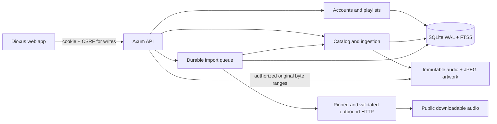

# Authoritative architecture

Vela is a modular monolith: one Axum/Tokio process, one local SQLite database, immutable managed media and generated web assets. Edition2024; Rust1.99.0 pinned. No Redis, mandatory FFmpeg, external search engine or cloud service. Dioxus0.7.10 compiles to WebAssembly; HTMLMediaElement owns browser decoding. Domain contracts do not depend on HTTP, SQL or UI frameworks.

| Boundary | Current responsibilities |
| --- | --- |
| `vela-domain` | Framework-independent serialized API contracts and opaque IDs |
| `vela-core` | Configuration, WAL/FK migrations, Argon2id accounts, sessions, private playlist application services |
| `vela-media` | Bounded metadata/image validation, BLAKE3 asset identity, immutable publication, owner-authorized catalog/asset lookup, byte-range selection |
| `vela-imports` | Source interface, controlled egress, durable bounded direct downloads and job recovery |
| `vela-server` | HTTP routing, auth/CSRF extraction, browser origin checks, multipart streaming, response headers, semaphore lifetimes, worker supervision |
| `vela-web` | Dioxus interface, same-origin API calls, account-scoped queue state, native browser audio/File APIs |

## Persistence and identity

Migration0001 defines accounts/sessions, physical media assets, private tracks, artwork, FTS5 triggers, favorites, durable import jobs, playlists/items/collaborators/mutation history, hashed expiring shares and audit events. Foreign keys and constraints are enabled on all pool connections; four connections,10s busy timeout,15s acquire timeout, WAL and FULL synchronous mode. Transactions preserve playlist revisions and import state.

Local track UUIDs identify private catalog entries. Physical asset UUIDs identify encoded files; BLAKE3 identifies exact bytes and permits shared disk storage without shared catalog access or disclosing duplicates across accounts. Migration0002 persists private artist/album UUIDs and maintains associations transactionally for existing and new tracks. Album keys include effective album artist and release year; original embedded strings remain available. This provisional grouping does not establish recording/master/edition identity (ADR0004). Future remote references must carry origin server+object identity; remote cache entries must remain distinct from locally owned assets.

## Upload/publication

Two concurrent uploads stream into random staging paths with per-file/body/time limits. A framing guard caps part headers at8KiB, rejects additional parts, splits parser input into16KiB frames and yields between frames to bound eager multipart read-ahead. The browser's batch upload sends one file per request. Metadata validation/copying/image processing use one shared semaphore and blocking workers. Client cancellation during transfer removes the temporary upload. After complete receipt, a bounded detached task owns the upload permit and staging path and finishes atomic catalog publication even if the client leaves. Shutdown drains these tasks before closing SQLite.

Ingestion makes an immutable copy, hashes while copying, validates content and tags, checks managed physical-audio quota, publishes with no replacement and file/directory fsync, then commits catalog rows. A crash between immutable publication and database commit can leave a retained unreferenced blob. Startup removes only recognized unpublished temporary files, never published content or arbitrary files. Reconciliation remains a tracked requirement.

## Streaming

Auth determines asset ownership before opening files. Original bytes stream in64KiB buffers; one permit remains owned by each audio/artwork response body until completion/cancellation, maximum16. GET supports inclusive/open/suffix ranges,416 with total-size metadata, ETag and If-Range, weak If-None-Match comparison. HEAD ignores Range. Unsupported/invalid range units or multiple ranges may receive the full representation. File size is checked against persisted metadata.

## Imports

The adapter/egress interfaces separate source resolution from durable jobs. One serial worker claims queued jobs, stores progress, checks transfer/file/queue/disk bounds, validates received audio through the same media service, and atomically transitions status. Restart requeues interrupted work and starts transfers again from zero; successful ingestion is exact-deduplicated. Processing is a noncancellable atomic phase. Transient network failures retry with bounded attempts; user retries are explicit. SQLite stores durable progress; UI polls active jobs every2s. SSE is planned.

The transport disables proxy inheritance, redirects, credentials and compression; every redirect gets fresh validated/pinned DNS resolution. Public import never gains trusted-local storage access. Infrastructure worker failure stops the serving process instead of silently losing the worker while health reports success.

## Collaboration and privacy

All content begins private. Named local collaborators can view playlist metadata or mutate when granted edit permission. Mutations run BEGIN IMMEDIATE transactions with a compare-and-increment revision, valid mutation UUID, actor/request fingerprint and ordered stable entries. Reusing an identical mutation returns current state without applying it twice; conflicting stale revisions receive409. Shared titles never authorize original audio. Streaming remains owner-only for this slice. Expiring random link tokens are hashed at rest, and links use URL fragments in the browser to avoid carrying the token in initial-page URLs.

## Planned platform boundaries

Native engines will implement shared playback contracts behind Android Media3, iOS AVFoundation and an evaluated desktop backend. Offline manifests, device/session state, incremental synchronization and multi-server adapters are separate milestones. Federation will use ActivityPub/ActivityStreams, WebFinger and peer authorization, with explicit visibility for profile/metadata/audio/downloads; no federation routes or public directory exist currently.

Client asynchronous actions are bound to the initiating CSRF session identity. An old task is dropped before it resumes after a session change, and user-specific draft controls reset. Library request generations independently prevent older search/page responses overwriting newer ones. Queue order tracks occurrence indices so repeated copies of the same song do not move the playing indicator to the wrong occurrence. Both behaviors have real browser regression coverage.

Native shutdown distinguishes expected worker completion after cancellation from infrastructure failure. A30s HTTP drain deadline prevents slow connections from indefinitely holding shutdown; atomic import/upload processing still drains before SQLite closure. The process lifecycle helper tests repeated real SIGTERM/restart and deliberately broken isolated import-job storage.

## Catalog metadata edits

Migration0003 adds an owner-private metadata revision. GET/PATCH metadata snapshots use a typed complete update and a16KiB body bound. One BEGIN IMMEDIATE transaction verifies ownership, validates fields, checks revision, changes only catalog tags, updates grouped identities/FTS via triggers and records a fixed audit event. Stale writes receive409. The native browser dialog retains the draft and offers explicit reload; its async work is scoped to session/editor generation and the mounted component. Originals, technical properties and asset hashes remain unchanged; exact re-ingestion cannot overwrite an edited owner catalog. ADR0005 records the boundary.
