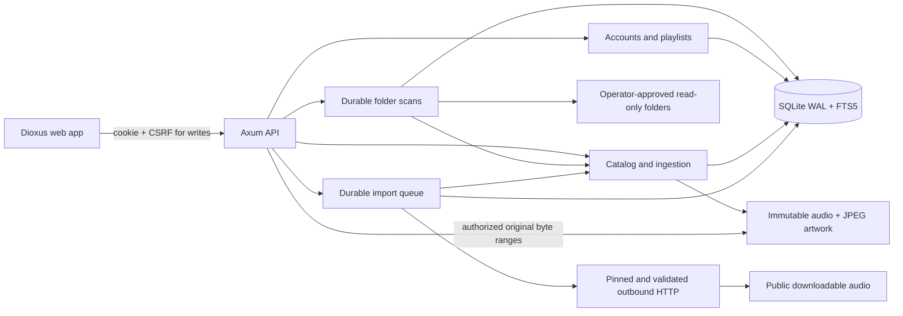

# Authoritative architecture

Vela is a modular monolith: one Axum/Tokio process, one local SQLite database, immutable managed media and generated web assets. Edition2024; Rust1.99.0 pinned. No Redis, mandatory FFmpeg, external search engine or cloud service. Dioxus0.7.10 compiles to WebAssembly; HTMLMediaElement owns browser decoding. Domain contracts do not depend on HTTP, SQL or UI frameworks.

| Boundary | Current responsibilities |
| --- | --- |
| `vela-domain` | Framework-independent serialized API contracts and opaque IDs |
| `vela-core` | Configuration, WAL/FK migrations, Argon2id accounts, sessions, private playlist services and bounded background-task read model |
| `vela-media` | Bounded metadata/image validation, BLAKE3 asset identity, immutable publication, owner-authorized catalog/asset lookup, byte-range selection |
| `vela-scanner` | Read-only directory capabilities, bounded snapshots, persistent scan sources/jobs/fingerprints |
| `vela-imports` | Source interface, controlled egress, durable bounded direct downloads and job recovery |
| `vela-server` | HTTP routing, auth/CSRF extraction, browser origin checks, multipart streaming, response headers, semaphore lifetimes, worker supervision |
| `vela-web` | Dioxus interface, same-origin API calls, account-scoped queue state, native browser audio/File APIs |

## Persistence and identity

Migration0001 defines accounts/sessions, physical media assets, private tracks, artwork, FTS5 triggers, favorites, durable import jobs, playlists/items/collaborators/mutation history, hashed expiring shares and audit events. Foreign keys and constraints are enabled on all pool connections; four connections,10s busy timeout,15s acquire timeout, WAL and FULL synchronous mode. Transactions preserve playlist revisions and import state.

Local track UUIDs identify private catalog entries. Physical asset UUIDs identify encoded files; BLAKE3 identifies exact bytes and permits shared disk storage without shared catalog access or disclosing duplicates across accounts. Migration0002 persists private artist/album UUIDs and maintains associations transactionally for existing and new tracks. Album keys include effective album artist and release year; original embedded strings remain available. This provisional grouping does not establish recording/master/edition identity (ADR0004). Future remote references must carry origin server+object identity; remote cache entries must remain distinct from locally owned assets.

## Upload/publication

Two concurrent uploads stream into random staging paths with per-file/body/time limits. A framing guard caps part headers at8KiB, rejects additional parts, splits parser input into16KiB frames and yields between frames to bound eager multipart read-ahead. The browser's batch upload sends one file per request. Metadata validation/copying/image processing use one shared semaphore and blocking workers. Client cancellation during transfer removes the temporary upload. After complete receipt, a bounded detached task owns the upload permit and staging path and finishes atomic catalog publication even if the client leaves. Shutdown drains these tasks before closing SQLite.

Ingestion makes an immutable copy, hashes while copying, validates content and tags, checks managed physical-audio quota, publishes with no replacement and file/directory fsync, then commits catalog rows. A crash between immutable publication and database commit can leave a retained unreferenced blob. Startup removes only recognized unpublished temporary files, never published content or arbitrary files. Reconciliation remains a tracked requirement.

## Streaming

Auth determines asset ownership before opening files. Original bytes stream in64KiB buffers; one permit remains owned by each audio/artwork response body until completion/cancellation, maximum16. GET supports inclusive/open/suffix ranges,416 with total-size metadata, ETag and If-Range, weak If-None-Match comparison. HEAD ignores Range. Unsupported/invalid range units or multiple ranges may receive the full representation. File size is checked against persisted metadata.

## Imports

The adapter/egress interfaces separate source resolution from durable jobs. One serial worker claims queued jobs, stores progress, checks transfer/file/queue/disk bounds, validates received audio through the same media service, and atomically transitions status. Restart requeues interrupted work and starts transfers again from zero; successful ingestion is exact-deduplicated. Processing is a noncancellable atomic phase. Transient network failures retry with bounded attempts; user retries are explicit. SQLite stores durable progress; UI polls active jobs every2s. SSE is planned.

The transport disables proxy inheritance, redirects, credentials and compression; every redirect gets fresh validated/pinned DNS resolution. Public import never gains trusted-local storage access. Infrastructure worker failure stops the serving process instead of silently losing the worker while health reports success.

## Collaboration and privacy

All content begins private. Named local collaborators can view playlist metadata or mutate when granted edit permission. Mutations run BEGIN IMMEDIATE transactions with a compare-and-increment revision, valid mutation UUID, actor/request fingerprint and ordered stable entries. Reusing an identical mutation returns current state without applying it twice; conflicting stale revisions receive409. Shared titles never authorize original audio. Streaming remains owner-only for this slice. Expiring random link tokens are hashed at rest, and links use URL fragments in the browser to avoid carrying the token in initial-page URLs.

## Planned platform boundaries

Native engines will implement shared playback contracts behind Android Media3, iOS AVFoundation and an evaluated desktop backend. Offline manifests, device/session state, incremental synchronization and multi-server adapters are separate milestones. Federation will use ActivityPub/ActivityStreams, WebFinger and peer authorization, with explicit visibility for profile/metadata/audio/downloads; no federation routes or public directory exist currently.

Client asynchronous actions are bound to the initiating CSRF session identity. An old task is dropped before it resumes after a session change, and user-specific draft controls reset. Library request generations independently prevent older search/page responses overwriting newer ones. Queue order tracks occurrence indices so repeated copies of the same song do not move the playing indicator to the wrong occurrence. Both behaviors have real browser regression coverage.

Native shutdown distinguishes expected worker completion after cancellation from infrastructure failure. A30s HTTP drain deadline prevents slow connections from indefinitely holding shutdown; atomic import/upload processing still drains before SQLite closure. The process lifecycle helper tests repeated real SIGTERM/restart and deliberately broken isolated import-job and scanner-job storage.

## Catalog metadata edits

Migration0003 adds an owner-private metadata revision. GET/PATCH metadata snapshots use a typed complete update and a16KiB body bound. One BEGIN IMMEDIATE transaction verifies ownership, validates fields, checks revision, changes only catalog tags, updates grouped identities/FTS via triggers and records a fixed audit event. Stale writes receive409. The native browser dialog retains the draft and offers explicit reload; its async work is scoped to session/editor generation and the mounted component. Originals, technical properties and asset hashes remain unchanged; exact re-ingestion cannot overwrite an edited owner catalog. ADR0005 records the boundary.

## Read-only folder snapshots

Migration0004 adds private scan sources, durable bounded jobs/counters and a per-source file map. Triggers enforce source/track ownership even on reassignment. Administrator source APIs expose configured root IDs/names only, never host paths. VELA_SCAN_ROOTS is operator configuration; absent configuration provides only data/sources. Explicit [] disables it. Configuration rejects unsafe/overlapping roots and aliases into managed data.

On Linux, cap-std/cap-fs-ext opens every root component and child directory without following symlinks. A bounded descriptor-relative depth-first walker admits regular, singly linked audio files and rejects symlinks/special files. Blocking traversal/copy runs on the blocking pool. A64KiB snapshot copy checks file size, free space, deadlines/cancellation and descriptor changes, then fsyncs and enters the shared bounded media pipeline. Originals are never modified. The scanner uses one worker alongside imports, and both are supervised after the HTTP listener is acquired.

Cached size/mtime/ctime/device/inode signatures and hashed relative paths skip unchanged files; this is best-effort change detection. New/changed content is exact-deduplicated into immutable managed storage; metadata edits survive repeated scans. Missing source files and source removal never delete owned music. Shutdown requeues interrupted scans; explicit cancellation retains already published tracks. The UI displays actual job counters with active-only polling. Linux is the implemented scanner platform; blocking kernel/network filesystem operations have no hard cancellation guarantee. See ADR0006.

## Typed catalog filtering

Migration0005 adds owner-prefixed indexes for trimmed genre/codec predicates, release years and title/newest order. Migration0006 keeps the genre prefix/order and appends raw genre to make grouped facets covering. A framework-free TrackFilters value and closed TrackSort enum compose with the existing owner/search/favorite predicates; query values are SQL parameters. The legacy list_tracks method delegates with defaults. The transport bounds/deserializes query forms and maps service validation to fixed JSON400 responses. GET /api/catalog/filters returns private, bounded genre/format suggestions from a coherent SQLite snapshot.

All pages return at most100 tracks plus one internal sentinel, with50 used by the UI. Default UUID order remains compatible. Title/newest cursors resolve a sort key only within the owner and compare the full key/UUID tuple, without OFFSET. Explicit NOCASE belongs on the title cursor's bound RHS so SQLite can seek the full tuple index. Foreign/missing sorted cursors share the same error. These are live pages; concurrent metadata changes can move boundaries between requests.

The Dioxus form separates draft values from accepted conditions. Search/filters are committed only when the latest authorized request succeeds; pagination and refresh read that accepted state. Invalid drafts preserve displayed results and invalidate older pending requests. Account changes clear all conditions and suggestions. Facet requests also carry session/revision/generation guards and fetch only while their form is visible. ADR0007 records units, collation and losslessness limits.

Core's build.rs watches the migrations directory, including newly added files, so stable incremental builds rerun SQLx embedding. An integration test checks the embedded filter/covering migrations, and native review packages record/verify their schema version against the created SQLite database. See [SQLx migration recompilation](https://docs.rs/sqlx/0.8.6/sqlx/macro.migrate.html) for the upstream stable-build requirement.

## Unified background tasks

Core JobService projects the existing durable import/scan tables, without owning their execution or duplicating state. Each owner-scoped indexed branch reads limit+1 rows; a bounded merge uses created_at/UUID/kind descending. The cursor includes every tie-breaker and remains valid after its anchor is removed. Migration0007 adds history tie-breakers and owner/status indexes. Rows, joined action hints and filter-independent owned activity share one WAL read snapshot. At most100 jobs are returned (50 in the UI); no OFFSET or whole-history materialization is used.

GET /api/jobs exposes no source URLs/paths/raw diagnostics. Ordinary accounts see only their imports; administrators additionally see their own scans. Import track titles/IDs and scan source names/IDs use owner-constrained joins. Existing services independently authorize cancel/retry/scan-again requests. A new scan is a new pass; the old history is retained until its source is removed.

Dioxus Jobs provides type/state filters, latest/older pages, real byte progress or indeterminate scan counters, errors/stale snapshots and actual mutation/navigation controls. Mounted visible pages poll while any authorized owned work is known active, even if filters hide it. Idle pages require refresh; leaving/logout invalidates timers and pending results. Exact session/generation/selection/lifetime guards prevent stale updates. Legacy import polling stops on Jobs. Catalog aggregates refresh on terminal/active polling so already published files survive cancel/failure visibility. Browser uploads remain in their transfer dialog, not the durable history. See ADR0008 and CONTRACTS.
