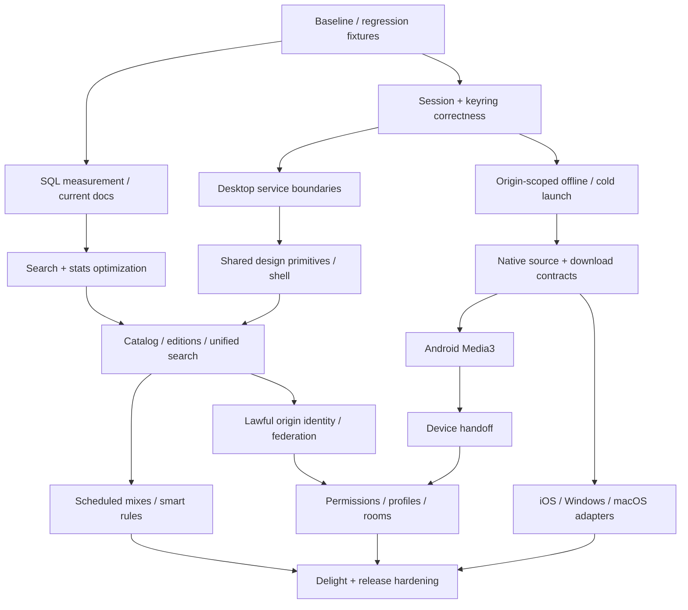

# Backlog для последующей реализации и делегирования

**Сейчас никому не делегировано.** Владельцы ниже — будущие роли, не запущенные
агенты. Каждый work package должен дать реальный code/test/docs diff и пройти
интеграцию; папка с заглушками или один зелёный compile не является результатом.

## 1. Общие границы

Интегратор владеет Cargo/lock, domain DTO, миграциями, cross-module contracts,
release, PROGRESS. Один владелец файла; для одновременной работы с ui.rs сначала
последовательно выделить presentation/service boundaries или разные worktrees с
явной интеграцией.2compiler jobs/один Cargo процесс, отдельные fixture data/ports.
Нельзя трогать data/runtime/release/backups пользователя или публиковать сервисы.

Для любой задачи обязательны: current HEAD, входной контракт, bounded resources,
session/privacy/ownership, cancellation+freshness, empty/error/offline/conflict,
тесты, evidence, rollback/compatibility, честные blockers. Успех только с exact
source commit и выполненной командой; native/server/web/hardware различаются.

## 2. Граф зависимостей



K implementation и validation не смешиваются: Apple build нужен Apple runner;
в отсутствие доступа сохраняется BLOCKED evidence, независимые задачи продолжаются.

## 3. Пакеты работ

| Package | Приоритет / будущий владелец | Разрешённые файлы / контракт | Конкретный результат / gate |
|---|---|---|---|
| WP-00 Current truth | P0 integrator/QA | docs/qa index, test-only fixtures; runtime read-only | Current feature/platform index и audited baseline, no false G14/G15 |
| WP-01 Session freshness | P0 client engineer | desktop/ui.rs login/resume/adopt; typed RequestScope | FIX-01, REG-AUD-01/08, old journeys |
| WP-02 Keyring worker | P0 native/security | desktop/session_store.rs + sequential UI integration | FIX-02, deadline/kill/bounded/redaction, real Secret Service |
| WP-03 Typed auth errors | P0 client/API | desktop/client.rs + UI adapter, no server auth redesign | FIX-03,401 vs503/cancel/offline regressions |
| WP-04 Device identity migration | P0 storage/security | desktop/offline.rs, domain scope by integrator | FIX-04, cloned IDs origin isolation + rollback |
| WP-05 Cold offline | P0 client/UX | desktop root states + offline service | FIX-05, fresh process no server, real local audio |
| WP-06 Offline writer | P1 storage/native | offline.rs + module worker; no app schema initially | FIX-06 concurrency/quota/crash/cancel/seek/noncurrent delete |
| WP-07 History read snapshot | P1 database/privacy | core/listening.rs tests only; shared API same | GET no writer reservation, consent/cutoff/delete race preserved |
| WP-08 Stats/search hot paths | P1 database/media | media/{lib,search,catalog,filters}.rs; migration by integrator |100k/1m warm/cold/foreign plans, measured improvement/no write regression |
| WP-09 Doc reconciliation | P1 product QA | Current docs header/index; preserve historical sections | One current source of truth, source/runtime scope, no unsupported claims |
| WP-10 Design foundations | P1 UI/a11y | web tokens/primitives/icons/style, scoped allowed asset list | Atlas tokens/fonts/contrast/focus, old player identity preserved |
| WP-11 Web shell | P1 Dioxus | web/shell.rs + root mounting seam; one integrator for main.rs | Persistent sidebar/canvas/right panel, tabs/mini/full phone, native dialog gates |
| WP-12 Home | P1 product UI | web/experience.rs,personal_mixes.rs after common API | Real shelves, sparse/disabled-consent/error isolation, short reasons |
| WP-13 Search UX | P1 UI/client | experience search service/view; server contracts coordinated | Cancel/race/Unicode/categories/keyboard/history controls |
| WP-14 Library/collections | P1 catalog/UX | media/catalog + web/desktop views assigned separately | Cursor+sort+folders/pin/view-density; full-context queue contract |
| WP-15 Album/artist model | P1 music data | domain/media/catalog; additive schema by integrator | Editions/discs/credits/asset selection, no lost playlist IDs |
| WP-16 Queue/context menu | P1 playback/UI | shared playback model only if needed; presentations separated | Deterministic next preview/undo/save/context; duplicate-safe drag+keys |
| WP-17 Native source streaming | P1 audio engineer | desktop/audio/source modules; no HTTP in callback | Progressive bounded spool, honest hash status, large seeks/reconnect |
| WP-18 Transcode compatibility | P2 media/devops | controlled process adapter/server route | Optional FFmpeg, capabilities/presets/cancel/resource limits |
| WP-19 DSP evaluation | P1 MIR/QA | analysis.rs/tests/example + lawful corpus manifests | Reference accuracy/abstention/CPU/RSS/contention, new extractor version |
| WP-20 Candidate coverage | P1 recommender | discovery/recommendations, service tests | Stratified/indexed retrieval, diverse old/new coverage, no private leakage |
| WP-21 Scheduled mixes | P1 recommender/jobs | core/service contracts + existing SQLite jobs pattern | Durable daily/weekly materialization, epoch erase, timezone/idempotency |
| WP-22 Smart rules | P2 data/UI | typed AST/domain/query compiler; no user SQL | Rule editor+preview+playlist source, caps/plans/consent |
| WP-23 Android engine | P0 platform | platform/android real Gradle/manifest/JNI and adapter | Media3Service/audio focus/headset/lock/offline APK actual emulator/device |
| WP-24 iOS engine | P1 platform | platform/ios real Xcode/Swift/bridge | AVAudioSession/remote commands/background/offline; Apple evidence required |
| WP-25 Desktop OS matrix | P1 platform/release | Windows SMTC/macOS integration + scoped CI | OS builds/install/run/media-key/device-change; Linux tests not reused as proof |
| WP-26 Secure stores | P1 security/platform | native secure-store interface + platform implementations | Keychain/Credential Manager/Keystore, no plaintext fallback, revoke/export redaction |
| WP-27 Download/sync journal | P1 mobile/client | shared download/manifest/journal + bounded adapters | Resume/hash/quota/rights/offline edits CAS-conflict and no lost data |
| WP-28 Device commands | P1 backend/native | device service/WS transport/domain envelopes | Auth/expiry/idempotent remote controls, two real clients |
| WP-29 Handoff | P1 playback/QA | coordinator/target adapter/UI sheet | Accept-before-stop, rollback on target fail, saved queue/position |
| WP-30 Federation contract | P1 network/security | FEDERATION_PROTOCOL/domain contract first | Standards mapping, identity/signature/key rotation/replay/inbox/blocklist |
| WP-31 Peer adapter/search | P1 catalog/network | peer cache/adapter services, web+desktop after contracts |3origins progressive partial/cursors/cache/TTL/tombstone/source grants |
| WP-32 Invitations/grants | P1 core/security | core playlist/sharing + migration by integrator | Named accept/expire/revoke; metadata/stream/download separate |
| WP-33 Profiles/follows | P2 social/network | privacy-safe public fields, follow delivery jobs | Opt-in visibility/block/mute, durable retry, no history auto-publish |
| WP-34 Listening rooms | P2 realtime/playback | room service + WS + UI, no audio rebroadcast | G20 membership/queue/clock/reconnect/grants/revocation |
| WP-35 Lyrics/credits/notes | P2 metadata/UX | optional permitted data readers/presentation | LRC seek/highlight/plain fallback, licensed source, private notes |
| WP-36 Personal stories | P2 analytics/privacy | qualified aggregate read model + local share renderer | Accurate stats, timezone, export/delete invalidation, private default |
| WP-37 Legal import adapters | P2 imports/storage | existing source trait, safe ZIP/WebDAV/S3/feed variants | Rights/access/quotas/archive traversal/separate trusted storage policy |
| WP-38 Interoperability | P2 protocol/client | OpenSubsonic adapter and compatibility suite | Real clients/API capabilities; no federation conflation |
| WP-39 A11y/i18n | P1 UX QA | component strings/locale/accessibility; shared ownership coordinated | en/ru/longscripts/200%/keyboard/actual SR platform matrix |
| WP-40 Ops and releases | P1 DevOps/security | scripts/deploy/CI/observability, integrator Cargo/lock; original runtime protected | AUD-20 MPRIS/ZBus dependency repair; container/ARM64/packages/restore/failure/load/notices |
| WP-41 Delight experiments | P2 product/recommender | notes/routes/album mode/other DEL tasks after prerequisites | Measurable user benefit, no fake catalog/paid dependency |

## 4. Допустимая будущая параллельность

Первая волна: один client owner WP01–03, один test/QA owner red regressions,
один database owner WP07–08; интегратор принимает contracts и запускает Cargo.
WP04–06 sequential storage migration. UI дизайн идёт как specs/test components
до изменения root, затем один root integrator.

Позднее: Android/iOS/Windows имеют независимые platform directories, но общие
DTO/Cargo/migrations всё равно только через integrator. Одинаковый ui.rs двум
одновременно не выдавать. Агенты не подтверждают own PR как независимый review.

## 5. Шаблон готового задания

```text
ID: WP-xx / конкретный slice
Контекст: source HEAD, installed build, существующая функция и её тесты.
Цель пользователя: один законченный journey.
Allowed paths: точный список; shared Cargo/lock/schema/runtime запрещены.
Inputs/outputs: typed contract, owner/origin/generation, compatibility version.
Ресурсы: max concurrency/bytes/time/disk, cancel/cleanup semantics.
Работа: red regression -> code -> positive/negative test -> docs/evidence.
DoD: exact acceptance cases, expected observable behavior, actual commands.
Не делать: unrelated rewrite, mock success, destructive data, external publish.
Handoff: diff, API changes, executed PASS/FAIL/NOT_RUN, blockers, exact next step.
```

## 6. Приёмка интегратором

1. Проверить diff на ownership/secret/path/grant/consent/lifetime/quotas.
2. Сопоставить code с тестом: тест воспроизводит исходный дефект, не копирует алгоритм.
3. Выполнить команды из evidence, relevant real browser/native/HTTP journey.
4. Запустить cross-system regression, сравнить source/build/assets/platform manifest.
5. Отметить фактическую часть golden scenario, не всю строку по одному subset.
6. Обновить authoritative docs и known limitations, commit coherent slice.
7. Если migration/storage — restore fixture и rollback-ready checkpoint.
8. Release/public publish — отдельный разрешённый шаг, не побочный эффект задачи.
